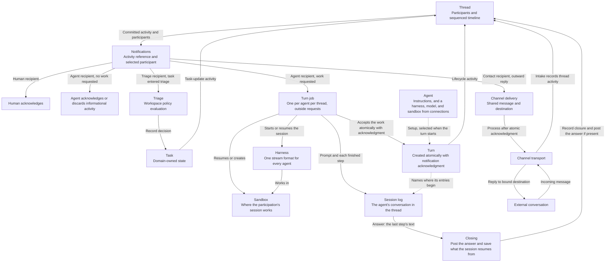
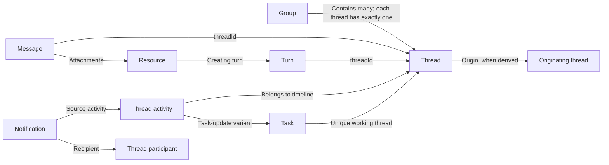
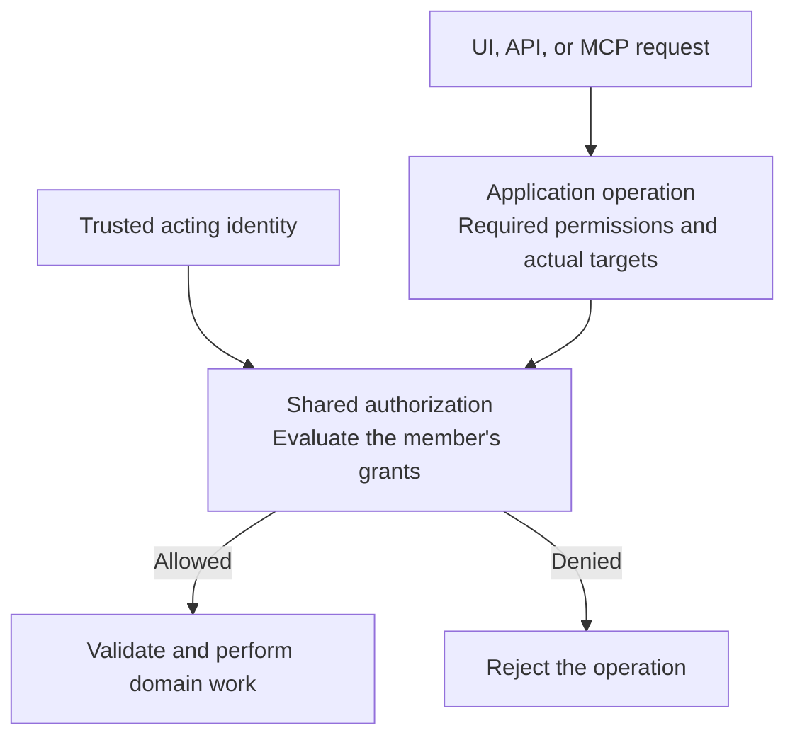
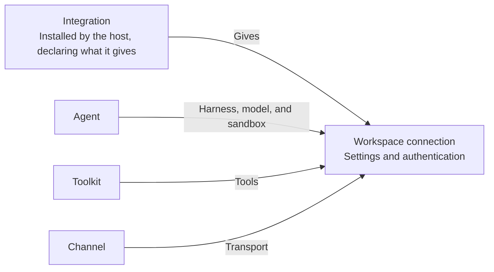
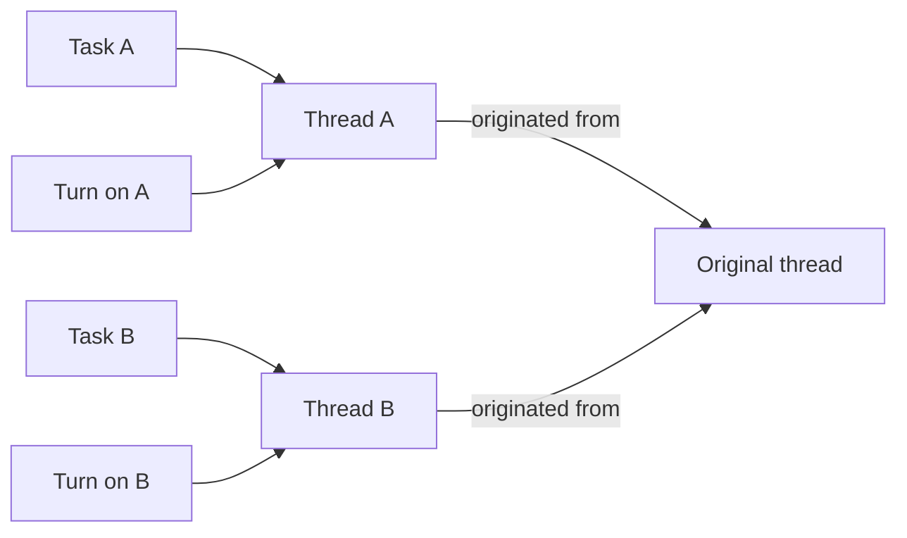
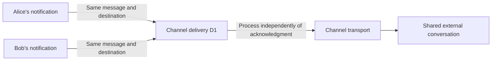

# Core model

This is a living design document for reconsidering amends from the user and developer
perspective. It will grow into an explanation of each core concept: what it does, why it
exists, what it owns, and how it relates to the others.

This document describes design intent. It does not describe or validate the current
implementation. The discussion is grounded in the work users want to do and the contracts
of external systems. Existing implementation choices do not constrain the design.

For current behavior, read [workspace workflows](workspace-workflows.md), the
[group workflows](group-workflows.md), [agents](agents.md), [connections](connections.md),
[turns](turns.md), the [core package guide](../packages/core/README.md),
and [known limitations](current-status.md).
Workspace management, the generic journal, notification storage and inbox reads,
and live changes read from the journal are implemented. Core and the storage adapters also implement
team-group creation, public groups, membership admission/departure, workspace-removal cleanup,
authorized group reads, and a shared group-audience check. Direct groups (DMs and group DMs) are
established and reused by member set, with their first thread, through `ThreadService.startDirect`.
Every thread opens through one internal thread start that creates the thread, admits its starting
participants, and records its first message activity and pending notifications atomically; see
[thread workflows](thread-workflows.md). Participants and message authors can be members,
contacts, or triage. Authorized group-thread discovery,
metadata, timeline pages, and current-participant summaries are also implemented. Human replies publish through
`ThreadMessageService`, admitting the author and eligible mentions in the same commit.
`ThreadParticipationService` implements self-follow/unfollow, quiet follow activity, and pending
agent-input settlement. `NotificationService.inbox` shows each of the reader's notifications with
its source under current thread access, without marking it seen or changing participation. A
person marks one seen with `NotificationService.markSeen`, as private `Seen` state outside the
journal.

Agents work on the workspace's connections to the integrations its host installs: a harness that
runs them, a model, and, when they need one, a sandbox. They accept their work notifications into
turns, one active turn per agent per thread. Each agent in each thread has a turn job, which runs
its turns there outside any request, one harness turn each, writes its conversation to the
participation's session log, and closes each turn by posting the agent's answer; see
[core's turns](../packages/core/README.md#turns) and [cluster](../packages/cluster/README.md).
Other participation management, the task and channel workflows that admit contacts and triage,
toolkits, contact/triage acknowledgment, and channel delivery below remain design intent.
“Agreed” records a design decision, not its implementation status.

## Architecture summary

Groups provide lasting spaces for multiple conversations. Every thread belongs to exactly
one group, and that group's membership is its access audience; action permissions still apply.
Participation decides who is involved and notified, never who can see the thread. Members
who are neither addressed nor following see a thread's new activity as unread through their
own read position. Tasks and
channel conversations use the same model: a task's working thread and a channel's conversation
threads live in groups. The thread holds the conversation and its ordered activity.
That timeline is the sole source of notifications. Thread participants supply the possible
recipients, the activity narrows them, and each recipient decides how to respond.
An agent accepts work into a durable turn, which its turn job runs as one harness turn,
recording the agent's conversation in its session log, and which closes by posting the agent's
answer when it has one.
The sections below retain the detailed decisions and rationale.

### Work flow

Arrows describe domain collaboration and ownership, not package imports. Domain operations
record activity on the thread; there is no direct domain-to-notification path outside that
timeline. The notification branches show how recipients respond to different activity.



### Responsibilities and relationships

- **Workspace member:** a human or agent participating in the workspace under the shared
  permission model. Workspace membership is separate from participation in a thread.
- **Permission:** authorization to perform an action within a scope. Application operations
  check permissions for the acting member and the actual target.
- **Role:** a named bundle of permissions assigned to members. Operations check the
  required permission rather than a particular role name.
- **Agent:** a workspace member that works: its instructions, and the harness, model, and
  sandbox it works on, each given by one of the workspace's connections, with `Auto` letting
  amends choose its harness. It has a stable identity and its own permissions as a workspace
  member. A turn keeps the selection it started on; changing the agent meanwhile does not
  change it.
- **Harness:** runs an agent, such as opencode or amends's own loop over a model, and streams
  every agent's turns in one format. Each agent's adapter translates its native behavior into
  that format, and starts a session anew, anew with a conversation, or from what an earlier
  session saved.
- **Sandbox:** where an agent works when it needs one, such as a directory on the host's
  machine or a Daytona machine, owning its filesystem. Its provider creates sandboxes from a
  template and resumes them by name. A sandbox knows nothing of the harness that runs in it.
- **Integration:** a kind of system amends connects to, installed by the host: what a
  connection to it takes, and what it gives, of harnesses, models, sandboxes, and tools.
- **Tool:** one callable operation with its own inputs, outputs, and behavior.
- **Toolkit:** a configured collection of tools available for agent selection. External
  toolkits reference a connection; internal toolkits invoke existing amends operations.
- **Connection:** a workspace's link to one integration, with its settings and how it
  authenticates; its key is kept apart, outside the journal. Its integration determines what it
  gives, and its readiness whether it can be used as it stands. Connecting a server does not
  create a toolkit or grant an agent its tools.
- **Group:** a lasting conversation space within a workspace, with an access audience and
  multiple threads. A team group has managed membership. A direct group has a fixed set of
  two or more human or agent members: a DM has two, a group DM three or more. Group membership
  does not automatically establish participation or request agent work in its threads; members
  can follow a team group to join its new threads.
- **Thread:** one conversation in exactly one group, with participants and a
  sequenced timeline of typed activity, including published messages, turn lifecycle events,
  and task updates. It owns their order without taking over the underlying domains' state
  or execution machinery.
- **Turn:** one agent's attempt on one thread: one harness turn, prompted with the work it
  accepted. Owns its accepted input, the selection it started on, where its entries begin in
  the session log, the reply it posted, and its outcome.
- **Session log:** the record of one agent's conversation in one thread, one per participation:
  the conversation it joined, each turn's prompt, and each step its harness finished. A session
  resumes with the conversation it rebuilds, and readers follow a turn through it.
- **Turn job:** the work commits ask for to run or stop an agent's turns in one thread, run
  outside any request and possibly on another machine. It reads and writes the workspace only
  through commands and queries that hold nothing in memory.
- **Task:** an assignable objective that can span turns, with one current assignee. Each task
  references its own unique working thread, placed in a group when the task is created. A task
  created from a conversation gets a new thread referencing that originating conversation.
- **Resource:** an amends entity whose creation references its producing turn. Later turns
  reference resources they use. A sandbox file is not automatically an amends resource.
- **Notification:** references a thread activity and the participant to inform. Its
  acknowledgment records the recipient's handling outcome.
- **Read position:** how far a human member has read a thread, by timeline sequence. It is
  private per-member state that shows unread activity without recording anything per message.
- **Triage:** evaluates a versioned workspace policy when a task enters triage. Rules match
  task conditions and select assignment, hold, dismissal, or agent consultation. Triage
  participates in the task's thread without group access and assigns only within that group.
- **Channel:** a configured external communication point with a transport adapter. It
  references a connection with channel support, carries multiple conversations, and owns
  receiving and sending external messages. Its conversations become threads in one destination
  group.
- **Contact:** an external person's identity and thread participation. Sender identity stays
  distinct from the external conversation used as the reply destination.
- **Channel delivery:** a durable transport operation for one published message and one
  external destination. Several contact notifications can refer to the same delivery.



Thread activity is the timeline item itself, not a second event stream. Messages and turns
retain their own thread references; activity references them or records a change to the
thread's task. The task stores the task-to-thread association without a reciprocal task
reference on the thread record. A thread may exist without a task, but never without a group.
The group relationship determines access; the origin relationship records where
the conversation came from and grants no access by itself.

### Workspace membership and authorization

Humans and agents share one workspace membership and permission model while retaining
their different identity types. Humans join through an authorized invitation and acceptance
flow; agent creation establishes the agent's membership with authorized permission grants.
External contacts can participate in threads without becoming workspace members.

Creating, configuring, using, and managing permissions for an agent are distinct actions.
An agent executes with its own permissions regardless of who requested the work. An
administrator invoking it does not elevate it, and a more restricted requester does not
reduce its authority. Authorized users may obtain information indirectly through an agent
even when they lack direct access. There is no requester-permission intersection.

Application operations declare required permissions and targets; shared authorization
evaluates them. Roles bundle permissions for assignment. An authorized workflow covers
its required internal steps, such as creating a task's working thread. Reads, lists, and
subscriptions also enforce the acting member's access. Audit records distinguish the
requesting activities from the agent and turn that performed the resulting operations.

### Groups, access audiences, and participation

A group holds multiple threads, and every thread belongs to exactly one group; there are no
standalone threads. A team group has managed membership. A direct group has a fixed set of two
or more members, with all of them participating initially in each new thread: a DM is a direct
group of two, and a group DM has three or more. A team group's threads inherit the group's
access audience. A member's new team-group thread starts with its author, the members its opening
message mentions, and the members who follow the group; the rest of the group sees it as unread.
A narrower or different audience uses another group, typically a direct group.

Five layers answer different questions about the same thread:

| Layer            | Question it answers                                                                                                                                  | Who belongs to it                                                                                      |
| ---------------- | ---------------------------------------------------------------------------------------------------------------------------------------------------- | ------------------------------------------------------------------------------------------------------ |
| Group membership | Who can see the thread?                                                                                                                              | The group's members.                                                                                   |
| Participation    | Who is involved in the thread and gets notified?                                                                                                     | Some group members, plus contacts and triage where applicable.                                         |
| Task assignment  | What is the objective, and who is responsible?                                                                                                       | One current assignee, who must be a participant.                                                       |
| Turn             | One agent's attempt on a thread: one harness turn, prompted with the work it accepted. Effects can occur during the attempt.                         | Identifies an attempt so its activity, effects, and outcome can be understood together.                |
| Session log      | The record of one agent's conversation in one thread, one per participation: what it joined, each turn's prompt, and each step its harness finished. | Gives the agent its memory in the thread, and readers each turn's work, apart from the journal.        |
| Turn job         | The work commits ask for to run or stop an agent's turns in one thread, run outside any request.                                                     | Lets long-running work run apart from requests, on any machine, while core stays commands and queries. |
| Read position    | What has each member already seen?                                                                                                                   | Each human member, privately, per thread.                                                              |

Assigning a task adds its assignee as a participant and notifies them; it neither creates nor
changes a group. Several people or agents share work on one task by participating and being
asked for work on its thread; independent work is split into separate tasks.

Members with group-creation permission can create team groups; membership changes require
the relevant management permission. These permissions initially belong to the Administrator
and Owner bundles, but any role or direct grant can supply them. Any active workspace member
can start a direct group with other active members. A direct group's membership never changes,
and its members cannot leave it; hiding it is a client presentation choice. A current team-group
member can leave their own membership without membership-management authority. Operations
check permissions and preserve the group's audience rules.

For human and agent operations, active workspace membership, inclusion in the thread's
access audience, and the required action permissions must all hold. Group members can
read a thread without participating when permitted. Reading advances only their own read
position; it does not subscribe them or request agent work. Replying, explicitly following, an
authorized mention, or following the group before the thread starts can establish
participation. Threads do not admit members from outside their group through participation.
Contacts and triage participate without becoming group members or gaining group access.

Unfollowing a thread ends participation while retaining the group's access. Losing group or
workspace membership ends the corresponding access and participation. Human muting changes notification
presentation while retaining access, participation, and recorded recipient selection.
See [groups and thread audiences](#agreed-groups-provide-a-shared-home-for-threads).

### Thread participants, addressing, and history

- A new thread in a direct group starts with all its members as participants. A member's new
  thread in a team group starts with its author, its explicitly mentioned eligible members, and
  the group's followers. A task's working thread starts with its creator and triage, or with its
  creator and assignee when assigned at creation. A new channel conversation starts with its
  contacts and triage. The group's human followers also join task and channel threads; its agent
  followers do not. Group membership alone enrolls no one.
  Later mentions can add participants under the thread's audience and admission rules.
- External people participate as separate contacts, preserving the actual author of each
  incoming message. Several contacts can belong to the same thread and external conversation.
- Committed thread activity is the sole source of notifications. Participants at that
  activity's position supply the possible recipients; activity-specific rules narrow them.
  Other members with access to the thread are not notified; they see its activity as unread
  through their read positions.
- For message-publication activity, notify explicitly mentioned participants, or all current
  participants when there are no mentions, never the message's own author. This applies equally to
  messages from people and from agents.
- Humans acknowledge notifications. Agents accept work from relevant messages from people and
  actionable task changes, and explicit agent work requests and their results; an explicit retry
  creates the agent's next turn itself. They discard notifications of agents' ordinary messages. Informational turn status
  notifies all current participants without requesting agent work. Triage handles
  task-entered-triage activity.
- Contact handlers forward eligible published replies through the channel, using the
  thread's external-conversation reference. Their notifications stay separate even when
  the outward delivery is shared.
- A joining participant receives earlier conversation as history. A human-authored joining
  message, task assignment, or explicit work request can supply initial input. Participation
  and the request to act are distinct: assignment also requests work from an agent already
  in the thread.
- Leaving or removal stops future notifications. An agent's pending unacknowledged work is
  settled as no longer actionable, and its active turn is cancelled without erasing progress
  or effects. Rejoining establishes a new history boundary; old unfinished requests do not
  automatically become input again. A human leaving does not cancel other agents' work.
- Pending input is specific to each agent and can include several actionable activities.
  History and pending input may interleave. Preserve order and authorship; another agent's
  response does not mark this agent's input handled.

### Task changes and agent collaboration

A task's current assignee must participate in its thread. Reassignment records the change,
cancels the previous agent assignee's turn, and hands the assignment to the new assignee.
Acceptance can happen immediately; execution of the transferred work waits until the previous
agent stops. The previous agent assignee leaves by default so broadcast messages do not
continue assigning it work. A former human assignee can remain in the conversation.

Requirement edits notify all current participants and become input for the current agent
assignee when the task permits work. Bookkeeping edits are informational unless explicitly
requesting work. Instructions to stop, hold, or dismiss cancel affected execution; explicit
resumption supplies new input. A turn's own task edits do not request new work from itself,
and completing its own task does not prevent finishing its turn and publishing a response.

An agent explicitly requests another agent's work through a tool that records addressed
thread activity. The tool returns after that activity is recorded; the receiving agent
accepts work through normal notification handling. Result activity refers to the request
and gives the requesting agent new input, including a response, resources, failure, or
cancellation. The requesting turn need not stay open. Agents' ordinary replies remain
conversation, and a request on the same thread does not require a separate task.

### Atomic handoff and independent execution

Creating a turn and acknowledging its notifications with `turnId` are one atomic operation.
Work that arrives while the agent has an active turn in the thread is not added to it: its
notifications stay pending, and the agent's next turn accepts them. Human acknowledgment records
when the person saw the notification; an agent's notification that asks for no work is created
settled as informational.

For agent work, acknowledgment means the turn owns the input. It does not wait for a harness to
start or for the agent to be prompted. Running, stopping, and recovery belong to the turn's job
afterward. There is at most one active turn per agent per thread, including a queued one.
Different agents can work concurrently, and one turn can accept many notifications.

Contact delivery follows the same ownership pattern: atomically create or reuse a channel
delivery and acknowledge the notification with its reference. The channel processes the
delivery afterward. This acknowledgment records a durable handoff, not successful external
delivery or proof that a person read the message.

### Turn lifecycle and control

Created turns are durable work. Activity that asks an agent for work, a retry, and the end of a
turn ask the agent's turn job to run, in the commit that records them. The job accepts the waiting
work into a turn and runs the agent's turns in the thread one at a time, outside any request;
recording the activity does not wait for it. A run cut short, as when its process
stops, runs again from the turn's prompt.

A finished turn never reopens. An explicit retry runs a failed or stopped turn's work again as a
new turn, prompted with who asked. What the earlier attempt did stays in the session log.

A failure of the agent, or of its harness, model, connection, or sandbox, fails the turn with its
reason. Tool errors are returned to the agent without failing the turn. A run that fails for any
other reason runs again after a delay, and a turn whose runs keep failing is given up and fails.
Timeouts do not establish whether a side effect happened; recovery must not blindly repeat
operations with uncertain outcomes.

### Turn input progress

| Boundary                                     | Meaning                                                                                            |
| -------------------------------------------- | -------------------------------------------------------------------------------------------------- |
| `acceptedThroughSequence`, on the turn       | Relevant input for which this turn accepted responsibility, fixed when it is created.              |
| `promptedThroughSequence`, per participation | How far the agent has been prompted in its participation, kept with what its session resumes from. |

```text
promptedThroughSequence <= acceptedThroughSequence
```

A turn's prompt is the relevant input after the participation's prompted position through what the
turn accepted; a retry's may hold nothing new but who asked. Input accepted by a turn that ended
before it prompted the agent is in the next turn's prompt. Notification acknowledgment cannot
advance the prompted position.

### Closing and publication

A turn closes by posting its answer, the text of the last step its harness finished, verbatim, as
the agent's message, naming the turn; closing, the post, and what the session resumes from are one
commit. Earlier steps, reasoning, and tool calls stay in the session log. Messages that arrived
while the turn worked were not in its prompt: they wait for the agent's next turn, so the answer
may follow messages it never saw, and the next turn answers them. Resource attachments remain
open.

A turn can complete without posting: an answer of only space posts nothing. No replacement text
is invented. A disconnected or truncated stream is not completion: the run fails, or runs again.

Deliberate cancellation ends the attempt without claiming successful completion. A cancellation
request and execution actually stopping are distinct: a queued turn stops at once, while a running
one stays `cancelling` until its job interrupts the harness turn and confirms it. Completed effects
and the session log remain, and an associated task is not automatically cancelled. A stopped turn
is never resumed. Stopping does not advance the prompted position past what the agent was given,
so a later turn's prompt still holds unprompted input. New work waits while cancellation is
pending; a successor must not run alongside it.

### Running a turn

A turn's job runs it in order: it accepts the turn; starts it, which selects the harness, model,
and sandbox it runs on and gives the agent's setup, its prompt, and what its session resumes from,
as data; writes the prompt to the session log; builds the agent's harness, model endpoint, and
sandbox from their connections with the integrations its host installs; starts the session; and
streams the turn. The session starts anew, named for the participation, with the conversation the
session log rebuilds, or resumes from what the participation's last turn saved. Each step the
harness finishes is appended to the log; drafts show readers the step being written and are not
kept.

Core runs nothing of the agent: what the job asks of the workspace are commands and queries over
data, each its own commit, so a job can run in another process, or on another machine, than the
one that serves requests. A run that finds the log past what it wrote was replaced by another run
of the same turn, and stops without ending it.

### Continuity across runs

Preserve three things separately: the session log, the sandbox's files, and the amends entities
created or changed during work. A participation's session works in a sandbox named for it, which
each turn's job resumes, or creates from its harness's template when it is gone, so the files a
turn left are there for the next while the sandbox lasts. A session moves between harnesses
through its conversation: a harness that did not save the session's state loads the conversation
instead. Existing tasks, messages, and resources are reconnected through references; they are not
recreated by replaying completed operations.

### Tools and external access

All platform-provided tools, internal and external, are exposed through one amends MCP
endpoint. Agents select workspace toolkits, and per-turn credentials identify the trusted
execution context and determine permitted tools. The server checks access during both
discovery and invocation, then resolves the toolkit's configuration and connection.
External credentials used by platform tools remain behind the server.

A connection provides access to an external system; a toolkit selects and configures tools
from that source. Multiple toolkits can share a connection. An external MCP connection can
discover tools without making them available to agents. A generic MCP integration can
expose selected upstream tools through our endpoint without a provider-specific implementation.

Connections also give agents the harness, model, and sandbox they work on, and will give
channels. Each connection's integration declares what it gives, and each connection separately
reports whether the necessary setup and authorization are available.
Consumers select compatible connections and explain missing configuration; application
operations enforce the same requirements.

Harnesses can also supply native tools, such as terminal and filesystem access. Those tools
are outside the amends MCP endpoint. Their availability depends on the harness and the sandbox it
works in; MCP permissions do not restrict them. Users need to understand both sources when
choosing an agent's toolkits, harness, and sandbox.

### Model selection and provider access

A model is one a workspace connection offers, by the id its provider gives it, with how hard it
reasons. The agent selects that connection and model, and holds a connection reference, not
credentials. The connection's integration makes the endpoint an agent reaches the model through,
with the connection's key, and refuses a model or effort it does not offer; the harness runs its
agent on that endpoint.

An agent whose setup can no longer run, as when a connection was removed or its harness needs a
sandbox it lacks, says why in its readiness, and its turns fail with that reason rather than run
on something else. Unsupported combinations are reported rather than silently modified. The turn
records the selection it started on, and a retry runs on the same. Fallback between models and
harness-managed authentication remain to be defined.

### External communication

A channel adapter identifies incoming conversations, messages, and their senders. Intake
finds or creates the matching thread; a new task intake creates its task in triage. Later
replies continue that conversation rather than creating another task for every message.
All resulting notifications still originate from committed thread activity.

Replies agents publish reach contact handlers through notifications. Contacts sharing
the same destination request the same logical channel delivery. The delivery key identifies
the published message and external destination; it excludes contact and notification IDs.
Within a channel, `messageId:threadId` is sufficient only when that thread has one stable
external destination. Otherwise, include the external conversation or destination identity.

The channel atomically creates or finds that delivery, so concurrent contacts cannot create
competing sends. Provider-level retry guarantees remain adapter capabilities: deduplicating
our delivery requests does not by itself prove that an uncertain external send can be
retried without duplication.

These ownership and behavioral rules are agreed. Exact storage mechanisms, lifecycle and
protocol schemas, harness continuation capabilities, task-thread context inheritance,
and resource revision contracts remain open. Unresolved details are recorded in
their owning sections below; see [Working method and scope](#working-method-and-scope)
for the meaning of each decision status.

## Working method and scope

- **Agreed** records a conclusion reached in the discussion. It remains open to revision
  when a concrete counterexample or better design warrants it.
- **Provisional** records a working definition or proposal whose details still need debate.
- **Open** records a question we have not settled.

Develop the model piece by piece. Challenge assumptions, explain the reasons for decisions,
and revise this document when the reasoning changes. Keep one current explanation of each
concept rather than accumulating contradictory proposals.

This pass covers workspace membership, invitations, permissions, roles, harnesses, sandboxes,
agents, model selection, tools, toolkits, integrations, connections, groups, threads, messages,
turns, session logs, turn jobs, tasks, resources, notifications, triage, channels, contacts, and
channel deliveries.
Team and direct groups establish spaces and access audiences for multiple threads.
Detailed connection and credential lifecycles and provider-specific transport contracts remain open.
Existing concepts must earn their place through a clear responsibility.

## Core vocabulary

These definitions summarize the discussion. The agreed sections below establish ownership
and relationships; detailed schemas and lifecycle rules remain open where stated.

| Concept          | What it represents                                                                                                                                                                                            | Why it exists                                                                                                                     |
| ---------------- | ------------------------------------------------------------------------------------------------------------------------------------------------------------------------------------------------------------- | --------------------------------------------------------------------------------------------------------------------------------- |
| Workspace member | A human or agent identity associated with a workspace and its permission assignments.                                                                                                                         | Gives humans and agents a common basis for participation and authorization.                                                       |
| Permission       | Authorization to perform a domain action within a scope.                                                                                                                                                      | Defines what the acting member may do to a particular target.                                                                     |
| Role             | A named collection of permissions assigned to members.                                                                                                                                                        | Makes permissions convenient to assign without hard-coding role names into operations.                                            |
| Harness          | Runs an agent, such as opencode or amends's own loop over a model, and streams every agent's turns in one format, with each agent's adapter translating its native behavior.                                  | Lets the application use different agents through one contract, and move a session from one to another.                           |
| Sandbox          | Where an agent works when it needs one, such as a directory on the host's machine or a hosted machine, created from a template and resumed by name. What its provider cannot do fails as unsupported.         | Separates where an agent works from the agent that works there.                                                                   |
| Agent            | A workspace member that works: its instructions, and a harness, model, and sandbox from the workspace's connections, with `Auto` letting amends choose its harness.                                           | Defines who works and on what, apart from any one turn.                                                                           |
| Tool             | One callable operation with its own input and output contracts and behavior.                                                                                                                                  | Lets an agent gain information or perform an action through a defined operation.                                                  |
| Toolkit          | A configured collection of tools, with settings and a connection reference when external access is required.                                                                                                  | Groups tools for configuration and selection by agents without duplicating external credentials.                                  |
| Connection       | A workspace's link to one integration, with its settings and how it authenticates; its key is kept outside the journal.                                                                                       | Supplies external access to compatible consumers while keeping access separate from their behavior.                               |
| Integration      | A kind of system amends connects to, installed by the host: the settings and authentication a connection to it takes, and what it gives, of harnesses, models, sandboxes, and tools.                          | Lets a host offer systems to workspaces without core depending on any of them.                                                    |
| Group            | A lasting space within a workspace for multiple threads, with a shared access audience. A team group has managed membership; a direct group has a fixed set of two or more members, such as a DM or group DM. | Lets related conversations share access without making everyone participate in every thread.                                      |
| Thread           | One conversation in exactly one group, with participants and an ordered timeline of message, turn, and task activity. It can reference an originating conversation independently of its group.                | Preserves the conversation and its activity, and establishes the source and possible recipients of notifications.                 |
| Message          | Input or output in a thread's conversation, written by a person or an agent. Several messages from people can contribute to one turn; its answer is posted as the agent's message when it closes.             | Records communication while the session log retains the detailed work.                                                            |
| Turn             | One agent's attempt on a thread: one harness turn, prompted with the work it accepted. Effects can occur during the attempt.                                                                                  | Identifies an attempt so its activity, effects, and outcome can be understood together.                                           |
| Session log      | The record of one agent's conversation in one thread, one per participation: what it joined, each turn's prompt, and each step its harness finished.                                                          | Gives the agent its memory in the thread, and readers each turn's work, apart from the journal.                                   |
| Turn job         | The work commits ask for to run or stop an agent's turns in one thread, run outside any request.                                                                                                              | Lets long-running work run apart from requests, on any machine, while core stays commands and queries.                            |
| Task             | An objective with one current assignee, worked on across turns. Each task references its own unique working thread, placed in a group when the task is created.                                               | Gives work an objective, assignment, and lifecycle beyond one attempt.                                                            |
| Resource         | An amends entity produced or used during work. A resource created during a turn explicitly references that turn. Its detailed content and revision contracts remain open.                                     | Gives an output or input an application identity that survives the sandbox and session it came from, with a record of its origin. |
| Notification     | A reference to a committed thread activity and the participant selected to receive it, with an acknowledgment outcome.                                                                                        | Separates informing participants from deciding whether and how to act.                                                            |
| Read position    | How far a human member has read a thread, by timeline sequence.                                                                                                                                               | Shows unread activity privately without recording anything per message for each member.                                           |
| Triage           | One versioned workspace policy of conditional rules, evaluated when a task enters triage.                                                                                                                     | Decides task disposition and assignment, optionally with agent consultation.                                                      |
| Channel          | A configured external communication point, implemented through a channel adapter using a connection with channel support. Its conversations become threads in one destination group.                          | Receives and sends messages while keeping transport details outside the core work model.                                          |
| Contact          | An external person's identity that can be a thread participant and message author.                                                                                                                            | Preserves individual participation and routes notification handling through external communication.                               |
| Channel delivery | A durable operation owned by a channel for delivering one published message to one external destination.                                                                                                      | Combines equivalent delivery requests from several contact notifications and records transport progress.                          |

## Agreed: workspace members share one permission model

### Hosts route workspaces; core operates within one workspace

A core context is bound to one workspace. A host can serve many such contexts
within one process, and several host instances can serve the same workspace when
their storage provides the required concurrency guarantees. Workspace contexts
can be reconstructed from persistent state; they do not require a permanently
running process per workspace.

The host authenticates identities, checks workspace-creation entitlement, allocates
workspace IDs, and binds storage. Core initialization atomically establishes the
workspace record, the creator's human membership, initial ownership, built-in roles,
and a workspace-scoped Owner assignment. Initialization receives trusted human identity
before an ordinary member actor exists. Repeated initialization cannot replace
ownership or grant additional access.

Creation attribution and current ownership are separate. Ownership does not
implicitly bypass permission checks; the initial owner receives permissions through its role assignment.
The initial permission set and subsequent changes to it must be deliberate.
Ordinary operations receive an actor specific to that operation and check current
membership and permissions. Ownership transfer and removal follow the workflows below.

### Ownership transfers as one atomic change

The current owner must hold `workspace.transfer-ownership` and select another active
human member of the same workspace. The request identifies the Owner assignment the
caller reviewed. Each transfer creates a fresh Owner assignment, so an old request
cannot become valid again merely because ownership returns to its original holder.

Transfer replaces both people's built-in workspace roles: the recipient becomes
Owner and the previous owner becomes Administrator. It updates current ownership
without changing creation attribution, direct grants, or access scoped to individual
resources. The metadata change and assignment facts share one commit. Competing
transfers cannot create multiple owners, and failures cannot leave partial changes.
Only initialization and this workflow establish Owner access; ordinary role operations
continue to protect it. Replay applies recorded outcomes without reauthorizing the
previous owner.

### Humans and agents share membership

Humans and agents can both be workspace members. They use the same permission checks for
the same actions, while retaining different identity types. A human authenticates and
interacts directly. An agent has behavioral configuration and executes through turns.
Its membership refers to its stable identity, not a particular running turn.

Workspace membership associates the identity with the workspace and its permission
assignments. The identity, behavioral configuration, membership, and granted permissions
describe different responsibilities; their exact record shapes remain open.

### Workspace membership and thread participation serve different purposes

Use **workspace member** for membership in the workspace, **group member** for membership
in a conversation group, and **participant** for participation in a thread. Workspace
membership establishes eligibility and permission assignments in the workspace. Group
membership supplies the access audience inherited by its threads. Thread participation
supplies possible notification recipients; it never supplies access. The required action
permissions apply in each case.
Joining a thread does not grant workspace administration or access to unrelated
conversations, tasks, agents, or connections. The
[thread access rules](#agreed-thread-access-combines-audience-and-action-permissions)
define these relationships independently of the eventual storage representation.

External contacts may be participants in a thread without becoming workspace members. Their
presence in a conversation does not give them the workspace permissions of an invited
human or configured agent. Contact handling uses the channel's authorized intake and delivery
contracts; appearing as a participant grants no authenticated workspace or group access.

### Humans join through invitations; agent creation establishes agent membership

An authorized member invites a person to a workspace with an intended initial role or
permission assignment. The invitation remains pending until that person authenticates and
accepts, establishing an active workspace membership. Sending an invitation and assigning
its initial access both require the appropriate authority.

Creating an agent establishes its workspace membership through the agent-creation flow.
Its initial permissions must also be authorized. Permission to create agents does not
include unrestricted authority to grant them access. Invitation delivery, expiry, revocation,
and detailed membership lifecycle states are refined below for the first human admission flow.

### Human invitations use named identities and required roles

An invitation identifies a human, its issuing member, a required built-in role,
and an expiry time. Issuance and revocation require invitation management and
assignment management permissions. Shared delegation policy allows the current owner
to delegate Member or Administrator, while other administrators can delegate Member.
Owner is reserved for initialization and the ownership-transfer workflow.

Acceptance receives a trusted authenticated human identity, checks recipient and
expiry, and rechecks the inviter's current membership, permissions, and delegation
authority. Membership, a workspace-scoped role assignment, and acceptance commit
together. An accepted invitation is a receipt: repeated acceptance never grants
again or reactivates a removed member. Rejoining requires a fresh invitation and
member ID. Role permissions remain live through the referenced role.

### Assignment changes use the same delegation policy

Assignment and revocation require explicit management authority. Assigning roles is
additive. Replacing a workspace role is a dedicated atomic operation that checks
the previous assignment IDs to reject stale changes. The owner can manage
administrators; other administrators can manage Member-only or unassigned members.
Member removal enforces the same recipient restrictions. Authorized non-owners may
still leave, and the current owner cannot be removed or have their access changed
through ordinary assignment operations.

### Removal ends workspace access while preserving membership history

Removing an active human or agent member requires `member.remove` on that member.
The current owner cannot be removed until ownership has been transferred. Ownership
does not bypass the permission check. An authorized non-owner can remove their own
membership; no separate read permission is required to perform removal.

For a human, removal also revokes all pending invitations for that recipient in the
same workspace. This is part of removal authority and requires no separate invitation
permission. Accepted receipts and invitations in other workspaces are unchanged.

For humans and agents, removal also ends all active group admissions tied to that workspace
membership. This cleanup is part of workspace-removal authority and requires no separate
group-management grant. Each departure records its admission ID and `workspace-removed`
reason, with the workspace-removal fact as its cause. Previous departures remain historical.

Authorization, the current-owner check, and publication and projection of removal
and group departures and invitation revocations share one journal commit. The member becomes removed; its record and permission
assignments remain for history. Subsequent authorization rejects that membership,
including an actor resolved before removal. Other workspace memberships are unchanged.
Authorized readers may still inspect the historical record. Repeating removal of
the same member returns `MemberService.AlreadyRemoved` without another fact.

For humans, an old accepted invitation remains a receipt and cannot restore access.
Rejoining requires a fresh invitation and member ID with newly authorized grants.

### Actions require permissions; roles bundle them

An action is something a member requests, such as creating a task. A permission authorizes
an action within a scope. A role is a named collection of permissions assigned to members.
Several roles can contain the same permission; an operation does not need to know which
role supplied it. This follows the distinction described in
[IAM permissions and roles](https://docs.cloud.google.com/iam/docs/overview#permissions_and_roles).

Illustrative names, not a finalized permission catalog:

```text
Action: Create a task
Required permission: task.create in the target workspace

Role: Task contributor
  task.read
  task.create
  task.update
```

Permission checks concern the actual action and target, not only a tool name or a workspace
role label. Reading one channel need not grant access to all channels. Using a connection
and managing its configuration are also different actions. Scope rules for future
resource types remain open.

Having permission to perform an action and having permission to grant that ability to
another member are separate. The system checks the grantor's authority when permissions
are assigned or changed; it does not infer unlimited grant authority from agent creation.

### Built-in roles are constructed from explicit permission tiers

Each permission declares its minimum built-in role through `builtinTier`: `member`,
`administrator`, or `owner`. Member includes member-tier permissions, Administrator
also includes administrator-tier permissions, and Owner includes all three tiers.
Classification is required for each action, including actions declared through a
permission group. It is never inferred from the action's name.

The tier orders bundle construction only. Operations still check individual
permissions at the requested scope; having a higher-tier permission does not grant
lower-tier permissions. Ownership protections and delegation rules are separate.
Custom roles will use explicit permission sets without needing a place in this hierarchy.

Workspace initialization records the generated role definitions and assigns Owner
to the creator. These are ordinary stored permission bundles with stable reserved
identities. Authorization and replay use the recorded permissions, so changing tier
declarations never silently changes existing workspace access. Instead, the bundles carry a
revision: when a host loads a workspace recorded at an earlier one, it records the current
bundles as role facts attributed to the system, and it never reverts a later revision. Built-in
roles are therefore managed by the product; custom roles will carry a workspace's own choices.

### Creating, configuring, using, and authorizing an agent are distinct actions

| Action                        | What it allows                                                                               |
| ----------------------------- | -------------------------------------------------------------------------------------------- |
| Create an agent               | Establish an agent and its initial configuration, with separately authorized initial grants. |
| Configure an agent            | Change its instructions, harness, model, sandbox, or other behavioral settings.              |
| Use an agent                  | Request work from that agent.                                                                |
| Manage an agent's permissions | Grant or remove the agent's access within the member's grant authority.                      |

An agent can be shared with other workspace members according to its access rules. Someone
can be allowed to use it without being allowed to configure it or change its permissions.
The creator is recorded as the origin of the agent; that identity does not determine the
agent's execution permissions or confer permanent unrestricted management rights.

For example, a member allowed to create agents but not to grant Finance access cannot give
that access to a new agent. Another member with the required grant authority can explicitly
give it access later. Merely invoking the agent as an administrator does not make that
change.

### Agents execute with their own permissions

The agent's granted permissions determine what it may access and do. The member requesting
work must be authorized to use the agent, but that member's own target permissions are not
intersected with the agent's execution permissions.

- A requester with broader permissions does not elevate the agent.
- A requester with narrower permissions does not reduce the agent's authority.
- Explicitly changing the agent's grants changes its authority; invoking it does not.
- Creating an agent does not make its runtime permissions a copy of its creator's access.

The current policy deliberately permits indirect access through an authorized agent:

```text
Alice cannot directly read Finance.
Researcher can read Finance.
Alice is allowed to use Researcher.

Researcher may read Finance and return information to Alice.
```

The Finance read is authorized against Researcher's permissions. Alice's lack of direct
Finance access does not block it. We do not introduce a second requester check at tool
execution or a general work-delegation permission. This is the chosen behavior, not an
unresolved question about preventing indirect access.

Tool configuration, supported harness and sandbox capabilities, and external provider authorization
still apply. The ability to call a tool does not alone authorize its action or target.
Per-turn credentials identify the acting agent and attempt and carry applicable execution
limits; they do not inherit the requester's permissions or expand the agent's grants.

Several people can contribute work to one turn without changing the identity under which
it executes. Requesting activities remain attributable individually. Audit information
records the source activity or activities and requesting identities, the acting agent and
turn, and the operations performed, including their targets and outcomes. The detailed
audit schema, storage, retention, and coverage remain open.

## Agreed: authorization protects requested application operations

Every protected application operation declares the permission or permissions it requires
and identifies the relevant target. Shared authorization evaluates those requirements for
the acting identity. The operation proceeds only when authorized and when its domain
validation succeeds. It does not hard-code a particular role such as administrator.

The check belongs at the application operation shared by UI, API, and MCP entry points.
The acting identity comes from trusted execution context. For a human request it is the
human member; for a turn's tool call it is the agent. The original requester is retained
for auditing, not used as an additional execution-permission requirement.



Permissions describe meaningful business actions rather than HTTP methods or individual
database writes. One requested operation can require several permissions if it lets the
caller independently choose privileged behavior. See the corresponding
[Cedar action-modeling guidance](https://docs.cedarpolicy.com/bestpractices/bp-map-actions.html).

Reads require authorization as well as commands that change state. Retrieving resources,
reading messages, listing tasks, and subscribing to activity must expose data permitted by
the acting member's access rules. Toolkits use the same authorization rules as other
application entry points rather than defining independent permission systems.

### Required internal steps are covered by the authorized workflow

An authorized operation may perform several internal steps. Creating a task can create
its working thread, record task activity, and establish notifications. Those required
effects do not automatically require separate member permissions for every internal call.

The parent operation's authorization must cover the actual setup requested, including its
destination and any caller-selected participants. An independently requested privileged
choice still needs authorization. For example, permission to create an agent does not
authorize arbitrary initial permission grants.

Internal functions continue to enforce their domain rules and valid relationships. They
must not become alternate public paths around application authorization. This distinction
avoids repeating role or permission logic in every helper while preserving the protection
of externally requested operations.

### Thread creation is one domain operation used by several workflows

Thread creation belongs to the thread domain. The task workflow coordinates it with task
creation; ownership does not move into the task domain. Starting a thread in a team or direct
group, creating a task's working thread, and receiving a new channel conversation use the same
internal thread-start implementation. Creating or selecting a group is a separate responsibility
from creating one of its threads.

| Requested operation                         | Authorization concerns                                                                                                          | Required internal work                                                                                                         |
| ------------------------------------------- | ------------------------------------------------------------------------------------------------------------------------------- | ------------------------------------------------------------------------------------------------------------------------------ |
| Start a thread in a group                   | Group access, starting a thread, and its requested participants.                                                                | Start the thread with the author and its selected participants, and publish the first message.                                 |
| Start a direct group with its first message | Active workspace membership, the selected members, agent-use authority when applicable, and `thread.start` on the direct group. | Establish or reuse the direct group for that member set, start the thread with all its members, and publish the first message. |
| Create a task                               | Creating that task, its thread's group, and any assignee chosen at creation.                                                    | Start the working thread with the creator and triage or the assignee, record the task activity, and create the task.           |
| Receive a new conversation on a channel     | The channel's configuration and destination group; no member actor performs it.                                                 | Start the thread in the destination group with its contacts and triage, publish the incoming message, and create the task.     |

Each requested operation owns its authorization, its rule for choosing the starting
participants, and its first timeline activity. The shared internal start does the rest in the
caller's commit: it validates the group and the eligibility of member participants, creates
the thread, admits the starting participants at the first sequence, and records the first
activity with its selected recipients. A thread therefore never exists without participants or
a first activity, and every workflow generates notifications through the same timeline rules.

A starting participant is a group member, a contact, or triage; only members are checked for
group eligibility. A message author is a member or a contact, and later an agent publishing from
a turn. Requiring a human author is a rule of the member-facing start and reply operations, not
of the internal publication. Workflows do not use synthetic mentions to choose participants:
mentions remain addressing recorded on the message, and mentioning an agent requests its work.

The internal thread-start operation does not repeat a separate member-level
`thread.create` check when it is a required step of one of those authorized workflows.
It still validates the thread's own rules, including workspace, group, origin, and
participant references. Placement, participation, and the first activity commit together.

There is no empty-thread operation. A future workflow that starts threads needs authorization
of its own before calling the same internal implementation. The rule is to authorize the
requested operation and its intended effects, not to exempt thread creation everywhere or
require an independent grant for every underlying mutation.

## Agreed: each agent's adapter normalizes what it reports

### The harness contract owns what agents report

The [harness](../packages/harness/README.md) defines one stream format for every agent's turns:
the parts an Effect AI provider streams, with the few only agents produce, such as a step's end, a
file change, and a compaction. Each agent's adapter translates its native interaction into that
format: opencode's reads opencode's session events through its bridge, and amends's own agent is a
loop over Effect AI already. Neither needs to know about threads, turns, or anything else in
amends.

Native interfaces differ in meaningful ways. ACP reports assistant content through
`agent_message_chunk`, and tool activity through `tool_call` and partial `tool_call_update`
notifications; see the official [prompt turn](https://agentclientprotocol.com/protocol/v1/prompt-turn)
and [tool call](https://agentclientprotocol.com/protocol/v1/tool-calls) contracts. AI SDK's
`fullStream` includes text deltas, tool calls, tool results, and errors; see the official
[streamText reference](https://ai-sdk.dev/docs/reference/ai-sdk-core/stream-text). Normalization
therefore belongs with the adapter that understands the native semantics. It may need to retain
state, combine updates, or interpret completion responses; renaming fields alone may be
insufficient.

### Further translation must introduce meaning

Crossing a module boundary is insufficient reason to create another schema for the same event. A
text delta should not acquire equivalent harness, job, and turn payload types merely because it
travels through those domains. A later translation is justified when the receiving domain
introduces meaning or enforces a useful guarantee: adding a turn's parts up into its steps, as the
harness does, or posting a step's text as the agent's message, as a turn does. The session log
stores steps as the harness adds them up, not a schema of its own for them.

### Normalization must remain faithful

The common contract should describe what agents can faithfully report. Richer detail can be
optional or declared as a capability, and an operation an agent cannot perform fails as
unsupported. Adapters must not fabricate execution guarantees or observations to make their
streams appear identical.

**Decision:** normalize within each agent's adapter, and translate again only where amends
introduces a different meaning or a useful guarantee.

## Agreed: a session starts anew, with a conversation, or from what it saved

The harness contract defines how a session continues as well as how its turns report. A session
starts anew, named by its id; anew with a conversation, as when an agent joins a thread already
under way; or from the state an earlier session saved when it let go between turns, stopped, or
suspended a turn. The agent that saved the state resumes from its own; any other agent loads the
conversation it records, so a session can move from one harness to another.

Continuation must preserve the information needed to carry on faithfully; replaying every
original notification is not the requirement. Native interfaces do not restore alike: AI SDK and
Effect AI take an ordered conversation through their
[message prompt interface](https://ai-sdk.dev/docs/foundations/prompts), while ACP's documented
[session loading](https://agentclientprotocol.com/protocol/v1/session-setup#loading-sessions)
restores only a session the agent itself kept, by its ID. An adapter that cannot take a
conversation says so rather than pretending, so a session is never moved to it.

The application preserves its own entities and supplies their relevant context. A harness never
reads amends storage or takes ownership of tasks, threads, or resources.

## Agreed: an agent's conversation in a thread is one session log

Each agent taking part in a thread has one session log for that participation, the record of its
conversation there. It begins with what the agent joined: the thread's messages from before it
took part, others' as input and its own as its answers. Then each entry names its turn: the
turn's prompt, each step its harness finished, and a note when a run of the turn stopped short and
ran again. A turn records where the log stood when it was created, so its entries are read from
there, and the same log answers two questions: what one turn did, and what the agent knows in the
thread. Leaving and rejoining starts a new participation and so a new log: a rejoining agent
starts fresh.

### Harnesses report steps as they finish

A step is recorded when it finishes: its texts and reasonings whole, its tool calls and their
results, and how it ended. Deltas stay live-only: they show readers a step while it streams, as
drafts, and the finished step replaces them. A harness that runs its own loop inside a sandbox
reports steps rather than model requests, so the step is the unit every harness can report. A step
the turn ended partway through, as when someone stops it, is recorded as it stood, so what the
agent had written stays in its history.

### The log holds the conversation; the session keeps little else

A session resumes with the conversation the log rebuilds: what was joined, then each turn's prompt
and the steps of its latest run, each as the harness records a step. What else a participation
keeps between turns is small: the agent that last ran its session and what that agent saved of
its own, how far the agent has been prompted, and the selection its last turn ran on. Neither that
state nor any turn record holds the conversation, so the conversation is stored once however many
turns there are. A turn's record says how it ended; the log holds what was written before the
commit that ends it.

### The log is written apart from the journal

The log is written apart from the journal and every commit, by appending after the position the
writer read to, so a host can keep it in a store built for appending. An append that finds the log
past that position is refused: another run of the same turn took over, as when the turn's job moved
to another machine, and this run stops without ending the turn. Readers follow a turn's entries as
they are appended, with the step being written as drafts that are not kept.

### Compaction belongs to the harness

A conversation can outgrow its model's context. Summarizing it is the harness's work, reported as
a compaction in a step, so that the conversation a session resumes with starts from the latest
compaction rather than the log's beginning, and reading it costs what the summary and what
followed cost. The thread and the log keep everything a summary replaced. How a harness decides to
compact, and what a summary keeps verbatim, remain open; nothing compacts yet.

## Agreed: sandbox providers share one contract, separate from harnesses

A sandbox provider supplies where an agent works: a directory on the host's machine, or a hosted
service such as Daytona, E2B, Vercel, or Cloudflare. What runs inside a sandbox is a separate
choice: opencode, amends's own agent, or anything else a harness starts. A sandbox knows nothing
about harnesses; a harness whose agent works in a sandbox reaches it through the bridge the agent's
template installs there, over a port the sandbox exposes.

Every provider creates sandboxes, from a template that prepares them and with the network they may
reach, and resumes one it created by its name. A sandbox runs processes and streams their output,
reads and writes files, exposes ports, when it is created or later, each as a URL with the
headers needed to reach it, and stops or is destroyed. An agent's bridge listens on a port the
sandbox picks, which its harness exposes as it connects, so a session that moves to another agent
keeps its sandbox. What a provider cannot do fails as unsupported rather than being assumed, as
enforcing a network policy does where a platform offers none. Platforms differ further: Vercel and
Cloudflare cannot write to a running process's input, and a local directory provides no
isolation. Anything the host talks to inside a sandbox therefore listens on a port rather than
relying on standard input. A provider that can snapshot uses it to start sandboxes from a prepared
template; a snapshot is a reference that only the provider which took it can restore or delete.
The contract and its conformance suites are [`@amends/sandbox`](../packages/sandbox), with local
and Daytona providers in `adapters/`.

## Agreed: each participation's session works in its own sandbox

An agent with a sandbox works in one per participation: the sandbox is named for the
participation, as its session is, and each turn's job resumes it, or creates it from the harness's
template when it does not exist yet. The session works in its own directory there, named by its
id, so its files stay in place when the session moves to another harness. A harness never stops or
destroys a sandbox: whoever created it owns it.

Filesystem state belongs to the sandbox, and an edited file does not become an amends resource.
Stopping an idle sandbox, destroying one whose participation ended, and restoring a participation's
files from a provider's snapshot when its sandbox is gone remain open. A filesystem snapshot alone
would not restore running processes, and restoring files would not prove that a session's
conversation matches them.

## Agreed: tools, toolkits, and connections

A **tool** is one callable operation, such as `create_task` or `create_resource`. Each tool
defines its own inputs, outputs, and behavior. A **toolkit** is a configured collection of
tools that an agent can be given access to.

A **connection** provides access to an external system, through the integration the host
installs for it. It records its settings and how it authenticates; its key is kept apart.
Connections and configured toolkits belong to the workspace; agents reference the toolkits they
use. Channels can also reference connections whose integrations give channels, and agents select
the connections that give their harness, model, and sandbox.

The term connection covers a personal account, company installation, service account, bot,
or unauthenticated MCP endpoint. An external identity and its authorization are part of
configuring that access; they do not make a connection a collection of tools.

### Platform tools and native harness tools are distinct

Platform-provided toolkits contain two kinds of tools:

- **Internal tools** invoke existing amends domain operations, such as creating a task or
  resource. The tool implementation adapts the call to the domain operation rather than
  duplicating its rules. These tools need no external connection; the user chooses which
  tools the agent can use.
- **External tools** use a configured connection to call an external API or upstream MCP
  server. An API-backed implementation defines its operations and provider-specific
  behavior. A generic MCP integration discovers and invokes tools already supplied by an
  upstream server, without requiring a separate implementation for each provider.

Both kinds are exposed through the same amends MCP endpoint.

Separately, a harness can provide native tools such as filesystem access and a terminal.
Those tools are outside that endpoint. A harness may allow configuration or disabling of
its native tools, and the sandbox bounds what they can reach. We only promise controls supported
by the selected harness and sandbox.

The agent's actual capabilities depend on both its configured toolkits and its harness and
sandbox.
For example, selecting only read-only MCP tools does not prevent file changes if the native
terminal can write files. The setup UI should make both sources of tools visible.

### Adding an external MCP server creates a connection

Adding a server records its endpoint and authentication configuration as a connection. We
can use that connection to discover available tools. Discovery alone does not create a
toolkit or grant any agent access to those tools.

A configured toolkit references the connection and selects tools to provide. Several
toolkits can share one connection:

```text
Connection: Company GitHub MCP
  Toolkit: Code review
    Tools for reading pull requests and posting reviews
  Toolkit: Issue management
    Tools for reading, creating, and updating issues

Agent: Reviewer
  Selected toolkit: Code review
```

This separation allows different tool selections to share authorized external access and
allows credentials to be refreshed or replaced without editing each agent. The same
toolkit implementation can also be configured against different connections.

The setup UI can offer to create a toolkit immediately after connecting. That creates a
separate toolkit referencing the connection; it does not change what a connection means.

### Implementations define requirements; workspace configuration supplies values

A toolkit implementation defines its tools, required configuration, supported connection
type, and execution behavior. It contains no particular user's credentials. For an upstream
MCP server, the generic integration obtains tool definitions from that server and invokes
the selected tools on it.

A configured toolkit supplies the implementation's settings, enabled tools, and connection
reference where needed. An agent selects configured toolkits and can narrow their tool
selection further. An internal toolkit does not need an external connection. A public MCP
server can have a connection with no credentials if it requires no authentication.

| Value                                                                                      | Owner                                           |
| ------------------------------------------------------------------------------------------ | ----------------------------------------------- |
| Provider, endpoint, external identity, authentication configuration, credential references | Connection in the workspace.                    |
| Actual API keys, access tokens, and refresh tokens                                         | Protected credential storage behind the server. |
| Toolkit implementation selection, ordinary settings, enabled tools, connection reference   | Configured toolkit in the workspace.            |
| Selected toolkits and any narrower tool selection                                          | Agent configuration.                            |
| Trusted workspace, agent, thread, and turn context; authorization to use our MCP endpoint  | Per-turn credentials and execution context.     |
| Supplying our endpoint and the turn's credentials to the harness                           | The turn's job, when it runs the turn.          |

For platform tools, the model and harness do not receive the underlying connection
credentials. The server resolves and uses those credentials when executing the selected tool.
Authorization to call amends and authorization to call an upstream service remain separate.

Ordinary settings and access restrictions have different meanings. A default repository
can fill an omitted argument; a repository restriction must be checked during execution.
Selecting a tool never grants more access than the connection's external authorization
allows.

### One MCP endpoint enforces access for each turn

All platform-provided toolkits are behind one amends MCP endpoint. Per-turn credentials
identify the trusted execution context and determine which configured tools that turn can
use. Knowing a tool's name does not grant permission to invoke it.

The acting member is the agent. Authorization uses that agent's grants and the requested
action's actual target, alongside applicable execution limits. The original requester is
recorded for auditing; their permissions do not narrow or expand the agent's authority.


When a turn invokes a platform tool:

1. The endpoint authenticates the turn and resolves its permitted toolkits and tools.
2. Tool discovery exposes the permitted tools. Invocation checks permission again.
3. The server resolves the configured toolkit, its settings, and any required connection.
4. The tool invokes the existing amends operation or the external service using that
   connection's authorization.
5. The call and result are recorded in the step that holds them, in the session log.

The configured toolkit determines which connection is used. Supplying an arbitrary
connection identifier as a tool argument must not allow the model to access a different
account. Thread and turn attribution come from trusted execution context, not an identity
claimed in model-generated arguments.

Internal operations that create or update entities return actual entity references for
the log and subsequent work. They continue to record thread activity through the existing
domain rules; tool calls do not introduce a separate route to notifications. Restoring
historical tool results does not execute those operations again.

Moving a session to another harness preserves the agent's intended platform-tool access.
The other harness's native tools may differ and must be understood separately.
Credential lifecycle, changes to configuration during a turn, tool naming, and unsupported
MCP capabilities still require detailed contracts.

### User setup follows the same ownership

For internal tools, the user configures a toolkit with the desired tools and enables that
toolkit for an agent. No external connection is required.

For external tools:

1. Choose the toolkit source or implementation, such as an external MCP server or a
   supported API integration.
2. Select an existing connection or create one with the required endpoint and authorization.
3. Configure the toolkit's settings and enabled tools.
4. Enable the toolkit for an agent, with any narrower tool selection.

These steps can appear in one setup flow. Separate responsibilities do not require separate
screens. Connections own external access, toolkits configure collections of tools, agents
select toolkits, and turns use the permitted tools through our MCP endpoint.

## Agreed: integrations declare what their connections give

A connection gives a workspace access to one integration: a kind of system amends connects to,
which the host installs. An integration is declared in code: the settings a connection to it
takes, as a form a person fills in; the methods it authenticates by; what its connections give, of
harnesses that run agents, models an agent runs on, sandboxes it works in, and tools it calls; and
how a connection is checked. Channels will be given the same way. A developer writes the
integration once, as a generic one, such as for any MCP server or any OpenAI-compatible API, or
for one system; each workspace creates connections to it with its own settings and key. Presets
that fill a generic integration's settings are data, not new integrations.

The connection supplies access. An agent selects the connections its harness, model, and sandbox
come from; a toolkit selects and configures callable tools; a channel owns external conversation
intake and delivery. These responsibilities remain separate even when they share a connection.
The key belongs with the connection, in protected storage, rather than being copied into each
consumer's configuration.

### What an integration gives is declared, not labelled

What a connection gives follows from its integration's code, which gives what it declares. The
following examples describe possible integrations, not claims about a particular provider's
existing one:

| Integration                     | Harnesses | Models | Sandboxes | Tools | Channels |
| ------------------------------- | --------- | ------ | --------- | ----- | -------- |
| amends's own agent, or opencode | Yes       | No     | No        | No    | No       |
| A model provider                | No        | Yes    | No        | No    | No       |
| Daytona, or this machine        | No        | No     | Yes       | No    | No       |
| A generic MCP integration       | No        | No     | No        | Yes   | No       |
| A messaging transport           | No        | No     | No        | No    | Yes      |

These are not user-editable labels that can enable missing behavior. An MCP server exposing a tool
named `send_message` does not give a channel: a channel is the broader transport contract of
receiving messages, identifying senders and conversations, routing replies, and handling
delivery. A provider name alone does not establish that a connection gives anything.

### A connection's readiness is its own

What an integration gives describes what it can do. Readiness describes whether a particular
connection can be used as it stands: `Ready`; `Invalid`, when its integration no longer takes its
settings or how it authenticates; or `Uninstalled`, when the host no longer installs its
integration. Checking a connection asks its system and reports its health: the credential refused,
the settings leading nowhere the integration works, or the system unavailable for now. A model a
connection no longer offers makes the agents that name it unable to run, not the connection.

### Consumers select compatible connections

An agent's harness is chosen from the connections that give harnesses, or `Auto`; its model from
those that give models, among the models each offers; and its sandbox from those that give
sandboxes, or none. A harness whose agent works only in a sandbox asks for one. Toolkit and channel
setup will offer the connections that give tools or channels. Incomplete setup explains what is
missing instead of claiming that the integration lacks the capability. Application operations
enforce the same rules; UI filtering alone is insufficient.



One connection can serve several consumers when its integration and authorization support them.
One capability does not imply another. Establishing a connection alone neither creates a toolkit
or channel nor sets up an agent.

## Agreed: hosts install integrations, and credentials stay outside the journal

An integration's code reaches its system, with that system's dependencies, so it lives in an
adapter. A host installs the integrations it offers and gives them to core, which validates and
checks connections through them and never imports an adapter; an app lists them as the choices for
adding a connection, rendering each one's settings form and authentication methods. Core runs
nothing of an agent: a turn's job builds the agent's harness, model endpoint, and sandbox from the
same integrations.

Authentication is a method a connection uses, not a kind of connection: none, a key the person
connecting supplies, or OAuth. An integration declares the methods it accepts. The key itself
lives in protected storage outside the journal: no fact, change-feed event, or view carries one,
and replay restores the connection without it. A key is stored in the commit that records its
connection, so both exist or neither does, and removing a connection deletes it. For OAuth, an
integration will declare the scopes each part needs, so readiness can differ per part as scopes
are granted; an OAuth client registered with a provider belongs to the host's configuration, not a
workspace, and refreshing an expired token will be part of resolving the credential for use.

Connections that authenticate with an API key, or not at all, are implemented. OAuth, channels,
and refreshing tokens arrive with the integrations that need them.

## Agreed: agents select a harness, a model, and a sandbox

An agent's setup names a connection for each part it works on: its harness, or `Auto`; its model,
by the id its provider gives it, with an effort; and its sandbox, or none. It stores connection
references, never credentials. This follows the same distinction used for tool access:

```text
Agent -> toolkit -> connection
Agent -> harness, model, or sandbox -> connection
```

A model selection describes the agent's setup; it does not establish a separate persisted model
entity. For example:

```text
Workspace connections: OpenRouter (models), opencode (harnesses), Daytona (sandboxes)

Agent: Reviewer
  Harness: opencode
  Model: claude-opus-5-5 from OpenRouter, high effort
  Sandbox: Daytona
```

### Requested, supported, available, and used are different information

| Responsibility                                             | Owner                                                         |
| ---------------------------------------------------------- | ------------------------------------------------------------- |
| Provider endpoint, authorization, and the models offered   | Workspace connection, through its integration.                |
| The efforts and limits each model takes                    | The model catalog, as the connection's integration offers it. |
| Whether a harness's agent needs a sandbox                  | The integration that gives the harness.                       |
| The requested harness, model, effort, and sandbox          | The agent.                                                    |
| The harness, model, and sandbox a turn actually started on | The turn, as its selection.                                   |

A usable setup requires all of the following: each connection still exists and is active, its
integration is installed and still takes it and gives the part; the model is one the connection
offers, with an effort it takes; a sandbox when the harness's agent needs one; and, on `Auto`, a
connection whose harness it can run on. Creating or configuring an agent refuses a setup that
cannot run, except that an agent on `Auto` may wait for a connection that gives a harness. An agent
whose setup stops running, as when a connection is removed, says which part fails and why, and its
turns fail with that reason rather than run on something else. Unsupported values are not silently replaced. Whether to support ordered
model alternatives or an explicit fallback policy remains open.

### Auto keeps an agent's harness in a conversation

On `Auto`, a turn runs on the harness the agent's last turn in the conversation ran on, while it
can still run there, so its session resumes on the same agent; otherwise on the oldest connection
whose harness it can run on. A retry runs on the selection the retried turn started on.

### Harness-managed model access needs an explicit contract

Every harness is given its model as an endpoint: its provider and model id, the protocol it is
served through, its base URL, its key, and how hard it reasons. Not every agent can take an
arbitrary endpoint, and some manage their own model access, such as a coding agent signed in to
its provider. ACP, for example, exposes model and reasoning selections through configuration
options; those options describe choices the ACP agent offers, and their existence does not
establish support for injecting an arbitrary provider endpoint or credentials. See
[ACP session configuration options](https://agentclientprotocol.com/protocol/v1/session-config-options).

Each adapter must describe the model access it can honor. How harness-managed authentication
relates to a workspace connection remains open. We must not claim interchangeable provider access
based only on a model name or ACP support. The amends MCP endpoint remains the interface for
platform tools; model inference uses the endpoint the harness is given.

## Agreed: preserve three kinds of state

### The session log

Each participation's session log records what its harness did, step by step: the texts and
reasonings it wrote, and its tool calls and their results. Preserve that history; a session
resumes with the conversation it rebuilds. Its storage is the host's to choose, apart from the
journal.

Recording a step in the session log does not post it to the thread. A turn posts its answer, the
text of its last step, when it closes.

### Sandbox filesystem

Filesystem state belongs to the sandbox, which outlives the turns that work in it. An edited file
does not automatically become an amends resource; preserving sandbox state and creating an
application resource are separate operations.

A usable continuation needs the conversation and the files to agree. A session resumed in a new
sandbox, after its old one is gone, has a conversation that reports edits its files no longer
hold, so recovering a participation's files when its sandbox is gone remains open. A filesystem
snapshot alone does not establish the state of running processes.

### Amends entities

Threads, messages, tasks, and resources persist in amends independently of sandboxes and sessions.
Continuing work reconnects to those entities through references and supplied context. It must not
recreate them by replaying historical tool calls.

For example, an amends operation creates a task and returns its reference. The session log records
that result; the task domain retains the actual task. A later turn can inspect or update the
existing task through that reference.

Retain the relationship between an entity creation or change and the turn and operation
that performed it. Historical results describe what the agent observed at that time; an
entity may subsequently change. The exact reference and revision schemas remain open.

Meaningful contributions must be preserved during work, so an interrupted turn can contribute its
already-produced work to a later run or turn.

## Agreed: a turn is one harness turn on a thread

An agent performs a turn on exactly one thread, optionally toward a task. The thread owns
the conversation; the turn owns the attempt. A turn is one harness turn: the agent is prompted
once, with the work the turn accepted, and works until its answer, calling tools as it goes. Work
that arrives while it works is not added to it: it waits for the agent's next turn, which the end
of this one asks for. Recording activity, accepting it into a turn, and prompting the agent with it
are separate events.

Several actionable thread activities can precede a turn, including messages from people and task
assignment, and one turn accepts them together. A retry or task assignment can start an attempt
without a new message from a person, so a single message is an insufficient execution boundary.

A turn logically holds or references:

- Its thread, and the participation it works for.
- The agent, and the harness, model, and sandbox it started on.
- Requesting identities and source activities for attribution, separately from the agent's
  execution authority.
- The position through which it accepted input.
- Where its entries begin in the participation's session log.
- The turn it retries, and who asked, for a retry.
- The reply it posted, its status, and its outcome.

When work concerns a task, that task is associated through the task's working thread. Whether
an additional direct task reference belongs on a turn is an open schema question; it is not
required to establish the relationship. These are logical responsibilities, not a decision to
embed everything in one record. A turn can finish while its task remains unfinished.

## Agreed: a retry is a new attempt at the same work

A finished turn never reopens. A run cut short continues the same turn; an explicit retry of
failed or stopped work is another attempt at it. The earlier turn retains its outcome, its entries
in the session log, its resources, and its attribution.

A retry is a new turn for the same agent, participation, and accepted work, naming the turn it
retries and who asked, on the selection that turn started on. Only the agent's latest turn in the
thread can be retried, while no other is active and the agent still takes part there. Its prompt
is what arrived since the agent was last prompted, with who asked: the retry asks the agent to
try again, and the earlier request and attempt remain its history. Do not rewind the prompted
position or relabel prompted input as new. Prompting with a retry does not establish that its work
succeeded.

## Agreed: turn jobs run turns, outside requests

A created turn is durable work. Each agent in each thread has a turn job, and the commits that ask
for its work store a request for it: activity that asks the agent for work, a retry, and the end of
a turn ask for a run, so work that waited is taken up; asking a turn to stop, or the agent's
leaving the thread or its group, asks for a stop. A request that cannot be stored fails its
commit, and one whose commit rolls back never existed. A run accepts the waiting work into a turn,
atomically with acknowledging its notifications, and runs it; the job runs the agent's turns in
the thread one at a time, while a stop reaches the run in progress. Independent agent and thread
pairs run concurrently, possibly on different machines; the job reaches the workspace like any
other caller, through commands and queries that hold nothing in memory.

Recording the activity ends once its commit stores the job's request. It does not wait for the
job, which accepts the work when it runs, or for the harness. A request whose handling was cut
short, as when its process stops, is delivered again, so work resumes after a restart; a run cut
short runs its turn again from the prompt, with a note in the log that its run stopped short.
Scheduling machinery does not introduce another user-facing domain concept.

### Tool failures and execution failures have different outcomes

| Situation                                                            | Turn behavior                                                                                 |
| -------------------------------------------------------------------- | --------------------------------------------------------------------------------------------- |
| A tool returns an error the agent can respond to                     | The harness gives the agent the result, and the same turn continues.                          |
| The agent reports a failure, or its harness, model, or sandbox fails | End the turn as failed, keeping its log and recording the reason.                             |
| A run fails for any other reason, as when storage is unavailable     | Run it again after a delay that grows, and give the turn up as failed once runs keep failing. |

A failed command can give the agent information it needs to change its approach. It does
not automatically fail the turn. Recovery must use recorded progress, without repeating completed
side effects or assuming an uncertain operation did not happen.

### Operation deadlines and uncertain outcomes

Use configurable operation deadlines and bounded recovery attempts. If a tool times out,
record what is known and allow the agent to respond when the harness can safely continue.
A timeout does not establish that an external action failed, stopped, or never happened.

When an operation may have completed before communication failed, recovery needs its recorded
result, supported deduplication, or a way to establish what happened. Otherwise, preserve the
uncertainty instead of blindly repeating the operation. A run cut short runs again from its
prompt, told that its earlier run stopped short; continuing the turn from the step in flight, so
that a tool call cut short is never run again, remains open. Use the cancellation controls below
when execution must stop; a timeout does not by itself establish completed cancellation.

### Required continuation state cannot be silently replaced

If state required to continue the attempt cannot be recovered, fail the turn and identify the
missing state. A fresh sandbox is acceptable when the conversation and durable resources are
sufficient. It is not a substitute for required files or execution state that have been lost.

The failed turn keeps its log, its truthful prompted position, and produced resources. A
subsequent explicit retry can request reconstruction of the missing work with the loss made
clear; it does not claim that the earlier execution was restored.

## Agreed: cancellation ends the turn and preserves completed effects

Cancelling a turn means ending that attempt permanently. It does not leave the turn in a
resumable state. This differs from an unexpected interruption: a run cut short runs again,
while deliberate cancellation records that the attempt should stop.

The cancellation flow:

1. Record the cancellation request. A queued turn stops at once; a running one becomes
   `cancelling` and accepts no work.
2. The turn's job interrupts the harness turn, which aborts it.
3. Distinguish the outstanding cancellation request from confirmation that execution has
   stopped or is prevented from continuing to act as that turn; do not report a completed
   cancellation merely because the request was sent.
4. The job records the step the turn left unfinished, lets go of the session, and ends the turn
   as cancelled, keeping what the session resumes from. The sandbox stays.

Preserve the session log and the effects already produced, including filesystem changes,
resources, published messages, and task updates. Cancellation does not undo completed
operations or erase their attribution. It is not successful completion.

Cancelling a turn does not automatically cancel its associated task. The task can remain
unfinished and be worked on in another attempt. The cancelled turn itself is not reopened.

### Cancellation keeps the prompted position truthful

The prompted position advances only when a turn prompts the agent. Cancellation does not move it
to what the turn accepted, or mark accepted but unprompted input handled. Notification
acknowledgment continues to record acceptance by a turn, not prompting. Relevant input a cancelled
turn accepted but never gave the agent is in the next turn's prompt.

For example:

```text
T1 accepts M1 and M2, and is cancelled while queued; the agent was prompted with neither.
M3 subsequently causes T2 to be created.
T2's prompt is M1, M2, and M3.
```

Had T1 prompted the agent with M1 and M2 before it was cancelled, they would be in its entries in
the session log, and T2's prompt would be M3 alone. The messages keep their existing thread
history and source associations. Cancellation activity itself does not start a replacement turn;
the next turn is created through the existing work-request handling.

Leaving and subsequently rejoining is a separate participation change. It establishes a new
history boundary under the [rejoining rule](#rejoining-establishes-a-new-history-boundary);
it does not change the cancelled turn's entries or claim its unfinished input was processed.

### New work waits for the cancelling turn to end

Once cancellation is requested, the turn no longer accepts new work. Notifications for that new
work remain pending while execution stops. A turn with cancellation still pending continues to
occupy the one-active-turn slot for its agent and thread.

When that turn has ended, the agent's next turn atomically accepts the pending notifications,
which acknowledge it with its reference. Creation and acknowledgment remain separate from
running it, just as in the normal notification flow. There is no need to assign new work to the
stopping turn or create a concurrent successor while cancellation is still underway.

### Recovery and outstanding cancellation

Recovery must respect recorded cancellation intent. A turn asked to stop that no run holds, as
after a restart, is confirmed stopped as it stands rather than run again. A terminally cancelled
turn is not an active turn to restart.

### Cancellation that cannot promptly stop execution

First interrupt the harness turn. If that cannot stop the agent, use the sandbox's controls, such
as stopping its processes. Finish cancellation only when execution has stopped or has been
prevented from continuing to act as that turn.

If neither can be established, keep cancellation pending with a visible failure reason.
The turn continues occupying its active slot, so a successor does not run alongside an
execution that can still act. Already-submitted external actions may nevertheless finish;
cancellation does not undo them or guarantee that they can be withdrawn.

Cancellation is turn lifecycle activity under the existing timeline and notification rules.
Its precise confirmation signals, deadlines, and execution-control mechanisms remain contract
work. New work waits for the turn to end; cancellation does not change which input has been
prompted.

## Agreed: the thread timeline records typed activity

The thread is aware of turns as activity within its conversation. That awareness does not
make it responsible for running agents. The turn owns its lifecycle and the selection it started
on, and the session log holds the agent's conversation.

Thread activity is the timeline item already established in this design. The implemented
opening-message and human-reply workflows record `message.published` activity referencing a separate
message, starting at sequence 1 and appending replies at the next sequence. Explicit following
records `participation.followed` activity referencing its participation. Every departure path
records `participation.ended` with its historical reason. Both participation kinds currently select
no notification recipients. All kinds use one activity-recorded fact and internal publisher;
notification generation consumes that fact uniformly.

It is a defined set of activity types, including message publication, turn lifecycle activity such
as turn started, and task updates. It is not another log beside the timeline. Every kind shares one
record: its position, a dotted kind name, the subject it is about, whether it is new activity for
readers, and details whose schema the owning domain defines beside its facts. Core assembles the
kinds into a closed set, each shown in timelines by its domain's resolver. Agents post their
answers as messages naming their turn, and turn activity records a turn's creation, start, request
to stop, and end; task kinds and their details remain to be specified.

The owning domain performs an operation, and its committed activity is recorded on the
relevant thread. The task domain still owns task state and the turn domain still owns
execution. The thread provides a common order and the sole source of notifications.

A turn occupies an interval: messages and task updates can arrive while it runs, and it
finishes at a later position in the conversation than it started. Sorting record creation
timestamps alone does not represent those relationships.

For example:

```text
1. Message from a person: "Implement this."
2. Turn A started.
3. Message from a person: "Also handle empty input."
4. The agent's message, Turn A's answer: "Implemented."
5. Turn A completed.
6. Turn B started, prompted with message 3.
```

### References and timeline position are different information

Messages and turns each carry their own thread reference. Activity belongs to a thread
and identifies its kind and subject: a published message, a turn lifecycle event, or a
change to the task whose working thread this is.

| Record               | What its references establish                                                                |
| -------------------- | -------------------------------------------------------------------------------------------- |
| Message              | Its thread, and its producing turn when applicable.                                          |
| Turn                 | The thread on which the attempt operates.                                                    |
| Task-update activity | The thread, sequence, task reference, and the historical change or task revision it records. |
| Timeline item        | The thread, sequence, activity kind, and the subject or change appearing there.              |

The thread reference on a message or turn identifies the conversation it belongs to. The timeline
item establishes where a particular occurrence appears in that conversation. Several
lifecycle items can reference the same turn without creating several turns.

A timeline item's thread must match the thread of the message or turn it references;
task-update activity belongs on that task's working thread. These references do not add
a reciprocal task field to the thread record. Timeline items do not duplicate complete
domain records.

A task-update activity preserves the change it reports, such as entering triage or being
assigned to A. Store the change or an immutable revision reference sufficient to interpret
it. Reading only the task's current mutable state would be insufficient: a later assignment
to B must not change what the earlier activity means. Task state and its recorded activity
must remain consistent; the storage mechanism is still open.

Timeline items have an increasing sequence number within the thread. Timestamps remain
useful for times and durations. The UI reads that coherent order rather than inventing it
by independently sorting unrelated collections. Messages, turns, and timeline items may
still be stored separately.

Detailed execution output is available through the session log rather than being published
as a thread message for every harness delta or intermediate step. A turn's timeline item opens
its entries in the log.

## Agreed: a turn posts its answer when it closes

When a turn closes, it posts its answer: the text of the last step its harness finished, verbatim,
as the agent's own message, naming the turn, as AI SDK gives a generation's text. No other model
rewrites or summarizes it. Text written before a tool call, earlier steps, reasoning, and tool
calls stay in the session log, where readers follow them; they are not rewritten into the answer.

Closing posts the answer, saves what the session resumes from, and completes the turn in one
commit. A turn asked to stop meanwhile stops instead, and one whose agent may no longer post in
the thread fails. A turn that fails or is stopped posts nothing.

The answer posts even when newer messages arrived while the agent worked. Those were not in its
prompt, so it does not claim to answer them: they ask for the agent's next turn, whose answer
follows them. The reply is associated with its producing turn and that turn's prompt, rather than
assumed to answer whichever message happens to be immediately above it. This replaces holding a
reply back until it accounts for every newer message, which only a turn that takes input in while
it works would need.

### Successful completion does not require a posted answer

A turn can complete without posting: an answer of only space posts nothing, as when the agent
updates a task or creates a resource without a conversational reply. An unexpected disconnection
or truncated stream is not completion: the run fails, or runs again. No replacement text is
invented, and text from an earlier step is not posted as though it were the answer. Completing the
turn does not complete its task, and creating a resource does not acquire a separate timeline item
merely because no message was posted.

### Verbatim text and attachments are separate

Attachments are explicit resource references beside the answer's text, not information inferred
by parsing it. For example, suppose R1 is the architecture diagram selected for attachment:

```text
Turn T1 in the session log:
  Step: "I will inspect the codebase." and tool calls with their results
  Resource created: R1
  Step: "Done."

Posted message:
  Text: "Done."
  Attachments: [R1]
  Producing turn: T1
```

The UI can render the diagram preview beneath "Done." without changing that text. The agent does
not have to mention R1 or write a link to it. The log must record actual resource references from
successful amends operations; an agent claiming to have created a resource is insufficient
evidence that it exists. Creating a resource does not automatically select it as an attachment,
and the attachment-selection rule remains to be defined.

## Agreed: groups provide a shared home for threads

A group is a lasting conversation space within one workspace. It owns the shared audience
for multiple threads. Every thread belongs to exactly one group in that same workspace; there
are no standalone threads. Each thread retains its own conversation, timeline, and
participation history.

There are two kinds of group. A team group has managed membership: members with the relevant
permissions add and remove others, and current members can leave themselves. A direct group
has a fixed set of two or more members, each a human or agent. A DM is a direct group of two;
a group DM has three or more. Its members can create multiple threads for different
conversations. A direct group's membership never changes and its members cannot leave it;
hiding one is a client presentation choice. Including another person requires a separate
direct group; mentioning that person does not expand the audience.

Starting a direct group reuses the existing direct group for exactly the same member set. The
set is identified by member IDs, so someone who leaves the workspace and rejoins has a new member
ID and gets a new direct group; the earlier group's history is not restored to them.

The initial group model uses explicit membership drawn from active workspace members.
Members with the relevant permissions create team groups and manage their membership;
any active workspace member can start a direct group, and current team-group members can
leave themselves, as described below. Workspace membership alone does not enroll someone in a group.
Joining a group makes its existing
threads available under their action permissions, including earlier conversation history;
it does not enroll the member in every thread or create historical notifications.

```text
Workspace
  Direct group (DM): Alice and Bob
    Thread: Release planning
    Thread: Investigating a bug
  Direct group (group DM): Alice, Bob, and Carol
    Thread: Review this proposal
  Team group: Engineering
    Thread: API changes
    Thread: Build failures
    Thread: Login fails (task working thread from the bugs@ channel)
```

Groups and channels have separate responsibilities. A group supplies an internal conversation
space and shared audience. A channel supplies external intake and delivery through its
connection and transport adapter. Groups can exist without a channel. Each channel routes its
conversations into one destination group, chosen when the channel is configured: either a new
team group created for it or an existing team or direct group. Each external conversation
becomes a thread in that group; there is no group per conversation.

Choosing a destination is an audience decision. Every current and future member of that group
can read every conversation from the channel, including earlier ones, so setting or changing
the destination requires authority over that group as well as over the channel. Changing it
affects new conversations only; existing threads stay where they are. Contacts participate in
the channel's threads but never become group members. Routing rules that choose among several
groups for one channel remain possible later.

### Group permissions govern creation and membership management

Agreed: a group belongs to its members, and no workspace role reaches it from outside. Neither
administrators nor the owner can see, read, rename, join, or manage a private group or a direct
group they are not in, so a private conversation stays between the people in it. Administrators
moderate public groups, removing people, from inside them. Every group operation except joining a
public group requires membership of the group as well as its permission.

| Requested action                                   | Who can perform it                                                              |
| -------------------------------------------------- | ------------------------------------------------------------------------------- |
| Create a team group and select its initial members | Members with group-creation permission in the workspace: every built-in role.   |
| Start a direct group with other active members     | Any active workspace member, with agent-use authority when applicable.          |
| Join a public team group                           | Members with `group.join` on it.                                                |
| Add a member to an existing team group             | Members of the group with the membership-management permission.                 |
| Remove another member from a private team group    | Members of the group with the membership-management permission.                 |
| Remove another member from a public team group     | Members of the group who also hold `group.moderate`: administrators and owners. |
| Leave one's own team-group membership              | Any current team-group member with active workspace membership.                 |
| Follow a team group, joining its new threads       | Any current group member with `group.follow`, for themselves.                   |
| Make an agent follow a team group                  | A current group member with agent-use authority for that agent.                 |

Application operations check the required permission and its workspace or group target;
they do not compare role names. Team-group creation uses `group.create` on the workspace, in
every built-in role. Bundle placement is a default choice, not a restriction on who may hold a
permission: another role or a direct grant can authorize the same operation, and holding a role
without the permission does not. Adding a member to an existing group requires
`group.membership.manage` on that Group target, also in every built-in role, and membership of
the group; no grant substitutes for that membership.

Group creation records a private team group and an explicit list of initial memberships
atomically. Its creation permission covers that requested audience without a second
membership-management check. The creator joins only if included in the list. A later
addition checks management permission, the group's existence, the workspace member's
eligibility, and absence of an active admission in the same commit as its publication.
See [group workflows](group-workflows.md) for the implemented contracts and remaining work.

Starting a direct group is a member operation. The initiating member is one of its members and
selects one or more other active human or agent members in the same workspace. Selecting an
agent also requires authority to use that agent. The authorized workflow covers establishing
or reusing the group for that exact member set; it does not require the permission to create
team groups or manage arbitrary group memberships. The group domain still owns creation
and validates its invariants when called from that workflow. Nothing authorizes changing an
existing direct group's members. Establishing the group needs no permission; opening its thread
requires `thread.start` on it, as every thread start does, and the default Member bundle grants
that across the workspace.

Leaving is a self-service operation bounded to the acting member's own current team-group
membership. It requires no membership-management authority or separate read
permission and cannot be used to remove someone else. Humans and agents follow the same
rule. Being the group's creator or the workspace owner does not prevent leaving a group;
workspace ownership and membership remain unchanged.

For private team groups, `GroupMembershipService.remove` and `leave` address a specific
`{ groupId, membershipId }`. Removal requires `group.membership.manage` on that group;
self-leave verifies the admission belongs to the caller. A successful departure records
`group.membership.removed` and ends that admission without deleting it. The payload records
the reason, while event provenance records the performer and time. Repeating the operation
returns `AlreadyRemoved`; a later authorized addition creates a new admission ID that an old
departure request cannot affect. These operations and workspace-removal cleanup are implemented
in core and the storage adapters; their group HTTP/UI surface remains future work.

Membership management happens from inside the group: management authority never lets someone
outside a group add themselves, since joining would expose the group's whole history. The one way
in from outside is joining a public group, which anyone may find. A direct group's fixed
membership is outside membership management; management authority does not add or remove its
members.

For implemented private team groups, ordinary metadata and current-roster reads require
`group.read` on the group as well as current workspace and group membership. The permission
is included in every built-in bundle; role names themselves confer no authority.
`GroupService.listMine` includes only current readable memberships. `get` and
`GroupMembershipService.listCurrent` return metadata and active admission records,
without exposing historical admissions or member profiles. Missing and outside-audience
groups share the same not-found outcome.

There is no management read of a group from outside it. The shared `GroupQuery.requireAudience` policy verifies active workspace and group membership
without a management bypass; callers check their action permission separately. It opens no
transaction, honors a caller's staged changes, and must run inside the commit for future
thread writes. Current read operations do not promise a shared snapshot.

Adding someone requires active membership in the same workspace and grants the group's
inherited thread access, subject to action permissions. It does not change workspace roles,
enroll the member in existing threads, or request agent work. Removing another member and
leaving oneself have the same access and participation consequences under the
[departure rules](#unfollowing-leaving-and-muting-have-different-access-effects).
Rejoining after departure requires authorized addition; the ability to leave does not grant
the ability to add oneself back.

Direct-group reuse follows the exact member set, as described above. Starting a direct group
never reactivates an ended membership or restores access to an earlier direct group's history.
Workspace removal ends a member's participation in its direct groups' threads; the groups and
their history remain.

## Agreed: thread access combines audience and action permissions

For a human or agent operation on a thread, all of the following must hold:

1. The actor has active membership in the thread's workspace.
2. The actor belongs to the thread's access audience.
3. The actor has the required permission for the requested action and target.
4. The operation's domain rules permit the requested change.

Audience determines which conversation the member can access. Permissions determine the
actions the member can perform there, such as reading, publishing, or managing participation.
An audience relationship does not grant unrelated permissions. A broad action grant does
not bypass the audience requirement; workspace ownership or an administrator role does not
implicitly make someone a member of every conversation. Any broader inspection policy
requires an explicit future design.

For implemented group threads, `ThreadService.get`, `listInGroup`, `listOpenings`,
`readTimeline`, and `listParticipants` enforce current group access and `thread.read` on the Thread target.
Discovery filters unreadable threads. Timeline pages follow an exclusive sequence cursor and
resolve message content or a historical follow summary under the same check. Participant summaries expose member references
and joining details, while routing identities and ended participation remain internal.
Reading requires no participation, creates none, and neither acknowledges input nor requests work.
`NotificationService.inbox` applies the same current group access and `thread.read` to each
notification's source, which only its recipient's inbox lists. It shows the same typed timeline
item without marking anything seen or changing participation. Historical notifications,
including discarded agent input, keep their source after unfollowing while access permits; group
departure or a revoked read grant hides it. Subscriptions retain their separate authorization
contract. See [thread reads](thread-workflows.md#reading-conversations)
and [notification sources](thread-workflows.md#notification-sources).

### Threads inherit their group's access audience

| Group kind   | Access audience for workspace members | Initial participants                                                                                          |
| ------------ | ------------------------------------- | ------------------------------------------------------------------------------------------------------------- |
| Direct group | Its fixed members.                    | All its members.                                                                                              |
| Team group   | Current group members.                | The author, the mentioned eligible members, and the group's followers. Task and channel threads differ below. |

All threads in a group inherit its audience. A member with read permission can browse and
read its threads without participating, including their earlier history. Activity they have not
read shows as unread. Private subsets
within a group and individual-thread sharing with group outsiders are outside the policy.
For a narrower or different audience, use a separate group, typically a direct group.

Adding a participant to a thread requires that human or agent to have group access.
A mention cannot silently grant access to the group or to just one of its threads. When the
selected person lacks access, the UI can offer an authorized team-group membership change or a
separate direct group. Granting group membership exposes the group's other threads as well,
subject to action permissions; the choice must make that audience change clear. Possessing a
thread link or knowing its ID grants nothing, and following requires group access.

### Access, participation, and recipient selection have separate effects

Reading a thread does not establish participation. An eligible member can become
a participant by replying, explicitly following, following the group before a thread starts,
or being added through an authorized mention or workflow. Validate participation changes
consistently with the activity that introduces them. Following is involvement in the
conversation, not a work request by itself.

For example, Alice, Bob, and Reviewer belong to Engineering. Alice starts a thread with a
message addressed to Reviewer. Alice and Reviewer participate. Bob sees the thread as unread
and can read it without receiving its activity notifications; replying adds Bob as a participant.
Had Bob followed Engineering, Bob would have joined when Alice started the thread. Reviewer
is asked to work by Alice's addressed message, not by its membership in Engineering.

Thread participants supply possible notification recipients. Activity selects among them
using the existing addressing rules, and the recipient decides how to handle the notification.
Access by itself generates no notification and requests no agent work. Mentioning an agent
also remains subject to authority to use that agent; its execution uses its own permissions.

The policy applies to discovery, lists, reads, publishing, and live subscriptions. A member
outside the audience must not obtain conversation details through list previews, activity
payloads, or notification-source resolution. A historical notification preserves who was
selected at publication; it is not continuing authority to read its source after losing access.
An open subscription must stop exposing protected content after access is lost. Exact
subscription enforcement and storage coordination remain implementation work.

These member-access rules do not turn contacts or triage into workspace members. Contacts
participate through authorized channel intake and delivery; triage uses its policy-processing
contract. Neither gains authenticated workspace or group access by appearing in a thread.
Channel conversations and task working threads live in groups like any other thread: the
channel's destination group or the task's placement supplies the internal audience. Group
membership is never inferred from contact or triage participation.

### Remaining group and audience contract details

The group/thread relationship (every thread in exactly one group), team and direct groups,
direct-group reuse by exact member set, inherited audience, channel destination groups, separation
from notification selection, permission-based team-group management, and self-service team-group
departure are agreed. Any active workspace member can start a direct group. Private team-group
creation is implemented through `group.create`, and member addition/removal through
`group.membership.manage`. Self-leave and group cleanup during workspace-member removal are also
implemented. Private-group reads use `group.read` plus audience membership, with separate management
inspection and a reusable audience check. Starting a private-group thread with a human text message,
initial participation, and notifications is implemented, as is starting a direct group; task and
channel thread starts, group/thread HTTP/UI, agents' published messages, and subscriptions remain future
work. Human replies require current group access and `thread.publish`, and `agent.use` only for
mentioned agents, as the [attention model](#agreed-attention-is-directed-followed-or-ambient)
agrees. Their required participation and publication steps share internal services with starts;
starting does not additionally require `thread.publish`. Thread reads now require current group
access and `thread.read`, with no participation side effects. Default role placement does not limit
future grants or roles. Other group operations, their permission declarations, broader group
schemas, and admission UI remain contract work. Public-group discovery, group lifecycle, and moving
existing threads between groups remain open. Moving or copying existing conversation content
requires an explicit audience decision; an origin link does not perform it.

A proposed contract for moving a thread, discussed for triage routing and not yet agreed,
treats the move as an explicit audience change recorded on the thread's timeline. Access
switches to the destination group's members. Member participants who also belong to the
destination keep participating, re-linked to their membership there; the others stop
participating with a moved reason, and their pending agent input is discarded. Contacts and
triage remain. A person needs move authority over both groups; triage moves only through
routing rules that administrators wrote. The thread's earlier history moves with it.

## Agreed: thread participants determine which agents take part

A thread has participants, including humans and agents. External people are represented by
individual contacts. Task workflows also involve a triage participant, which takes part
without group access. A new thread in a direct group starts with all its members
participating. A human-to-human direct group does not invoke an agent.

A thread that a member starts in a team group begins with its author, the eligible members its
opening message mentions, and the group's followers. Group membership alone lets a member read
and join a thread without making them a participant: an unmentioned post reaches the group's
followers, and the rest of the group sees it as unread. Task and channel threads start with the
people and policies responsible for the work, plus the group's human followers, so that new work
does not start a turn for every agent that follows the group:

| How the thread starts                        | Starting participants                                                                                                |
| -------------------------------------------- | -------------------------------------------------------------------------------------------------------------------- |
| A member posts in a team group               | The author, the mentioned eligible members, and the group's followers.                                               |
| A member posts in a direct group             | All its members.                                                                                                     |
| A member creates a task                      | The creator and triage, or the creator and the assignee when assigned at creation, plus the group's human followers. |
| A new conversation arrives through a channel | Its contacts and triage, plus the group's human followers.                                                           |
| Triage assigns the task                      | Adds the assignee.                                                                                                   |

Members of the group can still read task and channel threads and join by replying or following.
Later mentions can add participants under the
[audience and admission rules](#threads-inherit-their-groups-access-audience).

Following a group seeds participation only when a thread starts. Later unmentioned messages
address the thread's current participants; they do not re-enroll followers or restore someone
who left. Joining or following a group later grants access or future enrollment without joining
its existing threads.

These are thread participation rules. The initiating application operation must authorize
the requested conversation and participant changes. Adding a thread participant does not create
a workspace membership or confer unrelated workspace permissions. Access to use an agent
is separate from that agent's permissions when executing the requested work.

Authority to use an agent (`agent.use`) is required to bring it into a conversation: mentioning
it, assigning it, sending it an explicit work request, starting a direct group with it, or making
it follow a group. It is not required to reply in a thread where the agent already participates
or to post in a group it follows. The member who brought the agent in, or made it follow the
group, authorized it to handle that conversation; it still executes with its own permissions.

Thread participants supply the possible notification recipients for every activity. The
activity narrows those recipients according to its type and addressing. For a published
message, explicit mentions select recipients; with no mentions, all current participants
are notified. A message never notifies its own author, even when it mentions them. That
message rule applies equally when a person or an agent wrote the message.
Other activity types have their own
recipient rules, rather than being treated as synthetic messages.

Addressing does not limit which messages can be supplied as conversational history.
Ordinary agent responses contribute to the conversation; agent recipients discard the
corresponding notifications without invoking a turn. Deliberate collaboration uses explicit
work-request and result activity, described below.

## Agreed: attention is directed, followed, or ambient

Groups of a hundred or more members make it impractical to enroll and notify every member for
every post. Attention therefore has three kinds, and only the first two record anything per member:

| Kind     | What it means                                                                                                 | What is recorded                                            |
| -------- | ------------------------------------------------------------------------------------------------------------- | ----------------------------------------------------------- |
| Directed | Someone asked for this member: a mention, a direct group, an assignment, triage, or an explicit work request. | Notifications from the thread's activity.                   |
| Followed | The member is involved: they replied, followed, were mentioned or assigned, or follow the group.              | Participation, so later unmentioned activity notifies them. |
| Ambient  | The member can see the thread because they belong to its group.                                               | Nothing per message; unread comes from their read position. |

Notifications are still generated only from thread activity and selected from its participants.
A human's inbox is their pending notifications; an agent's are its work queue. Ambient activity
never becomes notifications or agent input.

### Following a group joins its new threads

A member can follow a team group. Each thread started in the group afterwards admits them at its
first sequence, as if they had followed it themselves, so its unmentioned activity notifies them.
Following is per member and per group, and off by default: a new group member is reached only
when addressed. Human followers join every new thread in the group, including task threads and
channel conversations. Agent followers join threads that members start; task and channel work
reaches agents through triage, assignment, or a mention.

Unfollowing a thread leaves that thread only. Unfollowing the group stops joining its future
threads without ending current participation. Leaving the group or the workspace ends following.
Direct groups need no following: all their members participate in every thread.

A member follows a group for themselves under `group.follow`. Making an agent follow a group
requires group membership and authority to use that agent; posting in the group does not.
Following changes who is admitted, so it is recorded as a journal fact.

### Read positions make ambient activity visible

Each human member has a read position per thread: the timeline sequence they have read through.
It only moves forward; a lower position is ignored, so several devices cannot move it back.
Members set only their own position, and only for threads they can read.

A thread is unread for a member when its latest sequence is past their read position. A thread they
have never read counts only when it has activity after they joined the group, so joining a group
with many older threads does not mark them all unread. Each thread keeps the sequence and time of
its latest message, and each group the time of its latest message in any thread; quiet participation
changes do not count. A member's read time for a group, set when they view or mark the group
read, shows whether the group has newer activity. Thread lists order by latest activity. Beside
that, a group counts the member's pending notifications from its threads: activity addressed to
them rather than merely unseen, as a badge beside a bold group in a sidebar.

Posting a message reads the thread through it for its author, settling their earlier notifications
from it the same way; a message never notifies its own author.

Marking a thread read through a sequence also records `Seen` for the member's pending
notifications from that thread's activity up to it, in the same operation. A human's `Seen` is
private state like the position, not a journal fact: reading never takes the workspace's write
order, and rebuilding projections keeps both. Agents have no read positions: turns track their
input progress.

Read positions and read times are private, per-member state rather than journal facts. They
change on every view, carry no audit value, and must not compete with conversation writes for the
workspace's write order. Rebuilding projections from the journal does not restore them. Their
store contract needs only keyed records, batch reads, and a forward-only update.
A member's other connected sessions learn of each change as an ephemeral signal on the change
feed, delivered only to that member and never stored; a session that reconnects rereads them.

### Effect at scale

A post in a 200-member team records one participation plus one per follower, and no notifications
for members who are neither addressed nor following. A reply notifies the thread's current
participants: the people who engaged, rather than the whole group.

A mention that notifies a whole group once without enrolling it, for announcements, is deferred.
It would be the only activity whose recipients do not come from the thread's participants.

## Agreed: leaving ends participation without erasing prior work

Leaving or removal ends that participant's involvement from the recorded departure onward.
Do not generate new notifications for them after departure. Earlier contributions and the
historical recipients of existing notifications remain recorded.

For an agent, settle unacknowledged work notifications from its ended participation as no
longer actionable because it left. Request cancellation of its active turn through the
existing cancellation flow. Preserve accepted work, the prompted position, the session log, and
produced resources; do not advance the prompted position or report unfinished input as processed.
Departure is an explicit reason to stop handling old requests, not a rewrite of those
requests or their notifications.

For a human, departure stops future notifications without cancelling work already requested
from other participants. Thread departure does not by itself remove workspace membership
or change permission assignments. Its access consequences follow the audience rules below.
If the departing participant is the current task assignee, use the unassignment or
reassignment workflow so the task is not left assigned to someone outside its thread.

### Unfollowing, leaving, and muting have different access effects

| Action                                | Access effect                                           | Participation and notification effect                                                                           |
| ------------------------------------- | ------------------------------------------------------- | --------------------------------------------------------------------------------------------------------------- |
| Unfollow a thread                     | Inherited group access remains, subject to permissions. | Ends participation and future recipient selection until an authorized rejoin. Not offered in direct groups.     |
| Unfollow a team group                 | Access remains.                                         | Stops joining its new threads; current participation is unchanged.                                              |
| Leave or be removed from a team group | Removes inherited access to all its threads.            | Ends participation in those threads and following of the group; the agent departure rules apply where relevant. |
| Lose workspace membership             | Removes access to its groups and threads.               | Ends the corresponding active participation; the agent departure rules apply where relevant.                    |
| Mute a thread as a human              | Access remains.                                         | Participation and durable notifications remain; presentation can suppress alerts.                               |

Group or workspace removal must stop new recipient selection for the affected member
consistently with the access change. Historical contributions and previously selected
recipients remain recorded. Agent cancellation still distinguishes a request to stop from
confirmation that execution stopped; loss of access does not erase completed effects.
Detailed coordination across affected threads remains implementation work.

Self-follow/unfollow is implemented for current group members. Follow requires `thread.follow`
on the Thread target and records a quiet joining activity; repeated follow retains the current
participation. Unfollow needs no action grant and addresses the actor’s exact participation ID.
It preserves group access, records a quiet participation-ended activity, ends future recipient
selection, and atomically discards that participation’s pending agent input. Everyone in a direct
group takes part in all of its threads, so its threads cannot be unfollowed.

A group or workspace departure is a group event, not a thread one: its one membership fact ends
every participation held through that admission together, records nothing in the threads, and
settles the member's pending notifications from the group, so its cost does not grow with how many
threads the member took part in. Cancelling an agent's active turns on departure will likewise
find them across the group rather than per participation. A later rejoin has a fresh ID and
boundary. See [following and unfollowing](thread-workflows.md#following-and-unfollowing) and
[departure and pending input](thread-workflows.md#departure-and-pending-input).

Muting does not acknowledge notifications, advance input progress, or cancel agent work.
It is a human presentation preference. Its exact UI and alert settings remain open.

### Rejoining establishes a new history boundary

Rejoining requires group access. Returning to a team group restores eligible access to its
threads but does not restore earlier participation or automatically revive work. After workspace
readmission, group membership must also be established again, and direct groups start afresh
for the new member ID; old memberships and participation remain historical.

Record the new joining position. Earlier conversation becomes history, including requests
left unfinished before departure and activity while the participant was absent. The message,
assignment, or explicit work request bringing the agent back supplies new input when its
handling rules request work. Participation alone does not create a prompt.

```text
M1: User asks A to investigate.
A leaves before finishing; its turn is cancelled.
M2-M5: Conversation continues without A.
M6: User mentions A again.

A receives M1-M5 as history and M6 as new input.
```

M6 can explicitly request resuming the old investigation. Rejoining does not automatically
revive old requests or their settled notifications. The new turn's starting boundary comes
from the new participation, with a new session log; the earlier participation keeps its log and
prompted position.
If the old turn is still cancelling, work from the new participation waits until it ends.

## Agreed: agent collaboration uses explicit requests and results

An agent's ordinary message does not invoke another agent, including when it mentions
one. Deliberate collaboration uses an explicit tool operation that records work-request
activity on the thread, addressed to the agent being asked to act. The operation follows
the existing permission and participant rules, including authorized addition of a
participant when needed.

```text
A requests a review from B through a tool.
  -> Addressed request activity is recorded on the thread.
  -> B receives a notification and accepts into an existing or new turn.
  -> B produces a result associated with that request.
  -> Result activity notifies A and supplies new input for A.
```

The request and result each have an explicit activity meaning. The result references its
request and can point to B's response and resources or record failure or cancellation.
A notification of turn status or of an agent's ordinary message does not stand in for that result:
agents still handle those as informational or discard them under the existing rules.

The requesting tool returns after recording the request activity. It does not wait for B's
execution to finish. A can finish its current turn; the result later starts A's next turn
through normal notification handling. Pending
cancellation and participation changes keep their existing rules. There is no requirement
to keep a harness tool call pending while another agent works.

Both the request and its result pass through thread activity and notification handling.
There is no direct agent-to-agent execution route that bypasses those records. A request
on the same thread does not require a task. Separately assigned work can instead have its
own task and working thread under the existing task model.

## Agreed: thread activity is the sole source of notifications

Notifications are generated only from committed activity in a thread timeline. Message
publication, turn lifecycle changes, and task updates use this same path. There is no
independent task-to-notification or turn-to-notification path outside the thread.

```text
Owning domain performs an operation
  -> committed activity on the relevant thread
  -> thread participants supply possible recipients
  -> activity narrows those recipients
  -> notifications reference the activity
  -> each recipient decides how to respond
```

A notification references its source activity and the participant to inform. For a message
notification, the message is reached through the message-publication activity. For a
task notification, the task and recorded change are reached through task-update activity.
The activity type determines how to resolve and interpret its subject.

The session log remains a separate record. Intermediate steps, tool calls, and resource
creation recorded only there do not generate notifications. Posting a turn's answer as the
agent's message creates message-publication activity on the thread, and that activity generates
notifications.

### Activity selects recipients from thread participants

Resolve recipients from the participants at the activity's sequence position. The generated
notifications preserve that selection; later participant changes do not change historical
recipients. A participant that should receive an assignment or triage notification must be
present before or consistently with recording the activity that selects it.

| Activity                                                           | Recipient rule                                                                                                                                                                     |
| ------------------------------------------------------------------ | ---------------------------------------------------------------------------------------------------------------------------------------------------------------------------------- |
| Message published                                                  | Explicitly mentioned participants, or all current participants if there are no mentions, never including its author. This applies equally to messages from people and from agents. |
| Turn created, started, completed, failed, or cancellation activity | All current thread participants.                                                                                                                                                   |
| Explicit agent work request                                        | The agent being asked to act.                                                                                                                                                      |
| Result of an explicit agent work request                           | The requesting agent, through the request reference and current participation rules.                                                                                               |
| Task entered triage                                                | The thread's triage participant.                                                                                                                                                   |
| Task assigned to a workspace member                                | The assignee, including when already participating in the thread.                                                                                                                  |
| Task requirement, bookkeeping, stop, or resumption changes         | All current thread participants; handling depends on the change's meaning and origin.                                                                                              |

Task assignment is the work request. Adding the assignee to the thread can accompany it,
but an assignment must still notify someone already participating in the thread. Likewise, entering
triage triggers evaluation even when triage already participates in the thread.

### Recipients decide whether activity requires work

Receiving a notification is not itself an instruction to invoke a harness. The handler
uses the activity type and its recorded meaning to decide what to do.

For an unmentioned human message, agent participants, including agents that joined by following
the group, may take a turn to evaluate
relevance, ask a question, do work, respond, or finish silently. Responsibility for relevance
sits with the recipient. Explicit mentions make a request direct and increase the expectation
of handling it, but do not require a meaningless visible reply. A completed relevance evaluation
with no response is a handled outcome, not unfinished input to retry. This recipient-processing
behavior is design intent. The implementation records, per recipient, whether the activity asks
it for work: a person's message asks the agents it reaches, and an agent's message asks no other
agent. Notifications that ask for work stay pending; an agent's notification that asks for none is
created settled as `Informational`, so no agent ever has to discard it.

| Recipient          | Activity                                                        | Handling                                                                                          |
| ------------------ | --------------------------------------------------------------- | ------------------------------------------------------------------------------------------------- |
| Human using amends | Activity selected for notification                              | Receive and acknowledge the notification.                                                         |
| External contact   | Published message selected for outward delivery                 | Create or reuse the channel delivery and acknowledge with its reference.                          |
| Agent              | A person's message addressed to it                              | Accept the input into its next turn; an active turn takes no more.                                |
| Agent              | An agent's message published                                    | Created settled as informational; it never starts a turn or adds input to one.                    |
| Agent              | Informational turn status                                       | Acknowledge or discard as informational; do not start another turn merely because a turn started. |
| Agent              | Explicit work request addressed to it, or result of its request | Accept the request or result as new input through normal batching.                                |
| Agent              | Task assigned to it                                             | Accept the assignment as work through the turn handoff.                                           |
| Agent              | Task requirement change for its assigned task                   | Accept as work when the task permits it, except for edits originating in that same turn.          |
| Agent              | Instruction to stop, hold, or dismiss affected work             | Apply the task lifecycle change and cancel affected execution.                                    |
| Agent              | Explicit resumption of its assigned work                        | Accept the resumption as new input.                                                               |
| Agent              | Task bookkeeping or requirement change for another assignee     | Settle as informational unless the operation explicitly requests work.                            |
| Triage participant | Task entered triage                                             | Evaluate the workspace triage policy and record a decision.                                       |

The rule discarding agents' messages applies to message-publication activity whose author
is an agent. It does not discard every kind of activity caused by an agent: for example,
an assignment remains task activity regardless of who performed the assignment.

Discarding the notification of an agent's message does not remove the message from the thread
or prevent its use as history. Under these rules, an agent mentioning another agent also
does not by itself invoke it.

### Informational turn activity informs all current participants

Turn creation, start, completion, failure, and cancellation activity notify all current
participants. Humans receive the activity and acknowledge it through the UI; agents settle
it as informational without starting or extending work. Under the current outbound policy,
external contact handlers do not forward ordinary turn status through the channel.

Recording who was informed does not require a push notification for every lifecycle change.
Presentation remains separate from notification recording and recipient handling. Detailed
steps and tool progress stay in the session log. Explicit agent work requests or results have
their own actionable meaning, and a retry creates the agent's next turn itself; a failed-turn
activity alone does not request another attempt.

### Acknowledgment records recipient handling

A notification's processing state records whether further handling is pending. A separate
recipient array on the message is unnecessary: notifications have their own source-activity
and recipient associations.

For agent work, a notification can be acknowledged when a turn durably accepts
responsibility for the input represented by its source activity. Its acknowledgment payload
contains the accepting `turnId`. A human acknowledgment in amends records when the person
saw the notification. A contact's outward-delivery acknowledgment instead references the
channel delivery that accepted responsibility. Several notifications can carry the same
delivery reference. These are different outcomes, each its own state: a person's is
`Seen { seenAt }`, and an agent's `Accepted { turnId, acceptedAt }`; delivery remains open. Neither agent nor contact handoff implies that execution or transport has completed.
Attempting delivery without preserving the accepted work is insufficient acknowledgment.

Several notifications can be accepted by one turn. Notification creation does not imply
one turn per activity. A new participant receives notifications from its joining position onward
according to the activity's rules. Earlier conversation and relevant activity remain
available as history without retroactive work notifications.

Recording thread activity must durably establish the notifications to create. Retried
notification processing must not accidentally create competing turns or duplicate input.
A human's acknowledgment records private `Seen` state beside the notification, outside the
journal, like a read position: seeing one's inbox has no audit value and must not compete with
conversation writes for the workspace's write order. Repeated calls preserve the first time, and
rebuilding projections keeps it. Active membership and ownership are required, with no
thread-access requirement. Acknowledgments that hand off work, a turn accepting input or a channel
delivery accepting a reply, will be journal facts recorded in the same commit as the turn or
delivery by the workflows that own them; the notification domain does not orchestrate that work.
See [marking a notification seen](thread-workflows.md#marking-a-notification-seen).

Other recipients' storage, acknowledgment fields, and retry mechanics remain open. Discarded and
informational notifications must not remain pending or repeatedly trigger processing. An
informational one is created settled, in its own `Informational` state rather than as an
acknowledgment, since nobody handled it: the activity recorded, per recipient, that it asks for no
work. The acknowledgment outcome for policy evaluation by triage remains to be defined.

### Turn creation and notification acknowledgment are atomic

Creating a turn and acknowledging the notification with that turn's reference happen as
one atomic operation: either both are recorded or neither is. There is no intermediate
committed state where this operation has created a turn but left its notification
unacknowledged.

Turn creation and turn processing are different operations. A created turn can wait before
processing starts, for scheduling, resource availability, or other execution conditions.
Notification acknowledgment does not wait for a harness to run or work to complete.

After the atomic creation and acknowledgment, execution belongs to the turn and its job.
Scheduling, crash recovery, retries, and preservation of its input are their responsibilities. An
execution interruption does not undo the notification acknowledgment or return responsibility to
notification processing.

A created turn waiting to run still counts as the agent's active turn in the thread. Subsequent
notifications must not create another turn while it is active, whether or not it has begun: they
stay pending, and the agent's next turn accepts them together once this one ends. An
acknowledgment that points to a turn means the turn accepted responsibility, independently of when
it prompts the agent.

### Multiple agents have independent turns

A human mentioning several agents notifies each and requests independent work on the same
thread. Each has its own session log, sandbox, resources, and answer. Multiple mentions alone
do not establish an execution order or a handoff between agents.

At most one turn is active for a particular agent on a particular thread, including a
created turn awaiting processing and a turn whose cancellation is still pending. Different
agents can work concurrently. Addressed input that arrives while a turn is active waits until
that turn ends; it then creates the agent's next turn through the atomic handoff.

Activity arrival does not create one turn per notification. Several work requests can accumulate
before a turn is created, and one turn accepts the pending input together, recording how far it
accepted. Requests that arrive after it are the next turn's.

## Agreed: turns track accepted input, and participations how far they prompted

For agent work, notification acknowledgment records a durable handoff to a turn, and prompting
records that the agent was given the work. Both refer to the thread timeline's sequence numbers,
rather than positions in the session log.

### Two sequence boundaries

| Field                     | Meaning                                                                          | When it changes                                                                    |
| ------------------------- | -------------------------------------------------------------------------------- | ---------------------------------------------------------------------------------- |
| `acceptedThroughSequence` | The turn accepted responsibility for every relevant input through this position. | Set when the turn is created, and fixed.                                           |
| `promptedThroughSequence` | The agent has been prompted with every relevant input through this position.     | Kept per participation, with what its session resumes from; advanced by prompting. |

A turn's prompt is the relevant input after the participation's prompted position through what
the turn accepted: others' messages, each named by its author, and, for a retry, who asked. A
participation's first turn starts its session log with the conversation the agent joined, the
thread's messages from before it took part. After leaving and rejoining, the new participation
prompts from its joining position, with a new log. Earlier conversation and activity are history.

Accepted but unprompted input is not handled merely because its notification was acknowledged or
its accepting turn was later stopped: it is in the next turn's prompt within the same
participation, under the relevance rules. A new joining boundary makes older requests history
without claiming they were handled.

```text
promptedThroughSequence <= acceptedThroughSequence
```

Neither boundary goes backward. These boundaries cover actionable thread activity, including task
assignment, rather than only published messages from people.

### Boundaries cover relevant input in order

Apply thread participation, joining, activity-specific recipient rules, and recipient handling
when identifying relevant input. A person's message addressed to this agent and a task
assignment to it can both be in its prompt. Messages addressed only to other participants,
agents' ordinary messages, and informational turn lifecycle events do not become prompts
merely because their sequence falls inside a range. Apply the task-change rules to requirement
edits, resumption, stop instructions, and changes originating in the turn itself. Explicit
agent work requests and their results are actionable input. History and pending input can
still interleave in the conversation.

Each boundary represents complete progress through eligible input, rather than the highest
individual activity encountered. Advancing through a later activity requires accounting for every
earlier relevant input in the interval.

Task input retains its source activity and the recorded task change. The application
supplies the associated work request and context through the common harness contract;
the harness need not understand amends task storage. A task assignment does not need to
be disguised as a user-authored message to enter this mechanism.

### Example: input arrives while a turn is queued

For an agent with no previous input, suppose M1 is at thread sequence 1 and M2 later appears at
sequence 3. Intervening timeline activity is not prompt input.

| Operation                                                | Accepted through | Prompted through | Notification acknowledgment |
| -------------------------------------------------------- | ---------------- | ---------------- | --------------------------- |
| Atomically create T1 for M1 and acknowledge N1.          | T1: 1            | 0                | N1 references T1.           |
| M2 arrives while T1 is queued; N2 stays pending.         | T1: 1            | 0                | N2 pending.                 |
| T1 starts and prompts the agent with M1.                 | T1: 1            | 1                | No change.                  |
| T1 ends; atomically create T2 for M2 and acknowledge N2. | T2: 3            | 1                | N2 references T2.           |
| T2 starts and prompts the agent with M2.                 | T2: 3            | 3                | No change.                  |

N2 does not wait for T1's work to be prompted; it waits for T1 to end, since an agent has one
active turn in a thread. Had M2 arrived before T1 was created, T1 would have accepted both and
prompted the agent with them together.

## Agreed: joining distinguishes previous history from new input

The thread records the position at which a participant joins and the associated activity. This
may be a message, explicit follow, or activity such as task assignment. Access gained through
a group alone does not establish thread participation or an input boundary. The introducing position
establishes the boundary for the participant:

- Earlier conversation and activity are history, even though this participant has never handled them.
- A human-authored message that causes the participant to join is initial input for that participant.
- Task assignment can also provide initial work through its activity notification.
- An explicit agent work request can provide initial work through its addressed activity.
- Following or admission without actionable input does not request agent work.
- Subsequent human messages without mentions are new input for the participant.
- Subsequent human messages explicitly mentioning the participant are new input for that participant.
- Subsequent task activity becomes input when its recipient and handling rules require work.
- Explicit agent work requests and results of the participant's requests supply new input.
- Messages addressed only to others and ordinary agent responses can provide context;
  they do not by themselves ask this participant to perform work.

Record the introducing activity and timeline sequence. A later join does not retroactively
make earlier activity pending work for that participant. Joining and requesting work are
different facts: an assignment to an existing participant still requires handling. If an
agent's message introduces an agent participant, its message notification is still discarded
under the rule for agents' messages; participation alone does not turn it into a work request.
Leaving and rejoining records a new introducing position. Earlier requests then become
history under the [rejoining rule](#rejoining-establishes-a-new-history-boundary), even when
they were left unfinished during the earlier participation.

For example:

```text
M1 User: @A investigate the bug.
M2 A: Here are my findings.
M3 User: @C implement the fix.
M4 User: Also add regression tests.
```

For C, M1 and M2 are history. M3 is the initial request. M4 is additional input because C
is now a participant and M4 has no mentions. If M4 arrives before C's first turn is created,
that turn takes M3 and M4 together as input. If it arrives later, C's next turn takes it. There is
no requirement for separate turns or native prompt calls per message.

### History and prompt are relative to each agent

When a turn starts, its prompt consists of pending input for that agent. Already-handled
input and other conversation supply history: the agent's own
[session log](#agreed-an-agents-conversation-in-a-thread-is-one-session-log) in the thread,
which begins with the thread's messages from before it took part. The relevant previous work is that agent's
own work: another agent answering a shared request does not mark the request handled on
its behalf.

History and pending input need not form a contiguous before-and-after split in a group
conversation. Preserve timeline order, message authorship, and the meaning of task activity
while identifying input the agent is being asked to act on. Do not represent another
agent's contribution as this agent's own previous response.

The harness contract distinguishes established history from new input without requiring
two separate native calls. An agent may take one ordered conversation and generate once, or
resume its own saved state before taking the new prompt. Previously prompted input must not be
supplied again as new input merely because the session moved to another harness or sandbox.

Thread participants and activity-specific rules determine notification recipients when
activity is recorded. Notifications reference that activity and whom to inform; turns establish
which attempt accepted the resulting work, and prompting what the agent was given. A separate
resolved recipient list on every message is not required. Historical notification recipients
must not be recomputed using only current participants or current task state.

### Prompts consider input for the particular agent

A person's message addressed only to A is in A's next prompt, not B's. An unmentioned message from
a person addresses all current agent participants, so each one's next turn takes it in. A task
assignment or other actionable task change follows the same rule for the agent selected to handle
it. Informational task changes do not automatically become prompts. Another agent's ordinary
output is history, not a prompt.

A turn's answer remains associated with its producing turn and that turn's prompt, rather than
being assumed to answer whichever message happens to be immediately above it. Notification
delivery can lag behind activity recording; work recorded after a turn accepted its input is the
next turn's, whether or not its notification has been handled yet.

## Agreed: task activity is the route to triage and assigned work

Triage is one policy across the workspace. Publishing an update creates a new policy
version. The policy contains rules with task conditions and decisions: for example,
conditions on task creator or task kind, and decisions to assign, hold, dismiss, or
consult an agent. A task is evaluated automatically whenever its status is set to `triage`.

Represent the task entering triage as task-update activity on its working thread. That
activity selects the triage participant from the thread's participants and produces its
notification. Triage handles the notification by evaluating the policy and recording its
decision through the task domain. There is no separate direct task notification path.

Triage is a separate policy participant in the task's working thread, not the task's assignee.
It takes part without group access. It assigns only within the thread's group: to a human or
agent member of that group. When a rule selects someone without access, the task is held with a
visible reason instead; changing group membership remains a separate authorized operation. An
agent that triage consults reads the task's thread, so it must belong to that group as well.

When a decision assigns the task, record the assignment as activity on that same thread.
The assignee must be a thread participant before or consistently with that activity so it
can select them. The activity notifies the assignee even if already participating. Human
assignees acknowledge; agent assignees accept the assignment through the atomic turn and
notification handoff. Assignment need not be encoded as a synthetic message.

The task remains authoritative for its current state. Its timeline activities preserve
the historical changes that caused notifications. Changing a task later cannot reinterpret
an earlier notification. Participant changes and task changes must therefore be recorded
consistently with their activity and recipient selection.

The notification route and triage's group-scoped participation are agreed; several triage
details remain open: whether triage remains a participant after assigning (keeping it lets it
re-evaluate a task sent back to triage), the exact participant change on hold, dismissal, or
reassignment, the acknowledgment for a triage decision, rule precedence, and the agent
consultation lifecycle. Adding a participant and assigning work remain distinct.

A proposed extension, not yet agreed, lets incoming work land in an intake group and be routed.
An intake group is an ordinary team group, such as an Inbox whose members review incoming work,
used as a channel's destination. Triage rules can include the task's current group as a
condition, and a routing decision moves the working thread to another group under the proposed
[move contract](#remaining-group-and-audience-contract-details) before assigning within that
group. Triage itself stays a policy on task status rather than a kind of group, so tasks created
inside a team can be assigned where they are, and sending a task back to triage does not remove
the team's access to it.

## Agreed: resources created during work reference their creating turn

A resource created during a turn explicitly references that turn. Its originating thread
and any associated task can be found through the existing relationships:

```text
Resource -> creating turn -> thread <- task
```

This identifies the actual attempt that produced the resource and also works for threads
without tasks. A separate task reference is unnecessary merely to record the resource's
origin.

Creation and subsequent use are different relationships. Later turns reference the
resources supplied as inputs; using a resource in another task does not change its origin.
The creating turn need not remain active for the resource to exist.

A published message can reference the resource as an attachment. These relationships
answer different questions: the resource-to-turn reference records its creation, while
the message-to-resource reference presents it to the conversation. The message's timeline
item places that presentation in order; resource creation itself remains detail in the
session log without requiring another thread activity or notification.

If a turn creates a resource and later fails without publishing a response, the resource
still exists and remains accessible through the turn. A separate timeline action for
independently publishing an artifact can be considered if that product behavior is needed;
it is not required for attachments to an agent's answer.

Resource revisions and an explicit task deliverable relationship are possible extensions
whose contracts remain open. If revisions are supported, which turn produced a version
and which version another turn consumed need to be distinguishable.

Starting a turn needs a query for resources created by turns on its thread. This can use
the resource-to-turn and turn-to-thread relationships without reading every session log. The exact query API and its domain placement remain open. Available resources
and the resources actually supplied to an attempt are distinct; the attempt records its
inputs.

## Agreed: each task has its own unique thread

The task references its working thread. Every task has one such thread, and that thread
cannot be the working thread of another task. A thread can exist without a task.

Only the task stores this task-to-thread association. The thread does not need a reciprocal
task reference. This direction lets conversations exist independently of task assignment
and lifecycle.

Creating a task from an existing conversation creates a new working thread for that task.
The new thread references the originating thread. The original conversation is preserved
as the origin of the work rather than becoming the working thread of every task it produces.



This allows independently assigned tasks to have separate conversations and attempts while
retaining their connection to the discussion that produced them.

The working thread is placed in a group when the task is created, because triage and the
first task activity need the thread, and threads do not move between groups as part of
ordinary work. The group comes from where the task was created:

| How the task is created                                    | Group of its working thread                                                                    |
| ---------------------------------------------------------- | ---------------------------------------------------------------------------------------------- |
| A new conversation arrives through a channel               | The channel's destination group; the conversation's thread is the working thread.              |
| From a conversation, by a member or an agent during a turn | That conversation's group by default, or another group in which the creator can start threads. |
| From a group or direct-group view                          | That group.                                                                                    |
| Without context, such as through an API                    | A group the creator chooses; there is no implicit default.                                     |

Task creation must authorize that placement and its audience, including admission of an
assignee chosen at creation. The group is also the assignee pool: an assignee needs group
access, and assignment cannot silently grant it. The origin reference does not choose the
group, copy participants, or grant access to either conversation. Members of the task's group
see its working thread, not the originating conversation, unless they belong to that group too.

Which context is supplied from the originating thread, and at what point in its history,
remain open. Copying context, such as quoting earlier messages into the task, is a deliberate
act by a creator who can read the origin. Any supplied context must follow the applicable authorization and sharing rules,
including the agreed agent-execution authority. The reference alone does not define automatic
inheritance of subsequent messages or shared filesystem state.

## Agreed: channels connect external conversations through contact participants

A channel is a configured communication point through which conversations enter and leave
amends, such as a Slack destination, an email address, or a Telegram entry point. One
channel can carry many conversations. A channel adapter implements the provider-specific
transport and message format; the channel does not own triage or agent execution.
A channel is separate from an internal group. Each channel routes its conversations into one
destination group chosen during configuration, as described in
[groups and thread audiences](#agreed-groups-provide-a-shared-home-for-threads). Routing never
creates a group per conversation, and contacts gain no access to the group's other threads.

A channel references a connection whose implementation supports the channel contract and
uses that connection's external access. A compatible toolkit can share the connection.
Conversation routing and delivery remain channel responsibilities; sharing credentials
does not move those responsibilities into the connection.

A contact represents an external person. Incoming messages preserve their actual authors,
and multiple external people can be participants in the same amends thread. Each person has a
distinct contact identity even when they share an external conversation and reply destination.

Contact records or profiles may be derived rather than managed as a separate directory.
Their identities and the information required for routing must remain recoverable across
restarts. For example, an adapter can identify a contact using its channel and an external
sender identifier. Display names alone are not sufficient identity. The exact contact
schema and cross-channel identity linking remain open.

### Identity, transport, and destination are distinct

| Information                              | Responsibility                                                                       |
| ---------------------------------------- | ------------------------------------------------------------------------------------ |
| Contact                                  | Identifies the external person who authored a message or participates in the thread. |
| Channel                                  | Supplies the configured transport for receiving and sending messages.                |
| Thread's external-conversation reference | Connects this amends conversation to its external reply destination.                 |

The same contact can participate in several conversations. A contact's identity alone
cannot select where a reply belongs. Persist the relationship between the amends thread,
the channel, and the external conversation; its exact storage shape remains open.

### Incoming communication enters through thread activity

For task intake through a channel:

1. The adapter receives the external message and identifies its conversation, message,
   and author, retaining the external origin information.
2. Intake finds or creates the corresponding amends thread in the channel's destination group,
   with the relevant external people as contact participants and triage as a participant.
   Group members are not enrolled; they can read the thread and join it by replying or following.
3. A new task intake creates a task with that working thread and status `triage`.
   Subsequent replies in the same conversation use the existing thread and task.
4. The incoming message is published on the thread, and task creation or status changes
   are represented as task activity.
5. Those committed activities generate notifications through the existing participation and
   recipient rules. Triage responds to task-entered-triage activity; the transport does
   not invoke triage or agents directly.

An incoming reply does not automatically create another task or thread. The adapter and
intake operation must preserve the correspondence with the external conversation. Detailed
grouping rules for each provider remain to be defined. Human members who follow the destination
group join each new conversation; agents that follow it do not, and join through triage,
assignment, or a mention.

### Contact handlers deliver published replies

When an agent posts its answer, its thread activity generates notifications
for the selected participants, including external contacts. Each contact's handler uses the
channel and thread's external-conversation reference to request outward delivery of the
published message and its attachments.

The current outward-reply case is a message an agent published. Raw turn-log content and
turn lifecycle notifications are not automatically sent as external replies. Imported
messages must not be echoed back to the conversation they came from. Other outward activity,
including replies authored by an internal human, requires an explicit handling rule.

The channel transports the published result. It does not reconstruct replies from raw
harness output or change thread participants to conceal duplicate delivery requests.

## Agreed: contact notifications can share one channel delivery

Notifications track informing individual participants. Delivery tracks sending a particular
published message to a particular external destination. Several contacts can receive
separate notifications that require the same outward message.



Alice and Bob remain separate people in the thread. The channel combines their equivalent
delivery requests into one durable logical delivery. Different external destinations
require different deliveries, even when the published message is the same.

### The key identifies the message and destination

Within a channel, `messageId:threadId` is a sufficient delivery key when that thread maps
to one stable external destination. If that assumption does not hold, the destination must
be part of the key. A conceptual key for a shared store is:

```text
channelId + externalConversationId + publishedMessageId
```

The exact encoding and provider-specific destination representation remain open. The key
excludes `contactId` and `notificationId`: those differ between the requests we intend to
combine. Requests sharing a key must describe the same published content, attachments,
and destination. A conflicting request must not silently overwrite or reuse a delivery
with different intent.

The channel records the destination and request associated with a delivery. A retry uses
that same intent rather than resolving a possibly changed route as a different send under
the old key.

### Delivery creation and notification acknowledgment are atomic

For each eligible contact notification, one atomic operation:

1. Creates the channel delivery for its key, or returns the existing delivery.
2. Acknowledges the notification with that delivery's reference.

Concurrent handlers must not both observe an absent key and create competing deliveries.
The uniqueness decision and durable handoff require an atomic create-or-reuse operation.
This follows the stable request identifier and atomic recording principles described in
the [AWS Builders' Library](https://aws.amazon.com/builders-library/making-retries-safe-with-idempotent-APIs/).

For the example above:

```text
Alice's notification acknowledgment -> D1
Bob's notification acknowledgment   -> D1
```

The channel processes D1 independently after the handoff. Delivery scheduling, transport
attempts, and recovery belong to the channel's delivery implementation. Notification
handling does not need to wait for the external send. The delivery records its progress,
outcome, and any external message reference returned by the provider.

A contact acknowledgment means the channel durably accepted the delivery request. It
does not mean the send has succeeded, and it does not mean the external person has read
the message. Those facts must not be substituted for the human-seen acknowledgment used
inside amends. Exact acknowledgment and delivery-state schemas remain open.

### Local deduplication and provider retry guarantees are separate

One channel delivery prevents multiple contact notifications from independently creating
multiple logical sends. It does not by itself guarantee exactly one externally visible
message across every transport failure.

If a provider accepts a send but the response is lost, the local system may not know
whether the external message exists. Where the provider supports an idempotency mechanism,
the adapter reuses a stable request identifier on retry. Otherwise, reconciliation or an
explicit uncertain-delivery policy is required; local bookkeeping alone cannot establish
that another send would be safe. See the discussion of ambiguous outcomes in
[Making retries safe with idempotent APIs](https://aws.amazon.com/builders-library/making-retries-safe-with-idempotent-APIs/).

Each channel adapter must state its transport guarantees. The agreed channel-level
contract is one shared logical delivery per published message and external destination;
provider-specific retry behavior remains to be designed and verified.
