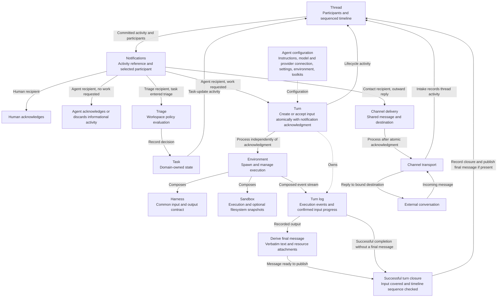
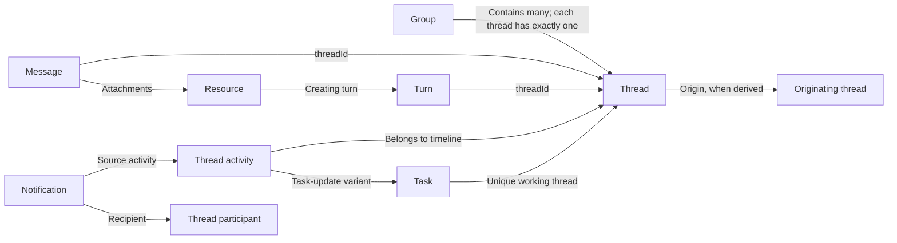
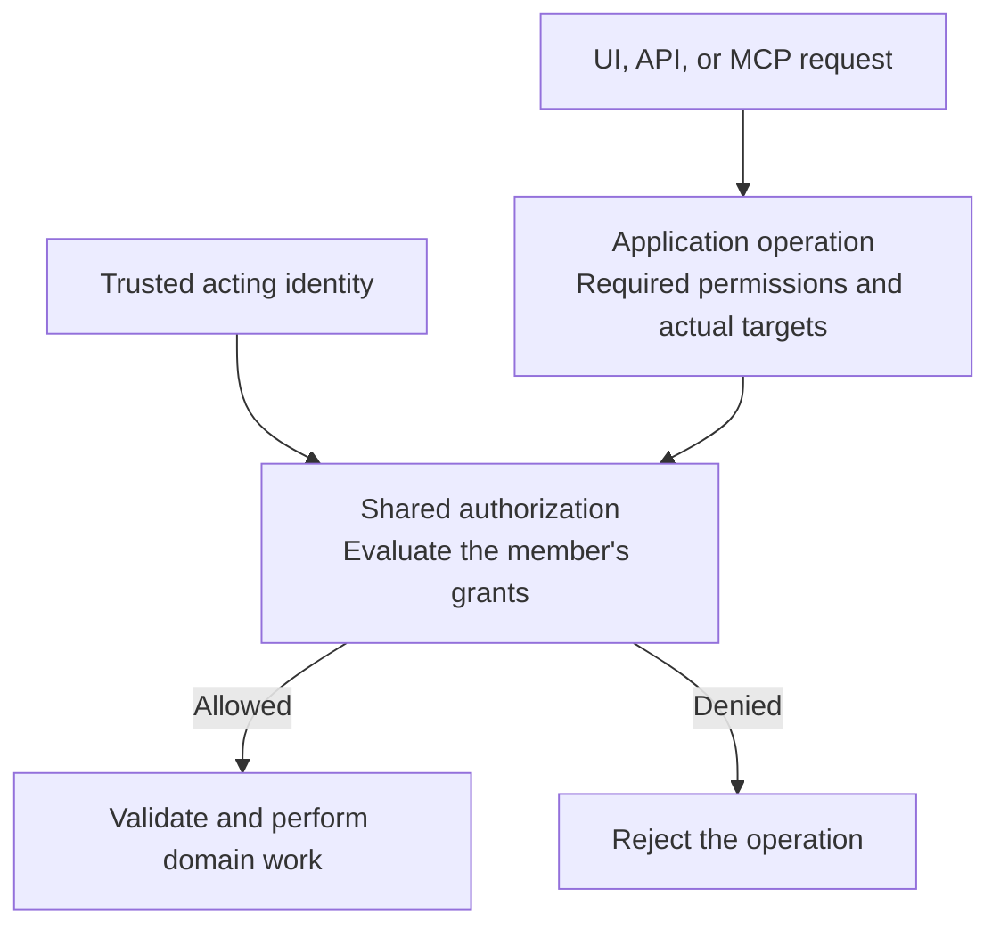
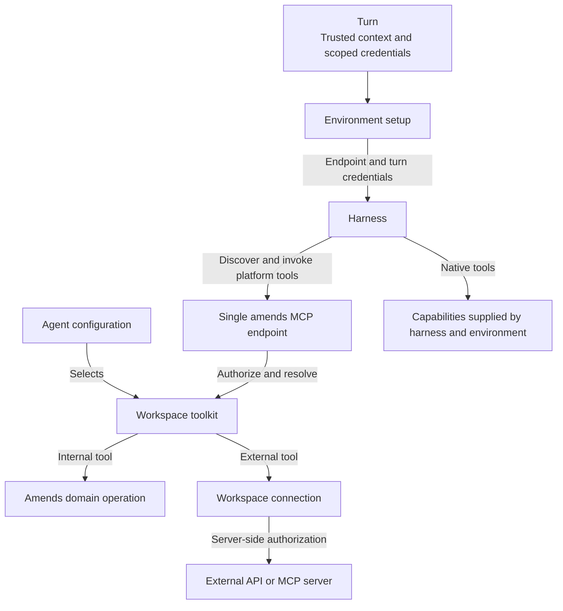
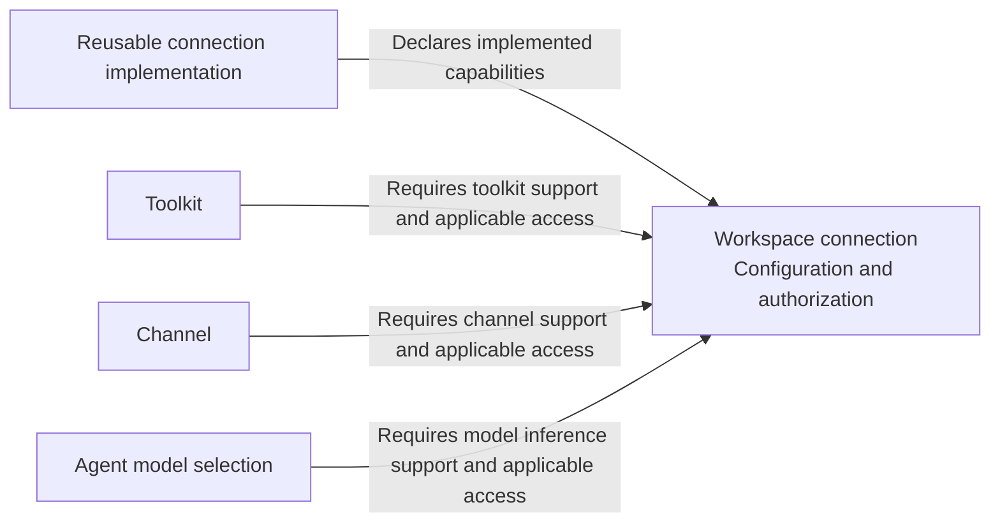
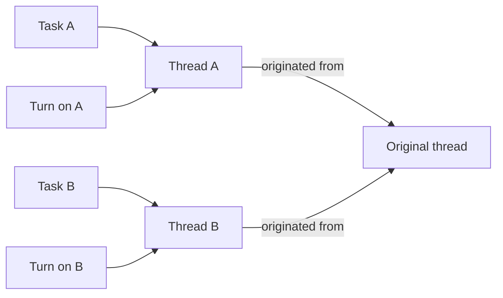
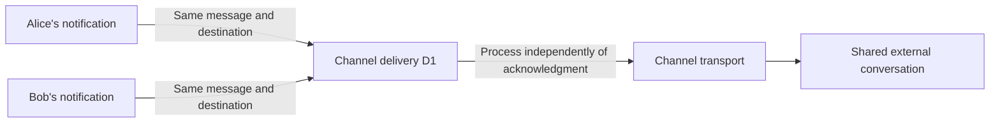

# Core model

This is a living design document for reconsidering amends from the user and developer
perspective. It will grow into an explanation of each core concept: what it does, why it
exists, what it owns, and how it relates to the others.

This document describes design intent. It does not describe or validate the current
implementation. The discussion is grounded in the work users want to do and the contracts
of external systems. Existing implementation choices do not constrain the design.

For current behavior, read [workspace workflows](workspace-workflows.md), the
[group workflows](group-workflows.md), the [core package guide](../packages/core/README.md),
and [known limitations](current-status.md).
Workspace management, the generic journal, notification storage and inbox reads,
and process-local live changes are implemented. Core and both adapters also implement
private team-group creation, membership admission/departure, workspace-removal cleanup,
authorized group reads, and a shared group-audience check. Direct groups (DMs and group DMs) are
established and reused by member set, with their first thread, through `ThreadApplication.startDirect`.
Every thread opens through one internal thread start that creates the thread, admits its starting
participants, and records its first message activity and pending notifications atomically; see
[thread workflows](thread-workflows.md). Participants and message authors can be members,
contacts, or triage. Authorized group-thread discovery,
metadata, timeline pages, and current-participant summaries are also implemented. Human replies publish through
`ThreadMessageApplication`, admitting the author and eligible mentions in the same commit.
`ThreadParticipationApplication` implements self-follow/unfollow, quiet follow activity, and pending
agent-input settlement. `NotificationApplication.resolveSource` resolves owned notifications under
current thread access, without acknowledgment or participation changes. Human acknowledgment is
implemented through `NotificationApplication.acknowledge` and a shared internal acknowledgment
service. Other participation management, the task and channel workflows that admit contacts and
triage, public groups, group/thread HTTP/UI, turns, execution,
agent/contact/triage acknowledgment, and channel
delivery below remain design intent. “Agreed” records a design decision, not its
implementation status.

## Architecture summary

Groups provide lasting spaces for multiple conversations. Every thread belongs to exactly
one group, and that group's membership is its access audience; action permissions still apply.
Participation decides who is involved and notified, never who can see the thread. Members
who are neither addressed nor following see a thread's new activity as unread through their
own read position. Tasks and
channel conversations use the same model: a task's working thread and a channel's conversation
threads live in groups. The thread holds the conversation and its ordered activity.
That timeline is the sole source of notifications. Thread participants supply the possible
recipients, the activity narrows them, and each recipient decides how to respond.
An agent accepts work into a durable turn, which executes through an environment,
records its execution, and conditionally publishes its final response when there is one.
The sections below retain the detailed decisions and rationale.

### Work flow

Arrows describe domain collaboration and ownership, not package imports. Domain operations
record activity on the thread; there is no direct domain-to-notification path outside that
timeline. The notification branches show how recipients respond to different activity.



### Responsibilities and relationships

- **Workspace member:** a human or agent participating in the workspace under the shared
  permission model. Workspace membership is separate from participation in a thread.
- **Permission:** authorization to perform an action within a scope. Application operations
  check permissions for the acting member and the actual target.
- **Role:** a named bundle of permissions assigned to members. Operations check the
  required permission rather than a particular role name.
- **Agent:** behavioral configuration with a required starting environment, selected
  workspace toolkits, and a model selection with its provider connection and settings.
  It has a stable identity and its own permissions as a workspace member. Moving an
  execution does not modify that reusable configuration.
- **Harness:** defines common input, event, additional-input, and supported continuation
  contracts. Each implementation translates native behavior in both directions.
- **Sandbox:** supplies execution capabilities and owns filesystem state. Snapshot and
  restore support are implementation capabilities. Its provider owns consistent capture
  and restoration; the environment requests these operations and records snapshot references.
- **Environment:** composes the harness, sandbox, and setup; owns spawning and lifecycle;
  exposes their events without redefining their payload meaning. Configures the harness
  with the amends MCP endpoint and the turn's credentials. Validates and configures the
  agent's selected model access through supported harness mechanisms. Spawning prepares the
  runtime without history or work prompts; history setup and new input submission follow.
  After a turn releases it, the environment owns retention, reuse, and cleanup policy.
- **Tool:** one callable operation with its own inputs, outputs, and behavior.
- **Toolkit:** a configured collection of tools available for agent selection. External
  toolkits reference a connection; internal toolkits invoke existing amends operations.
- **Connection:** workspace-owned access to an external system, including its provider or
  endpoint, authentication configuration, and protected credential references. Its
  implementation declares support for toolkits, channels, model inference, or a combination;
  each connection's configuration and authorization determine readiness. Connecting a
  server does not create a toolkit or grant an agent its tools.
- **Group:** a lasting conversation space within a workspace, with an access audience and
  multiple threads. A team group has managed membership. A direct group has a fixed set of
  two or more human or agent members: a DM has two, a group DM three or more. Group membership
  does not automatically establish participation or request agent work in its threads; members
  can follow a team group to join its new threads.
- **Thread:** one conversation in exactly one group, with participants and a
  sequenced timeline of typed activity, including published messages, turn lifecycle events,
  and task updates. It owns their order without taking over the underlying domains' state
  or execution machinery.
- **Turn:** one agent's attempt on one thread. Owns accepted input, incorporation progress,
  execution history, the model/provider selection and settings actually used, environments
  used, snapshot references, and outcome.
- **Task:** an assignable objective that can span turns, with one current assignee. Each task
  references its own unique working thread, placed in a group when the task is created. A task
  created from a conversation gets a new thread referencing that originating conversation.
- **Resource:** an amends entity whose creation references its producing turn. Later turns
  reference resources they use. A sandbox file is not automatically an amends resource.
- **Notification:** references a thread activity and the participant to inform. Its
  acknowledgment records the recipient's handling outcome.
- **Read position:** how far a human member has read a thread, by timeline sequence. It is
  private per-member state that shows unread activity without recording anything per message.
- **Triage:** evaluates a versioned workspace policy when a task enters triage. Rules match
  task conditions and select assignment, hold, dismissal, or agent consultation. Triage
  participates in the task's thread without group access and assigns only within that group.
- **Channel:** a configured external communication point with a transport adapter. It
  references a connection with channel support, carries multiple conversations, and owns
  receiving and sending external messages. Its conversations become threads in one destination
  group.
- **Contact:** an external person's identity and thread participation. Sender identity stays
  distinct from the external conversation used as the reply destination.
- **Channel delivery:** a durable transport operation for one published message and one
  external destination. Several contact notifications can refer to the same delivery.



Thread activity is the timeline item itself, not a second event stream. Messages and turns
retain their own thread references; activity references them or records a change to the
thread's task. The task stores the task-to-thread association without a reciprocal task
reference on the thread record. A thread may exist without a task, but never without a group.
The group relationship determines access; the origin relationship records where
the conversation came from and grants no access by itself.

### Workspace membership and authorization

Humans and agents share one workspace membership and permission model while retaining
their different identity types. Humans join through an authorized invitation and acceptance
flow; agent creation establishes the agent's membership with authorized permission grants.
External contacts can participate in threads without becoming workspace members.

Creating, configuring, using, and managing permissions for an agent are distinct actions.
An agent executes with its own permissions regardless of who requested the work. An
administrator invoking it does not elevate it, and a more restricted requester does not
reduce its authority. Authorized users may obtain information indirectly through an agent
even when they lack direct access. There is no requester-permission intersection.

Application operations declare required permissions and targets; shared authorization
evaluates them. Roles bundle permissions for assignment. An authorized workflow covers
its required internal steps, such as creating a task's working thread. Reads, lists, and
subscriptions also enforce the acting member's access. Audit records distinguish the
requesting activities from the agent and turn that performed the resulting operations.

### Groups, access audiences, and participation

A group holds multiple threads, and every thread belongs to exactly one group; there are no
standalone threads. A team group has managed membership. A direct group has a fixed set of two
or more members, with all of them participating initially in each new thread: a DM is a direct
group of two, and a group DM has three or more. A team group's threads inherit the group's
access audience. A member's new team-group thread starts with its author, the members its opening
message mentions, and the members who follow the group; the rest of the group sees it as unread.
A narrower or different audience uses another group, typically a direct group.

Five layers answer different questions about the same thread:

| Layer            | Question it answers                              | Who belongs to it                                              |
| ---------------- | ------------------------------------------------ | -------------------------------------------------------------- |
| Group membership | Who can see the thread?                          | The group's members.                                           |
| Participation    | Who is involved in the thread and gets notified? | Some group members, plus contacts and triage where applicable. |
| Task assignment  | What is the objective, and who is responsible?   | One current assignee, who must be a participant.               |
| Turn             | Which agent attempt is running?                  | One agent on one thread.                                       |
| Read position    | What has each member already seen?               | Each human member, privately, per thread.                      |

Assigning a task adds its assignee as a participant and notifies them; it neither creates nor
changes a group. Several people or agents share work on one task by participating and being
asked for work on its thread; independent work is split into separate tasks.

Members with group-creation permission can create team groups; membership changes require
the relevant management permission. These permissions initially belong to the Administrator
and Owner bundles, but any role or direct grant can supply them. Any active workspace member
can start a direct group with other active members. A direct group's membership never changes,
and its members cannot leave it; hiding it is a client presentation choice. A current team-group
member can leave their own membership without membership-management authority. Operations
check permissions and preserve the group's audience rules.

For human and agent operations, active workspace membership, inclusion in the thread's
access audience, and the required action permissions must all hold. Group members can
read a thread without participating when permitted. Reading advances only their own read
position; it does not subscribe them or request agent work. Replying, explicitly following, an
authorized mention, or following the group before the thread starts can establish
participation. Threads do not admit members from outside their group through participation.
Contacts and triage participate without becoming group members or gaining group access.

Unfollowing a thread ends participation while retaining the group's access. Losing group or
workspace membership ends the corresponding access and participation. Human muting changes notification
presentation while retaining access, participation, and recorded recipient selection.
See [groups and thread audiences](#agreed-groups-provide-a-shared-home-for-threads).

### Thread participants, addressing, and history

- A new thread in a direct group starts with all its members as participants. A member's new
  thread in a team group starts with its author, its explicitly mentioned eligible members, and
  the group's followers. A task's working thread starts with its creator and triage, or with its
  creator and assignee when assigned at creation. A new channel conversation starts with its
  contacts and triage. The group's human followers also join task and channel threads; its agent
  followers do not. Group membership alone enrolls no one.
  Later mentions can add participants under the thread's audience and admission rules.
- External people participate as separate contacts, preserving the actual author of each
  incoming message. Several contacts can belong to the same thread and external conversation.
- Committed thread activity is the sole source of notifications. Participants at that
  activity's position supply the possible recipients; activity-specific rules narrow them.
  Other members with access to the thread are not notified; they see its activity as unread
  through their read positions.
- For message-publication activity, notify explicitly mentioned participants, or all current
  participants when there are no mentions. This applies equally to user and assistant messages.
- Humans acknowledge notifications. Agents accept work from relevant user messages and
  actionable task changes, explicit retries, and explicit agent work requests and their
  results. They discard ordinary assistant-message notifications. Informational turn status
  notifies all current participants without requesting agent work. Triage handles
  task-entered-triage activity.
- Contact handlers forward eligible published replies through the channel, using the
  thread's external-conversation reference. Their notifications stay separate even when
  the outward delivery is shared.
- A joining participant receives earlier conversation as history. A human-authored joining
  message, task assignment, or explicit work request can supply initial input. Participation
  and the request to act are distinct: assignment also requests work from an agent already
  in the thread.
- Leaving or removal stops future notifications. An agent's pending unacknowledged work is
  settled as no longer actionable, and its active turn is cancelled without erasing progress
  or effects. Rejoining establishes a new history boundary; old unfinished requests do not
  automatically become input again. A human leaving does not cancel other agents' work.
- Pending input is specific to each agent and can include several actionable activities.
  History and pending input may interleave. Preserve order and authorship; another agent's
  response does not mark this agent's input handled.

### Task changes and agent collaboration

A task's current assignee must participate in its thread. Reassignment records the change,
cancels the previous agent assignee's turn, and hands the assignment to the new assignee.
Acceptance can happen immediately; execution of the transferred work waits until the previous
agent stops. The previous agent assignee leaves by default so broadcast messages do not
continue assigning it work. A former human assignee can remain in the conversation.

Requirement edits notify all current participants and become input for the current agent
assignee when the task permits work. Bookkeeping edits are informational unless explicitly
requesting work. Instructions to stop, hold, or dismiss cancel affected execution; explicit
resumption supplies new input. A turn's own task edits do not request new work from itself,
and completing its own task does not prevent finishing its turn and publishing a response.

An agent explicitly requests another agent's work through a tool that records addressed
thread activity. The tool returns after that activity is recorded; the receiving agent
accepts work through normal notification handling. Result activity refers to the request
and gives the requesting agent new input, including a response, resources, failure, or
cancellation. The requesting turn need not stay open. Ordinary assistant replies remain
conversation, and a request on the same thread does not require a separate task.

### Atomic handoff and independent execution

Creating a turn and acknowledging its notification with `turnId` are one atomic operation.
For an existing turn, extending accepted input and acknowledging the notification are also
atomic. Human acknowledgment records when the person saw the notification; discarded agent
notifications have no work turn, with the exact discard representation still open.

For agent work, acknowledgment means the turn owns the input. It does not wait for a
harness to start or incorporate input. Scheduling, execution, and recovery belong to the turn afterward.
There is at most one active turn per agent per thread, including turns awaiting processing.
Different agents can work concurrently, and one turn can accept many notifications.

Contact delivery follows the same ownership pattern: atomically create or reuse a channel
delivery and acknowledge the notification with its reference. The channel processes the
delivery afterward. This acknowledgment records a durable handoff, not successful external
delivery or proof that a person read the message.

### Turn lifecycle and control

Created turns are durable work. The turn implementation schedules eligible turns in creation
order within configured concurrency limits, accepts additional input while they wait, and
recovers created or interrupted active turns after restart. Notification handling does not
wait for processing to start.

A finished turn never reopens. An explicit retry records actionable thread activity referring
to the earlier attempt. Its notification follows normal batching: create a turn if none is
active, accept into an active turn that can take work, or wait while cancellation is pending.
The retry request is new input; previously incorporated input remains history.

Recoverable interruptions continue the same active turn within configured retry limits.
Tool errors can be returned to the agent without failing the turn. An inability to continue,
exhausted recovery, or loss of required continuation state fails the attempt with a recorded
reason. Timeouts do not establish whether a side effect happened; recovery must not blindly
repeat operations with uncertain outcomes.

### Turn input progress

| Boundary                      | Meaning                                                                                                                                   |
| ----------------------------- | ----------------------------------------------------------------------------------------------------------------------------------------- |
| `inputAfterSequence`          | Fixed boundary from this agent's preceding turn in its current participation, or just before the activity introducing that participation. |
| `acceptedThroughSequence`     | Relevant input for which this turn has accepted responsibility.                                                                           |
| `incorporatedThroughSequence` | Relevant input confirmed incorporated through the harness contract.                                                                       |

```text
inputAfterSequence <= incorporatedThroughSequence <= acceptedThroughSequence
```

Acceptance can advance before processing starts or while the harness runs. Incorporation
advances only for a confirmed batch and covers relevant input in order without gaps.
Notification acknowledgment cannot advance incorporation. A batch confirmed through 10
does not incorporate input newly accepted through 12. The turn log records this progress.

### Closing and publication

The turn log preserves intermediate and superseded assistant responses. When publishing a
final response, the turn deterministically derives a message from the log: the last completed
assistant response that accounts for the required input, preserved verbatim, plus separate
resource attachments. The assistant need not mention an attachment in its text. Resource creation
remains detail in the turn log; the published message presents selected artifacts without
requiring separate timeline items for their creation. Attachment selection remains open.
The turn must have incorporated all accepted input before successful closure.

A turn can succeed without a final assistant message when the harness reports successful
completion, required input is incorporated, and the closure check finds no additional
relevant work. No replacement text is invented. The timeline records completion; work and
resources remain accessible through the turn. A disconnected or truncated stream is not
successful completion.

Deliberate cancellation ends the attempt without claiming successful completion. A
cancellation request and execution actually stopping are distinct. Completed effects and
the turn log remain, the environment is released when the turn ends, and an associated
task is not automatically cancelled. A terminally cancelled turn is not resumed by crash
recovery. Cancellation does not advance incorporation progress or discard unincorporated
input; a later turn uses the existing cursor rules to distinguish history from pending work.
New work waits while cancellation is pending. If supported execution controls cannot establish
that execution has stopped or can no longer act as that turn, cancellation stays pending
with a visible reason; a successor must not run alongside it.

Publication atomically checks the expected thread timeline sequence and appends the final
message. A sequence conflict requires inspecting intervening activity: newer relevant input,
including actionable task changes, must be incorporated. Informational activity does not
require another generation: account for the intervening activity, update the expected
sequence, and retry the same response. Every retry repeats the check. Completion without a
message uses the same input and timeline checks. These checks also catch relevant activities
whose notifications have not yet been processed.

A stale response remains in the turn log; it is not inserted earlier in the thread to
repair ordering. Accepting new input and closing follow one consistent order, so accepted
work cannot disappear between those operations. Assistant publication records message
activity and generates ordinary notifications, whose agent recipients discard them under
the current message-handling policy.

### Runtime preparation and input submission

Execution preparation has three distinct stages: spawn the environment, set up history or
supported continuation state, then submit new input. Spawning acquires the sandbox and
completes required installation, harness initialization, and dependency setup. Success
returns a usable running interface; it does not prove the required conversation context
is present. A stable running-environment identifier can request reacquisition of an
existing runtime. The result distinguishes retained or restored filesystem state from
retained harness context; neither is inferred from the identifier alone.

The turn selects history and continuation context and supplies it through that interface.
The harness prepares the corresponding native context within its supported capabilities.
Once history setup succeeds, the turn submits pending input for execution. Neither spawn
success nor history setup counts pending input as incorporated. History setup can reuse
matching context already present. Filesystem restoration belongs to the sandbox provider
and occurs during sandbox preparation, independently of conversation history setup.

When a turn finishes, it releases the running environment. The environment applies its own
retention and reuse policy. Release does not necessarily stop a process or delete sandbox
files. A retained runtime must establish the correct context, configuration, and credentials
before another turn uses it.

### Continuity across environments

Preserve three things separately: the turn's execution log, supported sandbox filesystem
snapshots, and the amends entities created or changed during work. A supported environment
transfer can continue the same turn. Restored execution, input progress, and any required
filesystem snapshot must agree. Existing tasks, messages, and resources are reconnected
through references; they are not recreated by replaying completed operations.

The environment asks the sandbox provider to capture a snapshot and stores the returned
reference, associated with the relevant execution history. Restoration supplies that
reference back to a capable provider. The provider owns filesystem capture consistency
and restoration mechanics; amends does not implement provider-specific copying or freezing.

An agent requests an environment switch through a tool call. Its result is withheld from
the source execution. The destination is spawned, history is prepared with the pending
call preserved, and a successful result is supplied there so the same turn continues from
that call. The source stays available until handoff. If destination preparation fails
before handoff and the source is still usable, the failed switch result is returned there
and the same turn continues in the source.
Transfer compatibility includes support for this continuation boundary. A standalone pause
operation is not required by this flow.

The turn's `environmentId` identifies the running environment selected for execution and
recovery. It changes only after the destination is successfully prepared, together with
the recorded successful switch result. Recovery reacquires the environment named by that
record and prepares any missing history before continuing. Source cleanup does not change
which environment is authoritative.

### Tools and external access

All platform-provided tools, internal and external, are exposed through one amends MCP
endpoint. Agents select workspace toolkits, and per-turn credentials identify the trusted
execution context and determine permitted tools. The server checks access during both
discovery and invocation, then resolves the toolkit's configuration and connection.
External credentials used by platform tools remain behind the server.

A connection provides access to an external system; a toolkit selects and configures tools
from that source. Multiple toolkits can share a connection. An external MCP connection can
discover tools without making them available to agents. A generic MCP integration can
expose selected upstream tools through our endpoint without a provider-specific implementation.

Connections can also supply external access to channels and model inference. The reusable
connection implementation declares the capabilities it implements. Each configured
connection separately reports whether the necessary setup and authorization are available.
Consumers select compatible connections and explain missing configuration; application
operations enforce the same requirements.

Harnesses can also supply native tools, such as terminal and filesystem access. Those tools
are outside the amends MCP endpoint. Their availability depends on the harness configuration
and environment capabilities; MCP permissions do not restrict them. Users need to understand
both sources when choosing an agent's toolkits and environment.

### Model selection and provider access

Configured access to a model provider is a workspace connection with model inference
support. The agent selects that connection alongside its requested model and settings.
It holds a connection reference, not credentials. The environment validates whether its
harness can use the selected provider interface, model, and settings, then configures
supported access for execution. Wiring access does not move provider selection into the
environment definition.

Environment defaults fill omitted optional execution settings; explicitly supplied agent
values take precedence when supported. Unsupported combinations are reported rather than
silently modified. During agent creation, incompatible environments appear disabled with
an explanation. During a turn, the agent is offered only compatible destinations. The
same compatibility rules are enforced when attaching or transferring and checked again
before execution uses the configuration.

The turn records the selection actually used. A supported environment transfer preserves
the intended provider account and model when the destination supports them. Exact model
identifiers, discovery, fallback policy, credential delivery, and harness-managed
authentication remain to be defined.

### External communication

A channel adapter identifies incoming conversations, messages, and their senders. Intake
finds or creates the matching thread; a new task intake creates its task in triage. Later
replies continue that conversation rather than creating another task for every message.
All resulting notifications still originate from committed thread activity.

Published assistant replies reach contact handlers through notifications. Contacts sharing
the same destination request the same logical channel delivery. The delivery key identifies
the published message and external destination; it excludes contact and notification IDs.
Within a channel, `messageId:threadId` is sufficient only when that thread has one stable
external destination. Otherwise, include the external conversation or destination identity.

The channel atomically creates or finds that delivery, so concurrent contacts cannot create
competing sends. Provider-level retry guarantees remain adapter capabilities: deduplicating
our delivery requests does not by itself prove that an uncertain external send can be
retried without duplication.

These ownership and behavioral rules are agreed. Exact storage mechanisms, lifecycle and
protocol schemas, harness continuation capabilities, task-thread context inheritance,
and resource revision contracts remain open. Unresolved details are recorded in
their owning sections below; see [Working method and scope](#working-method-and-scope)
for the meaning of each decision status.

## Working method and scope

- **Agreed** records a conclusion reached in the discussion. It remains open to revision
  when a concrete counterexample or better design warrants it.
- **Provisional** records a working definition or proposal whose details still need debate.
- **Open** records a question we have not settled.

Develop the model piece by piece. Challenge assumptions, explain the reasons for decisions,
and revise this document when the reasoning changes. Keep one current explanation of each
concept rather than accumulating contradictory proposals.

This pass covers workspace membership, invitations, permissions, roles, harnesses, sandboxes,
environments, agents, model selection, tools, toolkits, connections, groups, threads, messages, turns,
tasks, resources, notifications, triage, channels, contacts, and channel deliveries.
Team and direct groups establish spaces and access audiences for multiple threads.
Detailed connection and credential lifecycles and provider-specific transport contracts remain open.
Existing concepts, including sessions, must earn their place through a clear responsibility.

## Core vocabulary

These definitions summarize the discussion. The agreed sections below establish ownership
and relationships; detailed schemas and lifecycle rules remain open where stated.

| Concept          | What it represents                                                                                                                                                                                                                    | Why it exists                                                                                                         |
| ---------------- | ------------------------------------------------------------------------------------------------------------------------------------------------------------------------------------------------------------------------------------- | --------------------------------------------------------------------------------------------------------------------- |
| Workspace member | A human or agent identity associated with a workspace and its permission assignments.                                                                                                                                                 | Gives humans and agents a common basis for participation and authorization.                                           |
| Permission       | Authorization to perform a domain action within a scope.                                                                                                                                                                              | Defines what the acting member may do to a particular target.                                                         |
| Role             | A named collection of permissions assigned to members.                                                                                                                                                                                | Makes permissions convenient to assign without hard-coding role names into operations.                                |
| Harness          | An implementation that drives agent work and exposes a common interaction contract. It might communicate with an agent through ACP or implement an agent loop using AI SDK or Effect AI.                                              | Lets the application use different agent implementations through a coherent contract.                                 |
| Sandbox          | An execution substrate supplying capabilities such as running commands and accessing files. Candidate implementations include local execution, Docker, cloud VMs, and platform runtimes; their capabilities need to be made explicit. | Separates execution capabilities from the machinery that drives agent work.                                           |
| Environment      | A reusable definition combining a selected harness, sandbox, and the setup needed to run them. Its domain owns spawning that composition and returning a usable running interface.                                                    | Gives users a complete execution setup and gives callers one boundary for using it.                                   |
| Agent            | Behavioral configuration, including instructions, a model and provider-connection selection, reasoning settings, a starting environment, and selected workspace toolkits.                                                             | Defines behavior, requested model access, starting execution setup, and available platform tools.                     |
| Tool             | One callable operation with its own input and output contracts and behavior.                                                                                                                                                          | Lets an agent gain information or perform an action through a defined operation.                                      |
| Toolkit          | A configured collection of tools, with settings and a connection reference when external access is required.                                                                                                                          | Groups tools for configuration and selection by agents without duplicating external credentials.                      |
| Connection       | Workspace-owned access to an external system, with provider or endpoint settings, authentication configuration, protected credential references, and declared support for toolkits, channels, model inference, or a combination.      | Supplies external access to compatible consumers while keeping access separate from their behavior.                   |
| Group            | A lasting space within a workspace for multiple threads, with a shared access audience. A team group has managed membership; a direct group has a fixed set of two or more members, such as a DM or group DM.                         | Lets related conversations share access without making everyone participate in every thread.                          |
| Thread           | One conversation in exactly one group, with participants and an ordered timeline of message, turn, and task activity. It can reference an originating conversation independently of its group.                                        | Preserves the conversation and its activity, and establishes the source and possible recipients of notifications.     |
| Message          | Input or output in a thread's conversation. Several user messages can contribute to one turn; its final assistant response is published when it can close.                                                                            | Records communication while the turn log retains the detailed execution history.                                      |
| Turn             | One bounded attempt to perform work on a thread using an agent and an environment. Effects can occur during the attempt.                                                                                                              | Identifies an attempt so its activity, effects, and outcome can be understood together.                               |
| Task             | An objective with one current assignee, worked on across turns. Each task references its own unique working thread, placed in a group when the task is created.                                                                       | Gives work an objective, assignment, and lifecycle beyond one attempt.                                                |
| Resource         | An amends entity produced or used during work. A resource created during a turn explicitly references that turn. Its detailed content and revision contracts remain open.                                                             | Gives an output or input an application identity that survives an execution environment, with a record of its origin. |
| Notification     | A reference to a committed thread activity and the participant selected to receive it, with an acknowledgment outcome.                                                                                                                | Separates informing participants from deciding whether and how to act.                                                |
| Read position    | How far a human member has read a thread, by timeline sequence.                                                                                                                                                                       | Shows unread activity privately without recording anything per message for each member.                               |
| Triage           | One versioned workspace policy of conditional rules, evaluated when a task enters triage.                                                                                                                                             | Decides task disposition and assignment, optionally with agent consultation.                                          |
| Channel          | A configured external communication point, implemented through a channel adapter using a connection with channel support. Its conversations become threads in one destination group.                                                  | Receives and sends messages while keeping transport details outside the core work model.                              |
| Contact          | An external person's identity that can be a thread participant and message author.                                                                                                                                                    | Preserves individual participation and routes notification handling through external communication.                   |
| Channel delivery | A durable operation owned by a channel for delivering one published message to one external destination.                                                                                                                              | Combines equivalent delivery requests from several contact notifications and records transport progress.              |

An environment definition and a running environment are distinct. Owning spawning does not
require the stored definition itself to perform side effects; the environment domain must
own the assembly and lifecycle behavior. A turn releases the running environment when it
finishes; the environment owns retention and cleanup. The returned interface's exact schema
and the available retention-policy settings remain open.

## Agreed: workspace members share one permission model

### Hosts route workspaces; core operates within one workspace

A core context is bound to one workspace. A host can serve many such contexts
within one process, and several host instances can serve the same workspace when
their storage provides the required concurrency guarantees. Workspace contexts
can be reconstructed from persistent state; they do not require a permanently
running process per workspace.

The host authenticates identities, checks workspace-creation entitlement, allocates
workspace IDs, and binds storage. Core initialization atomically establishes the
workspace record, the creator's human membership, initial ownership, built-in roles,
and a workspace-scoped Owner assignment. Initialization receives trusted human identity
before an ordinary member actor exists. Repeated initialization cannot replace
ownership or grant additional access.

Creation attribution and current ownership are separate. Ownership does not
implicitly bypass permission checks; the initial owner receives permissions through its role assignment.
The initial permission set and subsequent changes to it must be deliberate.
Ordinary operations receive an actor specific to that operation and check current
membership and permissions. Ownership transfer and removal follow the workflows below.

### Ownership transfers as one atomic change

The current owner must hold `workspace.transfer-ownership` and select another active
human member of the same workspace. The request identifies the Owner assignment the
caller reviewed. Each transfer creates a fresh Owner assignment, so an old request
cannot become valid again merely because ownership returns to its original holder.

Transfer replaces both people's built-in workspace roles: the recipient becomes
Owner and the previous owner becomes Administrator. It updates current ownership
without changing creation attribution, direct grants, or access scoped to individual
resources. The metadata change and assignment facts share one commit. Competing
transfers cannot create multiple owners, and failures cannot leave partial changes.
Only initialization and this workflow establish Owner access; ordinary role operations
continue to protect it. Replay applies recorded outcomes without reauthorizing the
previous owner.

### Humans and agents share membership

Humans and agents can both be workspace members. They use the same permission checks for
the same actions, while retaining different identity types. A human authenticates and
interacts directly. An agent has behavioral configuration and executes through turns.
Its membership refers to its stable identity, not a particular running turn.

Workspace membership associates the identity with the workspace and its permission
assignments. The identity, behavioral configuration, membership, and granted permissions
describe different responsibilities; their exact record shapes remain open.

### Workspace membership and thread participation serve different purposes

Use **workspace member** for membership in the workspace, **group member** for membership
in a conversation group, and **participant** for participation in a thread. Workspace
membership establishes eligibility and permission assignments in the workspace. Group
membership supplies the access audience inherited by its threads. Thread participation
supplies possible notification recipients; it never supplies access. The required action
permissions apply in each case.
Joining a thread does not grant workspace administration or access to unrelated
conversations, tasks, agents, or connections. The
[thread access rules](#agreed-thread-access-combines-audience-and-action-permissions)
define these relationships independently of the eventual storage representation.

External contacts may be participants in a thread without becoming workspace members. Their
presence in a conversation does not give them the workspace permissions of an invited
human or configured agent. Contact handling uses the channel's authorized intake and delivery
contracts; appearing as a participant grants no authenticated workspace or group access.

### Humans join through invitations; agent creation establishes agent membership

An authorized member invites a person to a workspace with an intended initial role or
permission assignment. The invitation remains pending until that person authenticates and
accepts, establishing an active workspace membership. Sending an invitation and assigning
its initial access both require the appropriate authority.

Creating an agent establishes its workspace membership through the agent-creation flow.
Its initial permissions must also be authorized. Permission to create agents does not
include unrestricted authority to grant them access. Invitation delivery, expiry, revocation,
and detailed membership lifecycle states are refined below for the first human admission flow.

### Human invitations use named identities and required roles

An invitation identifies a human, its issuing member, a required built-in role,
and an expiry time. Issuance and revocation require invitation management and
assignment management permissions. Shared delegation policy allows the current owner
to delegate Viewer or Administrator, while other administrators can delegate Viewer.
Owner is reserved for initialization and the ownership-transfer workflow.

Acceptance receives a trusted authenticated human identity, checks recipient and
expiry, and rechecks the inviter's current membership, permissions, and delegation
authority. Membership, a workspace-scoped role assignment, and acceptance commit
together. An accepted invitation is a receipt: repeated acceptance never grants
again or reactivates a removed member. Rejoining requires a fresh invitation and
member ID. Role permissions remain live through the referenced role.

### Assignment changes use the same delegation policy

Assignment and revocation require explicit management authority. Assigning roles is
additive. Replacing a workspace role is a dedicated atomic operation that checks
the previous assignment IDs to reject stale changes. The owner can manage
administrators; other administrators can manage Viewer-only or unassigned members.
Member removal enforces the same recipient restrictions. Authorized non-owners may
still leave, and the current owner cannot be removed or have their access changed
through ordinary assignment operations.

### Removal ends workspace access while preserving membership history

Removing an active human or agent member requires `member.remove` on that member.
The current owner cannot be removed until ownership has been transferred. Ownership
does not bypass the permission check. An authorized non-owner can remove their own
membership; no separate read permission is required to perform removal.

For a human, removal also revokes all pending invitations for that recipient in the
same workspace. This is part of removal authority and requires no separate invitation
permission. Accepted receipts and invitations in other workspaces are unchanged.

For humans and agents, removal also ends all active group admissions tied to that workspace
membership. This cleanup is part of workspace-removal authority and requires no separate
group-management grant. Each departure records its admission ID and `workspace-removed`
reason, with the workspace-removal fact as its cause. Previous departures remain historical.

Authorization, the current-owner check, and publication and projection of removal
and group departures and invitation revocations share one journal commit. The member becomes removed; its record and permission
assignments remain for history. Subsequent authorization rejects that membership,
including an actor resolved before removal. Other workspace memberships are unchanged.
Authorized readers may still inspect the historical record. Repeating removal of
the same member returns `MemberApplication.AlreadyRemoved` without another fact.

For humans, an old accepted invitation remains a receipt and cannot restore access.
Rejoining requires a fresh invitation and member ID with newly authorized grants.

### Actions require permissions; roles bundle them

An action is something a member requests, such as creating a task. A permission authorizes
an action within a scope. A role is a named collection of permissions assigned to members.
Several roles can contain the same permission; an operation does not need to know which
role supplied it. This follows the distinction described in
[IAM permissions and roles](https://docs.cloud.google.com/iam/docs/overview#permissions_and_roles).

Illustrative names, not a finalized permission catalog:

```text
Action: Create a task
Required permission: task.create in the target workspace

Role: Task contributor
  task.read
  task.create
  task.update
```

Permission checks concern the actual action and target, not only a tool name or a workspace
role label. Reading one channel need not grant access to all channels. Using a connection
and managing its configuration are also different actions. Scope rules for future
resource types remain open.

Having permission to perform an action and having permission to grant that ability to
another member are separate. The system checks the grantor's authority when permissions
are assigned or changed; it does not infer unlimited grant authority from agent creation.

### Built-in roles are constructed from explicit permission tiers

Each permission declares its minimum built-in role through `builtinTier`: `viewer`,
`administrator`, or `owner`. Viewer includes viewer-tier permissions, Administrator
also includes administrator-tier permissions, and Owner includes all three tiers.
Classification is required for each action, including actions declared through a
permission group. It is never inferred from the action's name.

The tier orders bundle construction only. Operations still check individual
permissions at the requested scope; having a higher-tier permission does not grant
lower-tier permissions. Ownership protections and delegation rules are separate.
Custom roles will use explicit permission sets without needing a place in this hierarchy.

Workspace initialization records the generated role definitions and assigns Owner
to the creator. These are ordinary stored permission bundles with stable reserved
identities. Authorization and replay use the recorded permissions, so changing tier
declarations never silently changes existing workspace access. During development,
permission changes use a recreated database and freshly initialized workspaces.
Synchronizing existing bundles is not required in this phase; compatibility will
be revisited when production data must be preserved.

### Creating, configuring, using, and authorizing an agent are distinct actions

| Action                        | What it allows                                                                               |
| ----------------------------- | -------------------------------------------------------------------------------------------- |
| Create an agent               | Establish an agent and its initial configuration, with separately authorized initial grants. |
| Configure an agent            | Change its instructions, model, toolkits, environment, or other behavioral settings.         |
| Use an agent                  | Request work from that agent.                                                                |
| Manage an agent's permissions | Grant or remove the agent's access within the member's grant authority.                      |

An agent can be shared with other workspace members according to its access rules. Someone
can be allowed to use it without being allowed to configure it or change its permissions.
The creator is recorded as the origin of the agent; that identity does not determine the
agent's execution permissions or confer permanent unrestricted management rights.

For example, a member allowed to create agents but not to grant Finance access cannot give
that access to a new agent. Another member with the required grant authority can explicitly
give it access later. Merely invoking the agent as an administrator does not make that
change.

### Agents execute with their own permissions

The agent's granted permissions determine what it may access and do. The member requesting
work must be authorized to use the agent, but that member's own target permissions are not
intersected with the agent's execution permissions.

- A requester with broader permissions does not elevate the agent.
- A requester with narrower permissions does not reduce the agent's authority.
- Explicitly changing the agent's grants changes its authority; invoking it does not.
- Creating an agent does not make its runtime permissions a copy of its creator's access.

The current policy deliberately permits indirect access through an authorized agent:

```text
Alice cannot directly read Finance.
Researcher can read Finance.
Alice is allowed to use Researcher.

Researcher may read Finance and return information to Alice.
```

The Finance read is authorized against Researcher's permissions. Alice's lack of direct
Finance access does not block it. We do not introduce a second requester check at tool
execution or a general work-delegation permission. This is the chosen behavior, not an
unresolved question about preventing indirect access.

Tool configuration, supported environment capabilities, and external provider authorization
still apply. The ability to call a tool does not alone authorize its action or target.
Per-turn credentials identify the acting agent and attempt and carry applicable execution
limits; they do not inherit the requester's permissions or expand the agent's grants.

Several people can contribute work to one turn without changing the identity under which
it executes. Requesting activities remain attributable individually. Audit information
records the source activity or activities and requesting identities, the acting agent and
turn, and the operations performed, including their targets and outcomes. The detailed
audit schema, storage, retention, and coverage remain open.

## Agreed: authorization protects requested application operations

Every protected application operation declares the permission or permissions it requires
and identifies the relevant target. Shared authorization evaluates those requirements for
the acting identity. The operation proceeds only when authorized and when its domain
validation succeeds. It does not hard-code a particular role such as administrator.

The check belongs at the application operation shared by UI, API, and MCP entry points.
The acting identity comes from trusted execution context. For a human request it is the
human member; for a turn's tool call it is the agent. The original requester is retained
for auditing, not used as an additional execution-permission requirement.



Permissions describe meaningful business actions rather than HTTP methods or individual
database writes. One requested operation can require several permissions if it lets the
caller independently choose privileged behavior. See the corresponding
[Cedar action-modeling guidance](https://docs.cedarpolicy.com/bestpractices/bp-map-actions.html).

Reads require authorization as well as commands that change state. Retrieving resources,
reading messages, listing tasks, and subscribing to activity must expose data permitted by
the acting member's access rules. Toolkits use the same authorization rules as other
application entry points rather than defining independent permission systems.

### Required internal steps are covered by the authorized workflow

An authorized operation may perform several internal steps. Creating a task can create
its working thread, record task activity, and establish notifications. Those required
effects do not automatically require separate member permissions for every internal call.

The parent operation's authorization must cover the actual setup requested, including its
destination and any caller-selected participants. An independently requested privileged
choice still needs authorization. For example, permission to create an agent does not
authorize arbitrary initial permission grants.

Internal functions continue to enforce their domain rules and valid relationships. They
must not become alternate public paths around application authorization. This distinction
avoids repeating role or permission logic in every helper while preserving the protection
of externally requested operations.

### Thread creation is one domain operation used by several workflows

Thread creation belongs to the thread domain. The task workflow coordinates it with task
creation; ownership does not move into the task domain. Starting a thread in a team or direct
group, creating a task's working thread, and receiving a new channel conversation use the same
internal thread-start implementation. Creating or selecting a group is a separate responsibility
from creating one of its threads.

| Requested operation                         | Authorization concerns                                                                                                          | Required internal work                                                                                                         |
| ------------------------------------------- | ------------------------------------------------------------------------------------------------------------------------------- | ------------------------------------------------------------------------------------------------------------------------------ |
| Start a thread in a group                   | Group access, starting a thread, and its requested participants.                                                                | Start the thread with the author and its selected participants, and publish the first message.                                 |
| Start a direct group with its first message | Active workspace membership, the selected members, agent-use authority when applicable, and `thread.start` on the direct group. | Establish or reuse the direct group for that member set, start the thread with all its members, and publish the first message. |
| Create a task                               | Creating that task, its thread's group, and any assignee chosen at creation.                                                    | Start the working thread with the creator and triage or the assignee, record the task activity, and create the task.           |
| Receive a new conversation on a channel     | The channel's configuration and destination group; no member actor performs it.                                                 | Start the thread in the destination group with its contacts and triage, publish the incoming message, and create the task.     |

Each requested operation owns its authorization, its rule for choosing the starting
participants, and its first timeline activity. The shared internal start does the rest in the
caller's commit: it validates the group and the eligibility of member participants, creates
the thread, admits the starting participants at the first sequence, and records the first
activity with its selected recipients. A thread therefore never exists without participants or
a first activity, and every workflow generates notifications through the same timeline rules.

A starting participant is a group member, a contact, or triage; only members are checked for
group eligibility. A message author is a member or a contact, and later an agent publishing from
a turn. Requiring a human author is a rule of the member-facing start and reply operations, not
of the internal publication. Workflows do not use synthetic mentions to choose participants:
mentions remain addressing recorded on the message, and mentioning an agent requests its work.

The internal thread-start operation does not repeat a separate member-level
`thread.create` check when it is a required step of one of those authorized workflows.
It still validates the thread's own rules, including workspace, group, origin, and
participant references. Placement, participation, and the first activity commit together.

There is no empty-thread operation. A future workflow that starts threads needs authorization
of its own before calling the same internal implementation. The rule is to authorize the
requested operation and its intended effects, not to exempt thread creation everywhere or
require an independent grant for every underlying mutation.

## Agreed: harness event normalization and environment composition

### The harness contract owns harness event meaning

The harness package defines the common harness contract, including its event schemas.
Each harness implementation translates its native interaction into that contract.

For example, an ACP implementation understands ACP notifications and responses; an AI SDK
implementation understands the SDK's stream and execution behavior. Both expose harness
events. Neither needs to know about environments, threads, or turns in the amends product.

The external interfaces have meaningful differences:

- ACP reports assistant content through `agent_message_chunk`, and tool activity through
  `tool_call` and partial `tool_call_update` notifications. See the official
  [prompt turn](https://agentclientprotocol.com/protocol/v1/prompt-turn) and
  [tool call](https://agentclientprotocol.com/protocol/v1/tool-calls) contracts.
- AI SDK's `fullStream` includes text deltas, tool calls, tool results, and errors. See the
  official [streamText reference](https://ai-sdk.dev/docs/reference/ai-sdk-core/stream-text).

Normalization therefore belongs with the implementation that understands the native
semantics. It may need to retain state, combine updates, or interpret completion responses.
Renaming fields alone may be insufficient.

### The environment composes events and adds its own context

The environment exposes harness events through its outward interface while preserving their
meaning and schema. It can add an envelope identifying their source and the relevant running
environment or operation. It also produces events about its own lifecycle, such as readiness
or setup failure, and can expose relevant sandbox events.

The following is an illustrative shape, not an implemented API or a final schema:

```text
Environment event
  source: harness      event: Harness.Event
  source: sandbox      event: Sandbox.Event
  source: environment  event: EnvironmentLifecycleEvent
```

| Information                             | Contract owner | Environment responsibility                         |
| --------------------------------------- | -------------- | -------------------------------------------------- |
| Assistant content and tool activity     | Harness        | Expose the harness event with relevant context.    |
| Command output and process exit         | Sandbox        | Expose relevant sandbox events with context.       |
| Environment readiness and setup failure | Environment    | Interpret its lifecycle and produce its own event. |

The exact event variants, envelope fields, and choice of subscriptions remain open. The
agreement is that a single outward interface can compose several contracts without replacing
their payload schemas.

### Dependencies follow ownership

The environment depends on the harness contract because it composes a harness. Each harness
implementation depends on that contract because it implements it.

```text
Environment --------------------> Harness contract
ACP harness implementation -----> Harness contract
AI SDK harness implementation --> Harness contract
```

The environment constructs any environment envelope. Harness implementations produce
harness events and have no dependency on an environment schema.

### Further translation must introduce meaning

Crossing a module boundary is insufficient reason to create another schema for the same
event. A text delta should not acquire equivalent harness, environment, and turn payload
types merely because it travels through those domains.

A later translation is justified when the receiving domain introduces meaning or enforces
a useful guarantee. For example, accumulating assistant content into a persisted thread
message introduces a product concept. Carrying that content through an environment usually
only requires composition and context. The turn owns its execution log, the thread owns
its timeline, and the underlying domains own their entities. Storage mechanisms and the
coordination of those records remain open.

### Normalization must remain faithful

The common contract should describe what implementations can faithfully report. Richer
detail can be optional or associated with explicit capabilities; the mechanism remains open.
Implementations must not fabricate execution guarantees or observations to make their
streams appear identical.

**Decision:** normalize within each harness implementation, compose at the environment
boundary, and translate again when the application introduces different meaning or a useful
guarantee.

## Agreed: the harness contract supports continuation in both directions

The harness contract defines both how implementations report work and how they accept the
context and state needed to continue it. Each implementation owns translation in both
directions: native execution into common output, and common continuation input into native
state sufficient to resume supported work.

Emitted events and continuation input need not have the same shape. Text deltas can be
assembled into content, and tool updates can establish the outcome of an operation.
Continuation must preserve the information needed to carry on faithfully; replaying every
original notification is not itself the requirement.

The contract must make unsupported continuation explicit. Reconstructing sufficient native
state does not imply reproducing every internal detail of the previous runtime. Exact
schemas, capability checks, and the treatment of unfinished operations remain open.

The application preserves its own entities and supplies their relevant context. A harness
does not need to understand amends storage or take ownership of tasks, threads, or resources.

Native interfaces do not provide identical restoration mechanisms. AI SDK accepts an ordered
conversation through its [message prompt interface](https://ai-sdk.dev/docs/foundations/prompts).
ACP's documented [session loading](https://agentclientprotocol.com/protocol/v1/session-setup#loading-sessions)
restores an existing agent-side session by ID; it does not accept an arbitrary uploaded
transcript. ACP support alone therefore does not establish the ability to reconstruct native
state from any amends turn log. Each harness implementation must satisfy the continuation
contract within its declared capabilities.

## Agreed: agents start in an environment and execution can move

An agent's configuration references its starting environment, selected workspace toolkits,
and the provider connection for its model selection. Every running attempt has an
environment, including execution that starts in-process. An attempt can request an
environment switch through a tool call and continue in the destination.

The configured starting environment and the environment currently executing a turn are
different information. Moving one attempt must not silently change where other attempts
using that agent start.

A supported environment transfer can remain within the same turn: changing execution
location does not by itself create another attempt. The environment exposes lifecycle
operations through its outward contract and relies on its harness and sandbox for the
respective continuation capabilities. A successful switch is completed in the destination;
a preparation failure before handoff returns the tool error to the still-usable source.
Recovery follows the turn's recorded `environmentId`. Handling calls that cannot finish
remains part of turn lifecycle policy. Filesystem snapshot consistency is a sandbox-provider
guarantee.

## Agreed: spawning, history setup, and input submission are separate stages

Spawning prepares a usable execution runtime. Preparing its conversation context and
submitting the work to perform happen afterward through the running environment's interface.

```text
Create turn
  -> spawn environment
  -> set up history or restore supported continuation state
  -> submit new input
  -> harness processes input and reports incorporation
```

### Spawning prepares the runtime without conversation content

Spawning receives the execution setup needed to acquire the sandbox, perform required
installation and initialization, and set up the harness and its dependencies. It takes
neither conversation history nor work prompts.

Successful spawning returns a running environment whose communication interface is usable.
Creating a container or launching a process is insufficient if required setup has not
completed. A failure in required setup is reported as a spawn failure.

Spawning may reacquire a retained runtime or reconstruct one through supported provider
mechanisms. It still receives no conversation history or work prompts. The result reports
what was actually retained, restored, or created so that continuation can be validated.

This readiness guarantee concerns the runtime. It does not claim that conversation history
matches the turn's requirements, pending input has been incorporated, or an external provider
cannot fail later. Detailed capability validation may depend on subsequent harness interactions.

### History setup follows spawning

The turn determines the context to supply using the existing history and input rules.
For a new turn, earlier conversation and handled input supply history. Resuming an
interrupted turn also supplies its execution history and supported continuation state.
Pending new input remains separate.

The turn supplies this context through a distinct operation on the running environment's
interface. The environment coordinates its components, and the harness implementation
translates the supplied context into its native preparation or restoration mechanism.
The harness does not independently choose thread history or query amends domain storage.

Successful history setup means subsequent execution will use the supplied context. It does
not start performing pending work or count pending input as incorporated. An implementation
may prepare and retain history to supply with its next invocation rather than perform a
native restore call immediately. Supported continuation must still be reported faithfully;
this step does not promise reconstruction of arbitrary native state.

If reacquisition retained the required context, history setup can verify and reuse it
without full restoration. Missing or incomplete context must be prepared through the
harness's supported mechanism. A restored filesystem does not by itself establish that
the harness has loaded the corresponding conversation. The turn follows the history-setup
stage in each case rather than skipping it based on a single restored/new flag.

The history may be empty for fresh work. This preparation step establishes a lifecycle
boundary without introducing a separate amends Session domain. Exact operation names,
input schemas, and the returned interface remain contract work.

### Input submission starts the requested work

Once history setup succeeds, the turn submits its pending input through the running
environment. The harness processes that input and confirms incorporation through the
existing contract. The turn records that progress for the submitted batch.

The responsibilities stay separate: the turn selects history and pending input, the
environment supplies the running interface and coordinates components, and the harness
prepares native context and executes the work.

Filesystem restoration remains a sandbox concern. If continuation requires a filesystem
snapshot, the environment must ensure the filesystem and restored execution context agree
before work resumes. The sandbox provider restores filesystem state during sandbox
preparation; a newly initialized harness that depends on those files starts afterward.
Reacquiring an existing runtime may instead retain both filesystem and harness state.
The provider owns snapshot capture consistency, including handling concurrent writers
within its supported snapshot contract.

## Agreed: environment reacquisition reports filesystem and harness continuity separately

A turn can request a previous running environment using a stable identifier. This identifies
the execution instance it wants back, separately from the reusable environment definition
that selects a harness and sandbox. The environment attempts to reacquire that instance
through its providers and reports the actual outcome.

The environment may reuse a still-available runtime, reconstruct it using supported saved
state, or report that it could only provide a fresh runtime. Filesystem restoration is the
sandbox provider's responsibility; some providers support it and others do not. The stable
identifier expresses the requested identity, not proof that a process or its state survived.
Exact identifier and provider-resource mappings remain contract details.

### Filesystem state and harness context have independent outcomes

| Acquisition outcome                          | Filesystem                | Harness context                                                |
| -------------------------------------------- | ------------------------- | -------------------------------------------------------------- |
| Existing runtime is available                | Retained.                 | May retain the required context; history setup verifies it.    |
| Sandbox reconstructed, harness started again | Restored where supported. | Needs history setup or supported native-session loading.       |
| Previous runtime and saved state unavailable | Fresh.                    | Needs history setup; required filesystem state may be missing. |

A single restored/new boolean cannot describe these outcomes. The result must distinguish
the filesystem outcome from the harness context that is retained or needs setup. Where
state is recovered, identify the known saved state or history position sufficiently to
compare it with the turn's required continuation. An existing harness can contain older
context than the turn now requires.

The turn still supplies its required context through the history-setup operation. That
operation can reuse matching retained context, prepare missing context, or report that
the requested continuation is unsupported. It must not duplicate incorporated input or
execute historical tool calls again. Native provider details stay behind the environment
and harness contracts.

### Best-effort acquisition reports missing state explicitly

Providing a fresh runtime is a valid acquisition outcome. Whether that runtime can continue
the turn depends on the state the turn requires. A turn that needs no previous filesystem
state may use a fresh sandbox after history setup. A turn that requires previous files
cannot treat a fresh filesystem as successful restoration.

For example, restoring history that records completed file edits does not recover those
files. If required continuation state cannot be recovered, the turn fails with the missing
state identified. A fresh outcome must not silently substitute for required restored state.
An explicit retry can request reconstruction as new work. A failed transfer preparation can
still return its tool error to a usable source, as described below.

When filesystem restoration is needed, the environment supplies the necessary restoration
reference during sandbox preparation and the provider performs the restoration. A fresh
harness is then initialized against the prepared filesystem before conversation setup and
new execution. If a retained runtime already provides the required state, full reconstruction
is unnecessary. Acquisition-result schemas and proof of matching retained context remain
contract work.

## Agreed: environments store references to provider-managed filesystem snapshots

The environment asks its sandbox provider to take a filesystem snapshot. The provider
performs the capture and returns a reference. Amends stores that reference and associates
it with the turn's relevant execution history so later continuation can request the
corresponding state.

To restore, the environment supplies the saved reference to a provider that supports
restoring it. The provider recreates the captured filesystem during sandbox preparation.
The environment coordinates these operations; the provider owns snapshot representation,
capture, and restoration mechanics.

```text
Environment -> sandbox provider: take snapshot
Sandbox provider -> environment: snapshot reference S1
Amends records S1 and its associated execution history

Later:
Environment -> sandbox provider: restore S1
Sandbox provider -> environment: restoration outcome
```

### Successful capture and restoration have a filesystem guarantee

A successful snapshot represents the declared filesystem state at a defined, consistent
point in time. Successful restoration recreates that captured state. The provider handles
how to establish consistency, including concurrent background writes. If it cannot provide
that guarantee, it reports unsupported capture or failure.

During transfer, amends requests capture after the other tool calls have finished and
their results have been recorded, while the switch call remains pending. The environment
coordinates that boundary and the turn records the snapshot-to-history association.
Finishing tool calls alone does not establish filesystem consistency; that guarantee
comes from the provider's capture operation.

Amends does not implement a generic filesystem-copying or process-freezing mechanism to
compensate for an unsupported provider. Snapshot and restore remain optional capabilities.
References do not imply portability between arbitrary providers; the destination must have
a declared compatible restoration mechanism when the captured state is required.

A filesystem snapshot does not promise restoration of running processes or their memory.
Richer process restoration, if provided, is a separate capability. Filesystem restoration
also does not prove that the harness has loaded conversation history; the separate
acquisition outcomes and history-setup step still apply.

The snapshot-reference schema, provider association, stored history position, retention,
and reference-expiry behavior remain contract details. The behavioral ownership is settled:
amends environments request and record snapshots; providers capture and restore their state.

## Agreed: turns release environments and environments own retention

When a turn finishes, it releases the running environment it was using. Release signals
that the turn has finished using that runtime. The environment owns the retention policy
and decides whether to keep, reuse, or clean up its components.

The turn does not contain sandbox-specific shutdown or retention logic. For example, an
environment's policy could stop its runtime immediately, keep it available for subsequent
work, or retain a persistent sandbox while starting a fresh harness later. These are policy
choices within the environment's supported capabilities, not a required universal timeout
or a rule to destroy every runtime after a turn.

The running harness and sandbox filesystem have different lifetimes. Stopping a harness
does not necessarily require deleting its files, and releasing an environment does not
by itself mean deleting sandbox state. The filesystem and snapshot guarantees still depend
on the sandbox implementation and the chosen retention policy.

Reusing a runtime must establish the correct history, configuration, and credentials for
the next turn. A process remaining alive does not prove that its conversation state is
appropriate for that work. Reuse must respect the separate history-setup and input-submission
stages and the existing continuation guarantees.

The release interface, supported retention-policy settings, and cleanup-retry mechanics
remain contract work. Transfer recovery follows the turn's recorded environment; handling
calls that cannot finish belongs to turn lifecycle policy. The ownership rule is settled:
the turn releases; the environment manages retention and cleanup.

## Agreed: an environment switch completes its tool call in the destination

An agent requests a switch of environments through a platform tool. The tool invokes the
turn's transfer workflow, which coordinates the source and destination through their
environment interfaces. This supplies a concrete execution boundary; the use case does
not require a separate general-purpose pause operation.

The logical success sequence is:

1. Record the environment-switch tool call and its requested destination in the turn log.
2. Validate the destination's compatibility and the agent's authority to use it. Keep the
   switch call pending instead of returning its result to the source harness.
3. Let every other in-flight tool call finish and record its result. Establish the source
   continuation state with the switch as its only unfinished tool call. The source must
   not keep advancing the turn while the destination takes over.
4. Acquire the destination without conversation history or work prompts, following the
   spawning and reacquisition contract. Inspect its filesystem and harness outcomes and
   ensure the state required for this continuation is available. Keep the source available,
   waiting on the switch call, while destination preparation proceeds.
5. Set up the destination's history and supported native state, preserving the pending
   switch call and the turn's confirmed input progress.
6. Persist the prepared destination's running-environment identifier as `turn.environmentId`
   together with the successful result of that logical switch call.
7. Supply the recorded result to the destination and continue execution there. Release the
   source after handoff. The source does not also receive a result that resumes its execution
   of the turn.

Filesystem reconstruction, when needed, is performed by the sandbox provider during
destination preparation before initializing a fresh harness against those files. Snapshot
capture consistency belongs to the provider, and amends retains the snapshot reference
with its associated execution history. Snapshot-reference and outcome schemas remain open.
The source is retained until the destination is ready to take over and handoff succeeds.
The recorded change to `turn.environmentId` establishes that handoff. Its environment's
retention policy determines component cleanup after release. The storage mechanism for
the recorded transition and cleanup retries remain contract work.

### Recovery follows the turn's recorded environment

The turn's `environmentId` is the source of truth for which running environment should
continue an active turn. It refers to the stable running-environment identifier used for
reacquisition, distinct from the agent's reusable starting-environment definition and the
turn's history of previously used environments.

Keep this field pointing to the source while the destination is being prepared. Update it
only after destination acquisition, required filesystem preparation, and history setup
have succeeded. The destination does not advance the turn before this handoff is recorded.

Record the new `environmentId` and the successful switch-tool result as one durable
transition. This prevents recovery from finding a selected destination without knowing
the result to supply, or a recorded successful switch while the source is still selected.
The database or log mechanism implementing that consistency remains open.

After an interruption, read the active turn record and reacquire the running environment
identified by `environmentId`:

| Recorded environment                                                          | Recovery behavior                                                                                                                 |
| ----------------------------------------------------------------------------- | --------------------------------------------------------------------------------------------------------------------------------- |
| Source; destination preparation or the handoff was not recorded as successful | Reacquire the source and continue handling the pending switch from recorded progress.                                             |
| Destination; successful handoff was recorded                                  | Reacquire the destination, establish the required history, and supply the recorded switch result if it has not been incorporated. |
| Destination; source cleanup was interrupted                                   | Continue through the destination and retry source cleanup independently.                                                          |

Reacquisition may reuse, reconstruct, or report fresh state according to the existing
contract. History setup verifies what is retained. If required state cannot be recovered,
the turn fails with that reason; the recorded identifier does not guarantee recovery.
Recovery must not repeat already-completed operations or select a different environment
merely because it appears to be running.

Only the selected execution may advance the turn. Runtime exclusivity and enforcement of
that selection remain requirements of the turn/environment/harness implementation; the
identifier determines the recovery target, not a guarantee that other processes have stopped.
Recovery continues the same active turn and does not create another turn solely because
the system restarted.

### Preparation failure returns the tool error in the source

If destination preparation fails before handoff and the source remains usable, complete
the pending switch call there with an error. The same turn continues in the source with
that result. Failure to acquire the destination or recover required state is a failed
switch operation; it does not automatically fail the whole turn.

```text
Source A: switch call C1 requests destination B
B: preparation fails before handoff
Source A: C1 receives the failure result
Source A: the same turn continues
```

The agent can then choose another destination, continue with the available capabilities,
or explain the failure. The failed result is recorded against the original logical call;
other completed operations are not repeated as part of returning to the source.

The success and failure routes are distinct: a successful call continues in the destination,
while a preparation failure continues in the still-usable source. Do not deliver outcomes
that allow both runtimes to continue the turn. An unused destination is released through
its environment's lifecycle handling.

If the source is also unavailable, or failure occurs after handoff, use turn execution
recovery based on the persisted `environmentId`. Read that record to resolve an uncertain
handoff rather than guessing from process availability. Do not return a failure to the
source after a successful destination handoff has already been recorded.

### The switch is the only unfinished tool call at handoff

If the harness issues the switch alongside other tool calls, wait for those other calls to
finish and record their results before handing execution to the destination. Once the
transfer boundary is being established, the source does not start additional tool calls
that would move work beyond it.

The switch call is intentionally excluded from that wait: its successful result belongs in
the destination. Waiting for its own result before transferring would prevent the transfer
from completing. The continuation history contains the results of the other calls and
the still-pending switch call.

An unfinished other call prevents the handoff from proceeding. Apply the turn's
[operation deadlines and recovery rules](#operation-deadlines-and-uncertain-outcomes) when
a call cannot finish. A timeout alone does not prove that an operation stopped or that its
side effects are settled. This rule concerns tool-call completion; filesystem consistency
and any background processes that outlive completed calls still require the sandbox's
explicit guarantees.

### The call and result remain one logical operation

The same agent continues the same turn. Its history includes a switch request followed by
the corresponding result, even though they occur in different running environments:

```text
Source environment:
  Assistant calls the environment-switch tool (call C1)
  C1 remains pending

Destination environment:
  Restore history containing C1
  Supply C1's result
  Continue the same turn
```

This preserves conversational continuity without asking the agent to start over or repeat
the switch request. Restoring the recorded call must not execute the transfer again, and
completed historical operations must not be replayed for their side effects. Transferring
execution does not by itself mark additional thread input as incorporated.

The requirement concerns the logical tool call and its result. It does not require moving
an existing network request, process stack, or transport response to a different client.
Each harness implementation must preserve the call/result association through its own
supported continuation mechanism.

### Compatibility includes pending-tool-call continuation

The source must be able to preserve the switch-call boundary, and the destination must be
able to continue from that state with the corresponding result. Matching model and settings
alone is insufficient. Only destinations supported for this transfer may be offered.

Native protocols provide different mechanisms. AI SDK represents tool calls and results
in conversation messages and correlates them by tool-call ID. ACP session loading takes
the ID of an existing agent-owned session; that interface alone does not establish support
for importing an arbitrary pending tool call or completing it in a different harness. See
the [AI SDK message contract](https://ai-sdk.dev/docs/foundations/prompts) and
[ACP session setup](https://agentclientprotocol.com/protocol/v1/session-setup).

The common harness contract expresses this capability without fabricating native support.
Other tool calls finish and their results are recorded before handoff; a successful switch
carries its pending call into the destination. Preparation failures return the tool error
to the still-usable source. Recovery follows the turn's recorded environment and switch
result; filesystem snapshot consistency belongs to the sandbox provider.

## Agreed: environment selection enforces configuration compatibility

Configuration ownership determines which settings can be combined:

- The environment owns sandbox setup, harness installation, and retention policy.
- The agent owns its instructions, model/provider selection, and selected toolkits.
- Where an environment supplies a default for an optional execution setting, an explicit
  agent value overrides that default if the requested value is supported.

A default supplies an omitted value. A capability restriction determines whether a value
can be used at all. An agent can override a default, but cannot override a harness's
capabilities. Resolving these settings does not transfer ownership of the model connection
or other agent choices to the environment.

For an optional reasoning setting, an illustrative resolution is:

| Environment                   | Agent setting | Result                  |
| ----------------------------- | ------------- | ----------------------- |
| Default medium                | Omitted       | Use medium.             |
| Default medium, supports high | High          | Use high.               |
| Supports only low and medium  | High          | Report incompatibility. |

Unsupported explicit settings are not silently dropped or replaced. The selected
environment must support the resolved combination, and the turn records the effective
settings used. The per-setting schema and the actual available default values remain
contract details.

### Agent creation shows incompatible environments as disabled

When the user selects an environment for an agent, evaluate each candidate against the
agent's requested model, provider connection, settings, and required supported capabilities.
Show incompatible environments as disabled and explain the mismatch, such as an unsupported
model or reasoning level. The user cannot select an incompatible environment.

Reevaluate compatibility when relevant agent choices change. Creating or updating the
agent's environment association enforces the same rules in the application operation;
UI filtering alone does not establish compatibility. Candidate visibility and use also
remain subject to the existing permission rules.

### Running agents receive only compatible destinations

When a turn requests environments it can move to, offer only destinations compatible with
the configuration that turn is executing. Use the turn's actual model/provider selection
and effective settings, rather than silently substituting a newer mutable agent configuration
or different destination defaults. A transfer also requires supported continuation of the
pending environment-switch call, including its completion in the destination.

The transfer operation validates compatibility again before proceeding. Changing execution
location does not authorize silently changing the model, provider account, or unsupported
settings to make a destination fit.

### Compatibility checks are shared and repeated when needed

Discovery, UI selection, agent configuration, and environment transfer use the same
compatibility rules. Execution setup checks the configuration it is about to use, so a
stale candidate list or a direct API call cannot bypass validation. A newly discovered
incompatibility is reported; it is not silently treated as a compatible selection.

This establishes compatibility when selecting and using an environment. How later edits
to environments or provider access affect already-saved agents remains part of the
configuration-change policy. Capability discovery, validation timing, and the precise
incompatibility response schemas remain contract work. Any future explicit model fallback
policy is separate from environment selection.

## Agreed: tools, toolkits, and connections

A **tool** is one callable operation, such as `create_task` or `create_resource`. Each tool
defines its own inputs, outputs, and behavior. A **toolkit** is a configured collection of
tools that an agent can be given access to.

A **connection** provides access to an external system. It records the provider or endpoint,
authentication configuration, and references to protected credentials. Connections and
configured toolkits belong to the workspace; agents reference the toolkits they use.
Channels can also reference connections whose implementations provide channel support,
and agents select model-provider connections with model inference support.

The term connection covers a personal account, company installation, service account, bot,
or unauthenticated MCP endpoint. An external identity and its authorization are part of
configuring that access; they do not make a connection a collection of tools.

### Platform tools and native harness tools are distinct

Platform-provided toolkits contain two kinds of tools:

- **Internal tools** invoke existing amends domain operations, such as creating a task or
  resource. The tool implementation adapts the call to the domain operation rather than
  duplicating its rules. These tools need no external connection; the user chooses which
  tools the agent can use.
- **External tools** use a configured connection to call an external API or upstream MCP
  server. An API-backed implementation defines its operations and provider-specific
  behavior. A generic MCP integration discovers and invokes tools already supplied by an
  upstream server, without requiring a separate implementation for each provider.

Both kinds are exposed through the same amends MCP endpoint.

Separately, a harness can provide native tools such as filesystem access and a terminal.
Those tools are outside that endpoint. A harness may allow configuration or disabling of
its native tools, and the environment can constrain the capabilities available to them.
We only promise controls supported by the selected harness and environment.

The agent's actual capabilities depend on both its configured toolkits and its environment.
For example, selecting only read-only MCP tools does not prevent file changes if the native
terminal can write files. The setup UI should make both sources of tools visible.

### Adding an external MCP server creates a connection

Adding a server records its endpoint and authentication configuration as a connection. We
can use that connection to discover available tools. Discovery alone does not create a
toolkit or grant any agent access to those tools.

A configured toolkit references the connection and selects tools to provide. Several
toolkits can share one connection:

```text
Connection: Company GitHub MCP
  Toolkit: Code review
    Tools for reading pull requests and posting reviews
  Toolkit: Issue management
    Tools for reading, creating, and updating issues

Agent: Reviewer
  Selected toolkit: Code review
```

This separation allows different tool selections to share authorized external access and
allows credentials to be refreshed or replaced without editing each agent. The same
toolkit implementation can also be configured against different connections.

The setup UI can offer to create a toolkit immediately after connecting. That creates a
separate toolkit referencing the connection; it does not change what a connection means.

### Implementations define requirements; workspace configuration supplies values

A toolkit implementation defines its tools, required configuration, supported connection
type, and execution behavior. It contains no particular user's credentials. For an upstream
MCP server, the generic integration obtains tool definitions from that server and invokes
the selected tools on it.

A configured toolkit supplies the implementation's settings, enabled tools, and connection
reference where needed. An agent selects configured toolkits and can narrow their tool
selection further. An internal toolkit does not need an external connection. A public MCP
server can have a connection with no credentials if it requires no authentication.

| Value                                                                                      | Owner                                           |
| ------------------------------------------------------------------------------------------ | ----------------------------------------------- |
| Provider, endpoint, external identity, authentication configuration, credential references | Connection in the workspace.                    |
| Actual API keys, access tokens, and refresh tokens                                         | Protected credential storage behind the server. |
| Toolkit implementation selection, ordinary settings, enabled tools, connection reference   | Configured toolkit in the workspace.            |
| Selected toolkits and any narrower tool selection                                          | Agent configuration.                            |
| Trusted workspace, agent, thread, and turn context; authorization to use our MCP endpoint  | Per-turn credentials and execution context.     |
| Supplying our endpoint and the turn's credentials to the harness                           | Environment setup.                              |

For platform tools, the model and harness do not receive the underlying connection
credentials. The server resolves and uses those credentials when executing the selected tool.
Authorization to call amends and authorization to call an upstream service remain separate.

Ordinary settings and access restrictions have different meanings. A default repository
can fill an omitted argument; a repository restriction must be checked during execution.
Selecting a tool never grants more access than the connection's external authorization
allows.

### One MCP endpoint enforces access for each turn

All platform-provided toolkits are behind one amends MCP endpoint. Per-turn credentials
identify the trusted execution context and determine which configured tools that turn can
use. Knowing a tool's name does not grant permission to invoke it.

The acting member is the agent. Authorization uses that agent's grants and the requested
action's actual target, alongside applicable execution limits. The original requester is
recorded for auditing; their permissions do not narrow or expand the agent's authority.



When a turn invokes a platform tool:

1. The endpoint authenticates the turn and resolves its permitted toolkits and tools.
2. Tool discovery exposes the permitted tools. Invocation checks permission again.
3. The server resolves the configured toolkit, its settings, and any required connection.
4. The tool invokes the existing amends operation or the external service using that
   connection's authorization.
5. The call and result are recorded through the harness event contract in the turn log.

The configured toolkit determines which connection is used. Supplying an arbitrary
connection identifier as a tool argument must not allow the model to access a different
account. Thread and turn attribution come from trusted execution context, not an identity
claimed in model-generated arguments.

Internal operations that create or update entities return actual entity references for
the log and subsequent work. They continue to record thread activity through the existing
domain rules; tool calls do not introduce a separate route to notifications. Restoring
historical tool results does not execute those operations again.

Moving execution to another environment preserves the agent's intended platform-tool
access. The destination's native capabilities may differ and must be understood separately.
Credential lifecycle, changes to configuration during a turn, tool naming, and unsupported
MCP capabilities still require detailed contracts.

### User setup follows the same ownership

For internal tools, the user configures a toolkit with the desired tools and enables that
toolkit for an agent. No external connection is required.

For external tools:

1. Choose the toolkit source or implementation, such as an external MCP server or a
   supported API integration.
2. Select an existing connection or create one with the required endpoint and authorization.
3. Configure the toolkit's settings and enabled tools.
4. Enable the toolkit for an agent, with any narrower tool selection.

These steps can appear in one setup flow. Separate responsibilities do not require separate
screens. Connections own external access, toolkits configure collections of tools, agents
select toolkits, and turns use the permitted tools through our MCP endpoint.

## Agreed: connection implementations declare supported capabilities

A connection provides reusable external access for toolkits, channels, and model inference.
A developer supplies the reusable implementation and its configuration requirements; each
workspace creates a connection with its own settings and authorization. The implementation
can be a generic integration, such as an MCP client, or custom code for an external system
that other workspaces can use.

The connection supplies access. A toolkit selects and configures callable tools, while a
channel owns external conversation intake and delivery. An agent selects its model access,
and its environment configures that access through the harness. These responsibilities
remain separate even when they share a connection. External credentials belong with the
connection and protected credential storage rather than being duplicated in each consumer's
configuration.

### Implementations declare supported capabilities

The reusable connection implementation declares which consumer contracts it implements:

- **Toolkit support:** supplies the integration needed to expose and execute tools.
- **Channel support:** supplies the transport needed to receive external messages and
  deliver replies, including the provider-specific conversation and sender information.
- **Model inference support:** supplies access to a model provider through its supported
  interface and authorization mechanism.

An implementation may support one or more capabilities. The following examples describe
possible implementations, not claims about a particular provider's existing integration:

| Implementation                            | Toolkit support | Channel support | Model inference support |
| ----------------------------------------- | --------------- | --------------- | ----------------------- |
| Generic external MCP integration          | Yes             | No              | No                      |
| Messaging transport integration           | No              | Yes             | No                      |
| Integration providing tools and messaging | Yes             | Yes             | No                      |
| Model provider integration                | No              | No              | Yes                     |

Capabilities are derived from the registered implementation and correspond to actual
implemented contracts. They are not user-editable labels that can enable missing behavior.
A declaration of channel support requires a working channel adapter, not only a boolean.

An MCP server exposing a tool named `send_message` does not establish channel support.
Channel support includes the broader transport contract: receiving messages, identifying
senders and conversations, routing replies, and handling delivery. A provider name alone
also does not establish compatibility between a connection and a toolkit, channel, or
harness using model inference.

### A configured connection establishes readiness

Supported capabilities describe what the implementation can do. Readiness describes whether
a particular connection has the configuration and authorization needed to use that support.
Missing authorization does not remove an implementation's capability.

For example, an implementation could support toolkits and channels while a configured
connection is ready for toolkits and needs additional authorization for channels:

```text
Implementation: Slack integration
  Supports: toolkits and channels

Connection: Acme Slack
  Toolkit access: configured
  Channel access: additional authorization required
```

This is an illustrative configuration, not a finalized readiness schema. A broad capability
does not grant permission for every operation. Individual tools, channel operations, and
model requests still respect the connection's actual authorization.

### Consumers select compatible connections

Toolkit setup offers connections whose implementations support toolkits. Channel setup
offers connections whose implementations support channels. Agent model setup selects a
connection with model inference support and validates compatibility with the selected
environment and harness. A connection can be selected in each flow it supports. Incomplete
setup explains the missing configuration or authorization instead of claiming that the
implementation lacks the capability.

Application operations and execution setup enforce compatibility and the requirements for
use. UI filtering alone is insufficient. The exact handling of incomplete configuration,
readiness states, and capability contract schemas remains open.



One connection can serve multiple consumers when its implementation and authorization
support their operations. One capability does not imply another. Establishing a connection
alone neither creates a toolkit or channel nor selects a model for an agent.

## Agreed: agents select model access and environments validate compatibility

Configured access to a model provider is a connection with model inference support. That
connection belongs to the workspace. The agent selects it alongside its requested model
and model settings, such as reasoning level. The agent stores a reference to the connection,
not the provider credentials.

The environment is responsible for validating and configuring that selection through its
harness. Owning runtime assembly does not make the environment the owner of the selected
provider account. This follows the same distinction used for tool access:

```text
Agent -> toolkit -> connection
Agent -> model selection -> connection
```

Model selection here describes agent configuration; it does not establish a separate
persisted model entity. For example:

```text
Workspace connection: Company model provider
  Capability: model inference
  Endpoint and protected credential references

Agent: Developer
  Model connection: Company model provider
  Model: X
  Reasoning: high
  Environment: Docker + Amends harness
```

### Requested, supported, available, and used are different information

| Responsibility                                                          | Owner                                                  |
| ----------------------------------------------------------------------- | ------------------------------------------------------ |
| Provider endpoint, authorization, and access to models                  | Workspace connection.                                  |
| Requested connection, model, and settings                               | Agent configuration.                                   |
| Supported provider interfaces, models, and settings                     | Harness implementation and its declared capabilities.  |
| Validating and configuring the requested combination for execution      | Environment using the selected harness and connection. |
| Connection, model selection, and settings actually used for the attempt | Turn.                                                  |

The environment exposes effective model options using the harness's capabilities and the
configured provider access. It does not maintain a competing, independently authored list
of supported models. Exact discovery and model-identifier contracts remain open.

A usable selection requires all of the following:

- The connection provides access to the requested model.
- The harness can use the connection's provider interface and supported authentication
  mechanism.
- The harness and model support the requested settings together.
- The configured environment can supply the required access for execution.

For example, support for model X does not establish support for reasoning level `high` with
that model. A harness supporting X in principle does not establish that a particular
connection is authorized to use it. Unsupported combinations must be reported explicitly.
Environment defaults fill omitted optional execution settings; supported explicit agent
values take precedence. Incompatible environments cannot be selected, and unsupported
values are not silently replaced. Whether to support ordered model alternatives or an
explicit fallback policy remains open.

### Environment transfers preserve the intended model access

A supported transfer should preserve the intended provider account, model, and settings
when the destination can honor them. Moving execution location does not itself select a
different provider account or authorize a different model. The destination validates the
selection against its own capabilities, and the turn records the selection actually used.
Continuation compatibility still applies independently of model access.

### Harness-managed model access needs an explicit contract

Not every harness can accept arbitrary provider connections. ACP, for example, exposes
model and reasoning selections through configuration options. Those options describe
choices offered by the ACP agent; their existence does not establish support for injecting
an arbitrary provider endpoint or credentials. See
[ACP session configuration options](https://agentclientprotocol.com/protocol/v1/session-config-options).

Each harness adapter must describe the selections and provider-access mechanisms it can
honor. The representation of harness-managed authentication and its relationship to a
workspace connection remain open. We must not claim interchangeable provider access based
only on a model name or ACP support.

The amends MCP endpoint remains the interface for platform tools. Model inference uses the
provider-access mechanism supported by the harness. The exact inference transport and
credential-delivery mechanism are not settled by this ownership decision.

## Agreed: preserve three kinds of state

### Harness transcript

Each turn has its own event log. Harness events in that log record what the harness did,
including content deltas, assistant messages, tool calls, and results. Preserve that history
and use the common harness contract to supply it for continuation. Its storage encoding
and retention remain open.

Recording an assistant message in the turn log does not publish it to the thread. The turn
derives its final thread response from the last completed assistant message in its log
when it is ready to close, subject to the timeline publication check described below.

### Sandbox filesystem

Filesystem state belongs to the sandbox. A sandbox implementation can expose filesystem
snapshot and restore capabilities. Filesystem restoration is available only when the
required capabilities are supported by the implementations involved.

An edited file does not automatically become an amends resource. Preserving sandbox state
and creating an application resource are separate operations.

A usable continuation state must associate the transcript position with the corresponding
filesystem snapshot, when a snapshot is needed. The environment requests capture through
the provider and records its reference; the turn retains the associated history position.
Supplying history that reports an edit succeeded while restoring filesystem state from
before that edit would give inconsistent continuation context. Exact reference and history
position schemas remain open. A filesystem snapshot alone does not establish the state of
running processes.

### Amends entities

Threads, messages, tasks, and resources persist in amends independently of execution
environments. Continuing execution reconnects to those entities through references and
supplied context. It must not recreate them by replaying historical tool calls.

For example, an amends operation creates a task and returns its reference. The harness
transcript records that result; the task domain retains the actual task. A later execution
can inspect or update the existing task through that reference.

Retain the relationship between an entity creation or change and the turn and operation
that performed it. Historical results describe what the agent observed at that time; an
entity may subsequently change. The exact reference and revision schemas remain open.

Meaningful contributions must be preserved during execution so an interrupted turn can
contribute its already-produced work to continuation or a later turn.

## Agreed: a turn is an attempt on a thread

An agent performs a turn on exactly one thread, optionally toward a task. The thread owns
the conversation; the turn owns the attempt.

Several actionable thread activities can precede a turn, including user messages and task
assignment. Additional input can be incorporated during work through the harness contract.
Recording activity, accepting its input, and incorporating that input are separate events.
The turn records its progress. Its log can contain several assistant messages even though
the final response is published to the thread only when the turn can close.

A retry or task assignment can start an attempt without a new user message. These cases
make a single message an insufficient execution boundary.

A turn logically holds or references:

- Its thread.
- Its current running environment, recorded as `environmentId` and used as the recovery target.
- The agent and configuration actually used.
- Requesting identities and source activities for attribution, separately from the agent's
  execution authority.
- The provider connection, model selection, and model settings actually used.
- The accepted source activities, their input, and the conversation and other context
  supplied to the attempt.
- The fixed boundary inherited from previous work, the input it has accepted, and the
  input the harness has confirmed incorporating.
- Its event log, including the harness transcript.
- The environments in which it executed.
- Any sandbox snapshots available for continuation and their associated transcript positions.
- Its status and outcome.

When work concerns a task, that task is associated through the task's working thread. Whether
an additional direct task reference belongs on a turn is an open schema question; it is not
required to establish the relationship.

These are logical responsibilities, not a decision to embed everything in one record or
to select a particular storage architecture. A turn can finish while its task remains
unfinished. Environment transfers can preserve the turn when supported continuation is
possible.

## Agreed: retry requests follow normal turn batching

A finished turn never reopens. Recovering an interrupted active turn continues that attempt;
an explicit retry of failed or cancelled work requests another attempt at the work. The
earlier turn retains its outcome, log, resources, and attribution.

Record the retry as thread activity referencing the earlier turn and addressed to its agent.
This is an actionable request, distinct from informational status activity such as a turn
failing. It enters the existing notification flow:

```text
Retry request -> committed thread activity -> agent notification
  -> atomic work acceptance and acknowledgment -> input incorporation
```

If there is no active turn for that agent and thread, the notification handler creates one.
If an active turn is accepting work, it accepts the retry request as additional input. If
cancellation is pending, the notification waits under the existing cancellation rule. A
retry does not require a separate turn for every request. Its source activity preserves the
reference to the earlier attempt even when several requests are handled by one turn.

The retry request is new input. Do not rewind the incorporation cursor or relabel previously
incorporated messages as unprocessed. The earlier request and attempt remain context; the
new request asks the agent to try that work again. Incorporating a request does not establish
that its work succeeded. Relevant input left unincorporated by the earlier turn also remains
pending under the normal cursor rules.

## Agreed: turns own scheduling and bounded execution recovery

A created turn is durable work waiting for execution. The turn implementation schedules
eligible turns in creation order as capacity becomes available, within configured concurrency
limits. The one-active-turn rule per agent and thread includes created turns; independent
agent/thread pairs can execute concurrently. Created turns can continue accepting input
while waiting to run.

Notification handling ends after the atomic acceptance and acknowledgment. It does not wait
for scheduling or harness startup. On application restart, the turn implementation picks up
created turns and recovers interrupted active turns, respecting any recorded cancellation.
Scheduling machinery does not introduce another user-facing domain concept.

### Tool failures and execution failures have different outcomes

| Situation                                                  | Turn behavior                                                         |
| ---------------------------------------------------------- | --------------------------------------------------------------------- |
| A tool returns an error the agent can respond to           | Record the result and let the same turn continue.                     |
| An interruption permits safe recovery                      | Recover the same active turn within configured retry limits.          |
| Execution cannot continue or recovery limits are exhausted | End the turn as failed, preserving its work and recording the reason. |

A failed command can give the agent information it needs to change its approach. It does
not automatically fail the turn. Recovery must use recorded progress and supported
continuation, without repeating completed side effects or assuming an uncertain operation
did not happen.

### Operation deadlines and uncertain outcomes

Use configurable operation deadlines and bounded recovery attempts. If a tool times out,
record what is known and allow the agent to respond when the harness can safely continue.
A timeout does not establish that an external action failed, stopped, or never happened.

When an operation may have completed before communication failed, recovery needs its recorded
result, supported deduplication, or a way to establish what happened. Otherwise, preserve the
uncertainty instead of blindly repeating the operation. Use the cancellation controls below
when execution must stop; a timeout does not by itself establish completed cancellation.

### Required continuation state cannot be silently replaced

If state required to continue the attempt cannot be recovered, fail the turn and identify
the missing state. A fresh runtime is acceptable when available history and durable
resources are sufficient. It is not a substitute for required files or execution state
that have been lost.

The failed turn keeps its log, truthful input progress, and produced resources. A subsequent
explicit retry can request reconstruction of the missing work with the loss made clear.
That request follows normal batching; it does not claim that the earlier execution was
restored. Destination preparation failure can still return a tool error to a usable source
and continue there, as established by the environment-transfer rules.

## Agreed: cancellation ends the turn and preserves completed effects

Cancelling a turn means ending that attempt permanently. It does not leave the turn in a
resumable state. This differs from an unexpected runtime interruption: recovery continues
an active attempt, while deliberate cancellation records that the attempt should stop.

The cancellation flow:

1. Record the cancellation request, stop accepting new work, and stop scheduling further
   work for the turn.
2. Request that the harness stop through its supported mechanism.
3. Distinguish the outstanding cancellation request from confirmation that execution has
   stopped or is prevented from continuing to act as that turn; do not report a completed
   cancellation merely because the request was sent.
4. End the turn as cancelled and release its running environment. The environment applies
   its own retention and cleanup policy.

Preserve the turn log and the effects already produced, including filesystem changes,
resources, published messages, and task updates. Cancellation does not undo completed
operations or erase their attribution. It is not successful completion and does not claim
that all accepted input was incorporated. Recorded input progress remains truthful.

Cancelling a turn does not automatically cancel its associated task. The task can remain
unfinished and be worked on in another attempt. The cancelled turn itself is not reopened.

### Cancellation preserves the existing input-cursor rules

The incorporation cursor advances only for input confirmed incorporated by the harness.
Cancellation does not move it to the accepted boundary or mark unincorporated input handled.
Notification acknowledgment continues to record acceptance by a turn, not incorporation.

When a later turn starts for the same agent within the same period of thread participation,
it uses the preceding turn's confirmed incorporation progress as its starting boundary.
Relevant unincorporated input remains pending, including input accepted by a turn that was
subsequently cancelled.

For example:

```text
T1 accepts M1 and M2, but only incorporates M1.
T1 is cancelled; its incorporation cursor still ends at M1.
M3 subsequently causes T2 to be created.
T2 receives M1 as history and M2 plus M3 as pending input.
```

The messages keep their existing thread history and source associations. There is no
separate cancellation rule that discards the unincorporated input. Cancellation activity
itself does not start a replacement turn; the next turn is created through the existing
work-request handling and follows the same history/input distinction.

Leaving and subsequently rejoining is a separate participation change. It establishes a new
history boundary under the [rejoining rule](#rejoining-establishes-a-new-history-boundary);
it does not change the cancelled turn's cursor or claim its unfinished input was processed.

### New work waits for the cancelling turn to end

Once cancellation is requested, the turn no longer accepts new work. Notifications for
that new work remain pending while execution stops. A turn with cancellation still pending
continues to occupy the one-active-turn slot for its agent and thread.

When that turn has ended, the notification handler can atomically create the next turn
and acknowledge the pending notification with its reference. Creation and acknowledgment
remain separate from starting execution, just as in the normal notification flow.

The next turn uses the cancelled turn's final confirmed incorporation cursor. Input left
unincorporated by the cancelled turn and relevant new input are handled through the same
existing rules. There is no need to assign new work to the stopping turn or create a
concurrent successor while cancellation is still underway.

Cancellation and input acceptance must follow a consistent order. Work accepted before
the cancellation request remains recorded on that turn; new work cannot be accepted into
it after the request. This waiting rule concerns notifications requesting new work;
informational notification handling keeps its existing rules.

### Recovery and outstanding cancellation

Recovery must respect recorded cancellation intent. If execution is still stopping after
an interruption, continue handling that cancellation rather than resuming ordinary work.
A terminally cancelled turn is not an active turn to restart from `environmentId`.

### Cancellation that cannot promptly stop execution

First request a cooperative stop through the harness. If that fails, use the environment's
supported execution controls. Finish cancellation only when execution has stopped or has
been prevented from continuing to act as that turn.

If neither can be established, keep cancellation pending with a visible failure reason.
The turn continues occupying its active slot, so a successor does not run alongside an
execution that can still act. Already-submitted external actions may nevertheless finish;
cancellation does not undo them or guarantee that they can be withdrawn.

Cancellation is turn lifecycle activity under the existing timeline and notification rules.
Its precise state representation, confirmation signals, deadlines, and execution-control
mechanisms remain contract work. New work waits for the turn to end; cancellation does not
change which input has been incorporated.

## Agreed: the thread timeline records typed activity

The thread is aware of turns as activity within its conversation. That awareness does not
make it responsible for spawning environments or implementing turn execution. The turn
continues to own its execution lifecycle, transcript, configuration, and snapshots.

Thread activity is the timeline item already established in this design. The implemented
opening-message and human-reply workflows record `MessagePublished` activity referencing a separate message,
starting at sequence 1 and appending replies at the next sequence. Explicit following records
`ParticipationFollowed` activity referencing its participation. Every departure path records
`ParticipationEnded` with its historical reason. Both kinds currently select no notification recipients.
All kinds use one activity-recorded fact and internal recorder; notification generation consumes
that fact uniformly.
Assistant publication and turn/task lifecycle variants remain future work. It is a defined
set of activity types, including message publication, turn lifecycle activity such as
turn started, and task updates. It is not another log beside the timeline. The remaining
discriminators and payload schemas remain to be specified.

The owning domain performs an operation, and its committed activity is recorded on the
relevant thread. The task domain still owns task state and the turn domain still owns
execution. The thread provides a common order and the sole source of notifications.

A turn occupies an interval: messages and task updates can arrive while it runs, and it
can transfer execution, continue, and finish at different positions in the conversation.
Sorting record creation timestamps alone does not represent those relationships.

For example:

```text
1. User message: "Implement this."
2. Turn A started.
3. User message: "Also handle empty input."
4. Turn A began an environment transfer requested through a tool call.
5. Turn A continued in the destination after receiving that tool call's result.
6. Final assistant message from Turn A: "Finished."
7. Turn A completed.
```

### References and timeline position are different information

Messages and turns each carry their own thread reference. Activity belongs to a thread
and identifies its kind and subject: a published message, a turn lifecycle event, or a
change to the task whose working thread this is.

| Record               | What its references establish                                                                |
| -------------------- | -------------------------------------------------------------------------------------------- |
| Message              | Its thread, and its producing turn when applicable.                                          |
| Turn                 | The thread on which the attempt operates.                                                    |
| Task-update activity | The thread, sequence, task reference, and the historical change or task revision it records. |
| Timeline item        | The thread, sequence, activity kind, and the subject or change appearing there.              |

The thread reference on a message or turn identifies the conversation it belongs to. The timeline
item establishes where a particular occurrence appears in that conversation. Several
lifecycle items can reference the same turn without creating several turns.

A timeline item's thread must match the thread of the message or turn it references;
task-update activity belongs on that task's working thread. These references do not add
a reciprocal task field to the thread record. Timeline items do not duplicate complete
domain records.

A task-update activity preserves the change it reports, such as entering triage or being
assigned to A. Store the change or an immutable revision reference sufficient to interpret
it. Reading only the task's current mutable state would be insufficient: a later assignment
to B must not change what the earlier activity means. Task state and its recorded activity
must remain consistent; the storage mechanism is still open.

Timeline items have an increasing sequence number within the thread. Timestamps remain
useful for times and durations. The UI reads that coherent order rather than inventing it
by independently sorting unrelated collections. Messages, turns, and timeline items may
still be stored separately.

Detailed execution output is available through the turn log rather than being published
as a thread message for every harness delta or intermediate assistant response. The exact
timeline variants and references back to the turn log remain open.

## Agreed: a turn derives its final thread message from its log

When there is a final assistant response, the turn owns deterministic logic that derives
its outgoing thread message from its log. This operation selects and assembles recorded
output; it does not ask another model to rewrite or summarize the execution. The published
assistant text remains verbatim.

The derivation:

1. Assembles assistant message content from its recorded deltas in order.
2. Selects the last completed assistant message that accounts for the input required for
   closure.
3. Collects the resource references to attach, according to the attachment-selection rule
   that remains to be defined.
4. Builds a message containing the unchanged assistant text, separate attachments, and
   its producing turn reference.

Selection uses the turn log, independently of which assistant messages already exist on
the thread. No independently maintained draft message record is required. Tool calls and
intermediate assistant messages remain available as detailed turn activity rather than
being rewritten into the final response.

### Verbatim text and attachments are separate

For example, suppose R1 is the architecture diagram selected for attachment:

```text
Turn T1 log:
  Assistant: "I will inspect the codebase."
  Tool calls and results
  Resource created: R1
  Assistant: "Done."

Derived thread message:
  Text: "Done."
  Attachments: [R1]
  Producing turn: T1
```

The UI can render the diagram preview beneath "Done." without changing that text. The
assistant does not have to mention R1 or write a link to it. Attachments are explicit
resource references, not information inferred by parsing assistant prose.

The log must record actual resource references from successful amends operations. An
assistant claiming to have created a resource is insufficient evidence that it exists.
The derivation reads those records; it does not execute recorded tool calls again or
recreate their resources. Creating a resource does not automatically select it as a final
attachment.

### Derivation and publication are separate operations

```text
Turn log -> derive final message -> attempt conditional thread publication
```

Deriving a message does not publish it or close the turn. If publication finds newer
relevant input, the turn incorporates that input and continues. Its log grows, and the
next closing attempt derives a new message from the updated log. Superseded responses
remain in execution history.

### Successful completion does not require an assistant message

A turn can succeed without publishing an assistant message. For example, it may update a
task or create a resource without producing a final conversational response. This requires
successful completion reported by the harness, incorporation of all required input, and a
closure check that finds no additional relevant work.

An unexpected disconnection or truncated stream is not successful completion. If there is
no final assistant message, do not fabricate replacement text or publish intermediate text
as though it were the final response. The timeline records turn completion, and the turn
retains its work and resources. Completing the turn does not automatically complete its
task. Resource creation does not acquire a separate timeline item merely because no message
was published.

## Agreed: closing a turn conditionally publishes its final response

When a turn is ready to close with a final response, it uses the message derived from its
log, including its verbatim assistant text and separately associated resource attachments.
Successful completion without a message follows the same input and timeline checks.

The turn can publish that response and finish successfully only after incorporating the input from user
messages and other actionable activity pending for it. If new input arrived while the
response was being generated, the response remains in the turn log, the harness incorporates
the additional input, and execution continues within the same turn. A later closing attempt
selects the latest completed assistant message from the log.

For successful closure, `incorporatedThroughSequence` must reach
`acceptedThroughSequence`. Each completed assistant response in the turn log is associated
with the input it was generated against. Advancing the turn's current incorporation boundary
does not make an older response account for that newer input. The selected response must
cover the input required for closure.

Accepting input and closing a turn follow one consistent order. If input acceptance commits
first, the turn remains responsible for that input and cannot close before incorporation.
If closure commits first without covering the input, that input belongs to a subsequent
turn. The atomic acceptance operation checks that the turn is still able to accept work.

### The timeline sequence makes the publication check concrete

For example:

```text
Thread sequence 1: user message M1
Thread sequence 2: turn T started

T incorporates M1 and produces assistant response A in its own log.
T expects the next thread timeline position to be 3.
```

T requests a conditional append: publish its response only if the thread's latest sequence
is still 2. If a user message M2 has taken position 3, the append fails without publishing A
or closing T. T incorporates M2, continues its log, and attempts to close again using the
updated context and expected timeline sequence.

The sequence check and append must occur as one operation relative to other timeline
appends. Checking first and publishing later would allow a user message to arrive between
those actions. The response is appended in order; it is never inserted before a user message
that already arrived.

The expected sequence represents timeline history the turn has accounted for. Merely
reading the current sequence at publication time and adopting it without handling intervening
input would bypass the protection. Sequence numbers are assigned by the thread when the
conditional append succeeds; a turn does not reserve a future position while generating.

A sequence conflict proves that the timeline changed. It does not by itself prove that new
user input arrived: a lifecycle event can also advance the sequence. The turn must inspect
intervening items and account for relevant input.

### Informational conflicts retry the same response

If intervening activity contains no new input for this turn, account for that activity,
advance the expected timeline sequence to the inspected position, and retry conditional
publication of the same response. No additional model invocation is needed.

For example, another agent's turn-completed activity can take the expected next position.
After inspecting that activity and finding no relevant input, the turn retries its unchanged
response against the new sequence. Every further conflict requires inspecting the newly
intervening activity again. If relevant work arrived, incorporate it and continue execution
before deriving a response that covers that input.

Completion without an assistant message uses the same conditional closure check. It can
retry closure after informational activity, but it must continue execution if relevant
input is pending. These checks include committed activity whose notifications have not
yet been processed.

### Log persistence and thread publication have different purposes

All assistant responses can remain in the turn log, including responses superseded after
additional input. Withholding a response from the thread does not undo tool calls,
filesystem changes, or amends operations already performed.

Live output can be shown as activity within the running turn. Its presence in the log or
live UI does not make it a published assistant message on the thread. This preserves the
full execution history while allowing the final conversational response to account for
pending input.

Successful response publication and successful turn closure must be coordinated so that
a publication conflict leaves the turn able to incorporate input and continue. The storage
mechanism, retry scheduling, and exact ordering of completion records remain contract work.

## Agreed: groups provide a shared home for threads

A group is a lasting conversation space within one workspace. It owns the shared audience
for multiple threads. Every thread belongs to exactly one group in that same workspace; there
are no standalone threads. Each thread retains its own conversation, timeline, and
participation history.

There are two kinds of group. A team group has managed membership: members with the relevant
permissions add and remove others, and current members can leave themselves. A direct group
has a fixed set of two or more members, each a human or agent. A DM is a direct group of two;
a group DM has three or more. Its members can create multiple threads for different
conversations. A direct group's membership never changes and its members cannot leave it;
hiding one is a client presentation choice. Including another person requires a separate
direct group; mentioning that person does not expand the audience.

Starting a direct group reuses the existing direct group for exactly the same member set. The
set is identified by member IDs, so someone who leaves the workspace and rejoins has a new member
ID and gets a new direct group; the earlier group's history is not restored to them.

The initial group model uses explicit membership drawn from active workspace members.
Members with the relevant permissions create team groups and manage their membership;
any active workspace member can start a direct group, and current team-group members can
leave themselves, as described below. Workspace membership alone does not enroll someone in a group.
Joining a group makes its existing
threads available under their action permissions, including earlier conversation history;
it does not enroll the member in every thread or create historical notifications.

```text
Workspace
  Direct group (DM): Alice and Bob
    Thread: Release planning
    Thread: Investigating a bug
  Direct group (group DM): Alice, Bob, and Carol
    Thread: Review this proposal
  Team group: Engineering
    Thread: API changes
    Thread: Build failures
    Thread: Login fails (task working thread from the bugs@ channel)
```

Groups and channels have separate responsibilities. A group supplies an internal conversation
space and shared audience. A channel supplies external intake and delivery through its
connection and transport adapter. Groups can exist without a channel. Each channel routes its
conversations into one destination group, chosen when the channel is configured: either a new
team group created for it or an existing team or direct group. Each external conversation
becomes a thread in that group; there is no group per conversation.

Choosing a destination is an audience decision. Every current and future member of that group
can read every conversation from the channel, including earlier ones, so setting or changing
the destination requires authority over that group as well as over the channel. Changing it
affects new conversations only; existing threads stay where they are. Contacts participate in
the channel's threads but never become group members. Routing rules that choose among several
groups for one channel remain possible later.

### Group permissions govern creation and membership management

| Requested action                                   | Who can perform it                                                        |
| -------------------------------------------------- | ------------------------------------------------------------------------- |
| Create a team group and select its initial members | Members with group-creation permission in the workspace.                  |
| Start a direct group with other active members     | Any active workspace member, with agent-use authority when applicable.    |
| Add a member to an existing group                  | Members with the required membership-management permission for the group. |
| Remove another member from a group                 | Members with the required membership-management permission for the group. |
| Leave one's own team-group membership              | Any current team-group member with active workspace membership.           |
| Follow a team group, joining its new threads       | Any current group member with `group.follow`, for themselves.             |
| Make an agent follow a team group                  | A current group member with agent-use authority for that agent.           |

Application operations check the required permission and its workspace or group target;
they do not compare role names. Team-group creation uses `group.create` on the workspace.
Its initial `administrator` built-in tier places it in the Administrator and Owner bundles;
that placement is a default bundle choice, not a restriction on who may hold the permission.
Another role, including a future role between Viewer and Administrator, or a direct grant
can authorize the same operation. Holding an Administrator role without the permission does
not authorize it. Adding a member to an existing group requires `group.membership.manage`
on that Group target. Its default tier is also `administrator`, and any role or direct
grant can provide it. That permission is independent of `group.create` and group membership.

Group creation records a private team group and an explicit list of initial memberships
atomically. Its creation permission covers that requested audience without a second
membership-management check. The creator joins only if included in the list. A later
addition checks management permission, the group's existence, the workspace member's
eligibility, and absence of an active admission in the same commit as its publication.
See [group workflows](group-workflows.md) for the implemented contracts and remaining work.

Starting a direct group is a member operation. The initiating member is one of its members and
selects one or more other active human or agent members in the same workspace. Selecting an
agent also requires authority to use that agent. The authorized workflow covers establishing
or reusing the group for that exact member set; it does not require the permission to create
team groups or manage arbitrary group memberships. The group domain still owns creation
and validates its invariants when called from that workflow. Nothing authorizes changing an
existing direct group's members. Establishing the group needs no permission; opening its thread
requires `thread.start` on it, as every thread start does, and the default Viewer bundle grants
that across the workspace.

Leaving is a self-service operation bounded to the acting member's own current team-group
membership. It requires no membership-management authority or separate read
permission and cannot be used to remove someone else. Humans and agents follow the same
rule. Being the group's creator or the workspace owner does not prevent leaving a group;
workspace ownership and membership remain unchanged.

For private team groups, `GroupMembershipApplication.remove` and `leave` address a specific
`{ groupId, membershipId }`. Removal requires `group.membership.manage` on that group;
self-leave verifies the admission belongs to the caller. A successful departure records
`group.membership.removed` and ends that admission without deleting it. The payload records
the reason, while event provenance records the performer and time. Repeating the operation
returns `AlreadyRemoved`; a later authorized addition creates a new admission ID that an old
departure request cannot affect. These operations and workspace-removal cleanup are implemented
in core and both adapters; their group HTTP/UI surface remains future work.

Membership management concerns the group's membership, rather than access to its thread
content. A member's management permission authorizes the metadata needed for that
operation even when that member does not participate in the group. Reading its
conversations still requires inclusion in the audience and the applicable action permission.
A member with the required management permission can explicitly add themselves when the group's admission rules permit it;
that recorded membership change supplies access. A direct group's fixed membership is outside
membership management; management authority does not add or remove its members.

For implemented private team groups, ordinary metadata and current-roster reads require
`group.read` on the group as well as current workspace and group membership. The permission
is included in new Viewer and higher-tier bundles; role names themselves confer no authority.
`GroupApplication.listMine` includes only current readable memberships. `get` and
`GroupMembershipApplication.listCurrent` return metadata and active admission records,
without exposing historical admissions or member profiles. Missing and outside-audience
groups share the same not-found outcome.

Separate `getForManagement` and `listCurrentForManagement` methods inspect a known group's
metadata and current roster under `group.membership.manage`, even without audience membership
or `group.read`. These methods do not supply group discovery or conversation access.
The shared `GroupAudience.require` policy verifies active workspace and group membership
without a management bypass; callers check their action permission separately. It opens no
transaction, honors a caller's staged changes, and must run inside the commit for future
thread writes. Current read operations do not promise a shared snapshot.

Adding someone requires active membership in the same workspace and grants the group's
inherited thread access, subject to action permissions. It does not change workspace roles,
enroll the member in existing threads, or request agent work. Removing another member and
leaving oneself have the same access and participation consequences under the
[departure rules](#unfollowing-leaving-and-muting-have-different-access-effects).
Rejoining after departure requires authorized addition; the ability to leave does not grant
the ability to add oneself back.

Direct-group reuse follows the exact member set, as described above. Starting a direct group
never reactivates an ended membership or restores access to an earlier direct group's history.
Workspace removal ends a member's participation in its direct groups' threads; the groups and
their history remain.

## Agreed: thread access combines audience and action permissions

For a human or agent operation on a thread, all of the following must hold:

1. The actor has active membership in the thread's workspace.
2. The actor belongs to the thread's access audience.
3. The actor has the required permission for the requested action and target.
4. The operation's domain rules permit the requested change.

Audience determines which conversation the member can access. Permissions determine the
actions the member can perform there, such as reading, publishing, or managing participation.
An audience relationship does not grant unrelated permissions. A broad action grant does
not bypass the audience requirement; workspace ownership or an administrator role does not
implicitly make someone a member of every conversation. Any broader inspection policy
requires an explicit future design.

For implemented group threads, `ThreadApplication.get`, `listInGroup`, `readTimeline`, and
`listParticipants` enforce current group access and `thread.read` on the Thread target.
Discovery filters unreadable threads. Timeline pages follow an exclusive sequence cursor and
resolve message content or a historical follow summary under the same check. Participant summaries expose member references
and joining details, while routing identities and ended participation remain internal.
Reading requires no participation, creates none, and neither acknowledges input nor requests work.
`NotificationApplication.resolveSource` applies the same current group access and `thread.read`
after checking notification ownership and historical source references. It returns the same typed
timeline item without acknowledging input or changing participation. Historical notifications,
including discarded agent input, remain readable after unfollowing while access permits; group
departure or a revoked read grant blocks source resolution. This is implemented through core and
the gateway; HTTP/UI integration remains future work. Subscriptions retain their separate
authorization contract. See [thread reads](thread-workflows.md#reading-conversations)
and [source resolution](thread-workflows.md#resolving-a-notification-source).

### Threads inherit their group's access audience

| Group kind   | Access audience for workspace members | Initial participants                                                                                          |
| ------------ | ------------------------------------- | ------------------------------------------------------------------------------------------------------------- |
| Direct group | Its fixed members.                    | All its members.                                                                                              |
| Team group   | Current group members.                | The author, the mentioned eligible members, and the group's followers. Task and channel threads differ below. |

All threads in a group inherit its audience. A member with read permission can browse and
read its threads without participating, including their earlier history. Activity they have not
read shows as unread. Private subsets
within a group and individual-thread sharing with group outsiders are outside the policy.
For a narrower or different audience, use a separate group, typically a direct group.

Adding a participant to a thread requires that human or agent to have group access.
A mention cannot silently grant access to the group or to just one of its threads. When the
selected person lacks access, the UI can offer an authorized team-group membership change or a
separate direct group. Granting group membership exposes the group's other threads as well,
subject to action permissions; the choice must make that audience change clear. Possessing a
thread link or knowing its ID grants nothing, and following requires group access.

### Access, participation, and recipient selection have separate effects

Reading a thread does not establish participation. An eligible member can become
a participant by replying, explicitly following, following the group before a thread starts,
or being added through an authorized mention or workflow. Validate participation changes
consistently with the activity that introduces them. Following is involvement in the
conversation, not a work request by itself.

For example, Alice, Bob, and Reviewer belong to Engineering. Alice starts a thread with a
message addressed to Reviewer. Alice and Reviewer participate. Bob sees the thread as unread
and can read it without receiving its activity notifications; replying adds Bob as a participant.
Had Bob followed Engineering, Bob would have joined when Alice started the thread. Reviewer
is asked to work by Alice's addressed message, not by its membership in Engineering.

Thread participants supply possible notification recipients. Activity selects among them
using the existing addressing rules, and the recipient decides how to handle the notification.
Access by itself generates no notification and requests no agent work. Mentioning an agent
also remains subject to authority to use that agent; its execution uses its own permissions.

The policy applies to discovery, lists, reads, publishing, and live subscriptions. A member
outside the audience must not obtain conversation details through list previews, activity
payloads, or notification-source resolution. A historical notification preserves who was
selected at publication; it is not continuing authority to read its source after losing access.
An open subscription must stop exposing protected content after access is lost. Exact
subscription enforcement and storage coordination remain implementation work.

These member-access rules do not turn contacts or triage into workspace members. Contacts
participate through authorized channel intake and delivery; triage uses its policy-processing
contract. Neither gains authenticated workspace or group access by appearing in a thread.
Channel conversations and task working threads live in groups like any other thread: the
channel's destination group or the task's placement supplies the internal audience. Group
membership is never inferred from contact or triage participation.

### Remaining group and audience contract details

The group/thread relationship (every thread in exactly one group), team and direct groups,
direct-group reuse by exact member set, inherited audience, channel destination groups, separation
from notification selection, permission-based team-group management, and self-service team-group
departure are agreed. Any active workspace member can start a direct group. Private team-group
creation is implemented through `group.create`, and member addition/removal through
`group.membership.manage`. Self-leave and group cleanup during workspace-member removal are also
implemented. Private-group reads use `group.read` plus audience membership, with separate management
inspection and a reusable audience check. Starting a private-group thread with a human text message,
initial participation, and notifications is implemented, as is starting a direct group; task and
channel thread starts, group/thread HTTP/UI, assistant publication and subscriptions remain future
work. Human replies require current group access and `thread.publish`, and `agent.use` only for
mentioned agents, as the [attention model](#agreed-attention-is-directed-followed-or-ambient)
agrees. Their required participation and publication steps share internal services with starts;
starting does not additionally require `thread.publish`. Thread reads now require current group
access and `thread.read`, with no participation side effects. Default role placement does not limit
future grants or roles. Other group operations, their permission declarations, broader group
schemas, and admission UI remain contract work. Public-group discovery, group lifecycle, and moving
existing threads between groups remain open. Moving or copying existing conversation content
requires an explicit audience decision; an origin link does not perform it.

A proposed contract for moving a thread, discussed for triage routing and not yet agreed,
treats the move as an explicit audience change recorded on the thread's timeline. Access
switches to the destination group's members. Member participants who also belong to the
destination keep participating, re-linked to their membership there; the others stop
participating with a moved reason, and their pending agent input is discarded. Contacts and
triage remain. A person needs move authority over both groups; triage moves only through
routing rules that administrators wrote. The thread's earlier history moves with it.

## Agreed: thread participants determine which agents take part

A thread has participants, including humans and agents. External people are represented by
individual contacts. Task workflows also involve a triage participant, which takes part
without group access. A new thread in a direct group starts with all its members
participating. A human-to-human direct group does not invoke an agent.

A thread that a member starts in a team group begins with its author, the eligible members its
opening message mentions, and the group's followers. Group membership alone lets a member read
and join a thread without making them a participant: an unmentioned post reaches the group's
followers, and the rest of the group sees it as unread. Task and channel threads start with the
people and policies responsible for the work, plus the group's human followers, so that new work
does not start a turn for every agent that follows the group:

| How the thread starts                        | Starting participants                                                                                                |
| -------------------------------------------- | -------------------------------------------------------------------------------------------------------------------- |
| A member posts in a team group               | The author, the mentioned eligible members, and the group's followers.                                               |
| A member posts in a direct group             | All its members.                                                                                                     |
| A member creates a task                      | The creator and triage, or the creator and the assignee when assigned at creation, plus the group's human followers. |
| A new conversation arrives through a channel | Its contacts and triage, plus the group's human followers.                                                           |
| Triage assigns the task                      | Adds the assignee.                                                                                                   |

Members of the group can still read task and channel threads and join by replying or following.
Later mentions can add participants under the
[audience and admission rules](#threads-inherit-their-groups-access-audience).

Following a group seeds participation only when a thread starts. Later unmentioned messages
address the thread's current participants; they do not re-enroll followers or restore someone
who left. Joining or following a group later grants access or future enrollment without joining
its existing threads.

These are thread participation rules. The initiating application operation must authorize
the requested conversation and participant changes. Adding a thread participant does not create
a workspace membership or confer unrelated workspace permissions. Access to use an agent
is separate from that agent's permissions when executing the requested work.

Authority to use an agent (`agent.use`) is required to bring it into a conversation: mentioning
it, assigning it, sending it an explicit work request, starting a direct group with it, or making
it follow a group. It is not required to reply in a thread where the agent already participates
or to post in a group it follows. The member who brought the agent in, or made it follow the
group, authorized it to handle that conversation; it still executes with its own permissions.

Thread participants supply the possible notification recipients for every activity. The
activity narrows those recipients according to its type and addressing. For a published
message, explicit mentions select recipients; with no mentions, all current participants
are notified. That message rule applies equally to user and assistant authors.
Other activity types have their own
recipient rules, rather than being treated as synthetic user messages.

Addressing does not limit which messages can be supplied as conversational history.
Ordinary agent responses contribute to the conversation; agent recipients discard the
corresponding notifications without invoking a turn. Deliberate collaboration uses explicit
work-request and result activity, described below.

## Agreed: attention is directed, followed, or ambient

Groups of a hundred or more members make it impractical to enroll and notify every member for
every post. Attention therefore has three kinds, and only the first two record anything per member:

| Kind     | What it means                                                                                                 | What is recorded                                            |
| -------- | ------------------------------------------------------------------------------------------------------------- | ----------------------------------------------------------- |
| Directed | Someone asked for this member: a mention, a direct group, an assignment, triage, or an explicit work request. | Notifications from the thread's activity.                   |
| Followed | The member is involved: they replied, followed, were mentioned or assigned, or follow the group.              | Participation, so later unmentioned activity notifies them. |
| Ambient  | The member can see the thread because they belong to its group.                                               | Nothing per message; unread comes from their read position. |

Notifications are still generated only from thread activity and selected from its participants.
A human's inbox is their pending notifications; an agent's are its work queue. Ambient activity
never becomes notifications or agent input.

### Following a group joins its new threads

A member can follow a team group. Each thread started in the group afterwards admits them at its
first sequence, as if they had followed it themselves, so its unmentioned activity notifies them.
Following is per member and per group, and off by default: a new group member is reached only
when addressed. Human followers join every new thread in the group, including task threads and
channel conversations. Agent followers join threads that members start; task and channel work
reaches agents through triage, assignment, or a mention.

Unfollowing a thread leaves that thread only. Unfollowing the group stops joining its future
threads without ending current participation. Leaving the group or the workspace ends following.
Direct groups need no following: all their members participate in every thread.

A member follows a group for themselves under `group.follow`. Making an agent follow a group
requires group membership and authority to use that agent; posting in the group does not.
Following changes who is admitted, so it is recorded as a journal fact.

### Read positions make ambient activity visible

Each human member has a read position per thread: the timeline sequence they have read through.
It only moves forward; a lower position is ignored, so several devices cannot move it back.
Members set only their own position, and only for threads they can read.

A thread is unread for a member when its latest sequence is past their read position. A thread they
have never read counts only when it has activity after they joined the group, so joining a group
with many older threads does not mark them all unread. Each thread keeps the sequence and time of
its latest message, and each group the time of its latest message in any thread; quiet participation
changes do not count. A member's caught-up time for a group, set when they view or mark the group
read, shows whether the group has newer activity. Thread lists order by latest activity.

Marking a thread read through a sequence also records `Seen` for the member's pending
notifications from that thread's activity up to it, in the same operation. Those acknowledgments
remain journal facts; with nothing pending, marking read writes only the position. Agents have
no read positions: turns track their input progress.

Read positions and caught-up times are private, per-member state rather than journal facts. They
change on every view, carry no audit value, and must not compete with conversation writes for the
workspace's write order. Rebuilding projections from the journal does not restore them. Their
store contract needs only keyed records, batch reads, and a forward-only update.

### Effect at scale

A post in a 200-member team records one participation plus one per follower, and no notifications
for members who are neither addressed nor following. A reply notifies the thread's current
participants: the people who engaged, rather than the whole group.

A mention that notifies a whole group once without enrolling it, for announcements, is deferred.
It would be the only activity whose recipients do not come from the thread's participants.

## Agreed: leaving ends participation without erasing prior work

Leaving or removal ends that participant's involvement from the recorded departure onward.
Do not generate new notifications for them after departure. Earlier contributions and the
historical recipients of existing notifications remain recorded.

For an agent, settle unacknowledged work notifications from its ended participation as no
longer actionable because it left. Request cancellation of its active turn through the
existing cancellation flow. Preserve accepted work, incorporation progress, logs, and
produced resources; do not advance the cursor or report unfinished input as processed.
Departure is an explicit reason to stop handling old requests, not a rewrite of those
requests or their notifications.

For a human, departure stops future notifications without cancelling work already requested
from other participants. Thread departure does not by itself remove workspace membership
or change permission assignments. Its access consequences follow the audience rules below.
If the departing participant is the current task assignee, use the unassignment or
reassignment workflow so the task is not left assigned to someone outside its thread.

### Unfollowing, leaving, and muting have different access effects

| Action                                | Access effect                                           | Participation and notification effect                                                                           |
| ------------------------------------- | ------------------------------------------------------- | --------------------------------------------------------------------------------------------------------------- |
| Unfollow a thread                     | Inherited group access remains, subject to permissions. | Ends participation and future recipient selection until an authorized rejoin.                                   |
| Unfollow a team group                 | Access remains.                                         | Stops joining its new threads; current participation is unchanged.                                              |
| Leave or be removed from a team group | Removes inherited access to all its threads.            | Ends participation in those threads and following of the group; the agent departure rules apply where relevant. |
| Lose workspace membership             | Removes access to its groups and threads.               | Ends the corresponding active participation; the agent departure rules apply where relevant.                    |
| Mute a thread as a human              | Access remains.                                         | Participation and durable notifications remain; presentation can suppress alerts.                               |

Group or workspace removal must stop new recipient selection for the affected member
consistently with the access change. Historical contributions and previously selected
recipients remain recorded. Agent cancellation still distinguishes a request to stop from
confirmation that execution stopped; loss of access does not erase completed effects.
Detailed coordination across affected threads remains implementation work.

Self-follow/unfollow is implemented for current group members. Follow requires `thread.follow`
on the Thread target and records a quiet joining activity; repeated follow retains the current
participation. Unfollow needs no action grant and addresses the actor’s exact participation ID.
It preserves group access, records a quiet participation-ended activity, ends future recipient
selection, and atomically discards that participation’s pending agent input. Group and workspace
departures use the same per-participation lifecycle and record the corresponding ending activities. A later rejoin has a fresh ID and boundary. See
[following and unfollowing](thread-workflows.md#following-and-unfollowing).

Muting does not acknowledge notifications, advance input progress, or cancel agent work.
It is a human presentation preference. Its exact UI and alert settings remain open.

### Rejoining establishes a new history boundary

Rejoining requires group access. Returning to a team group restores eligible access to its
threads but does not restore earlier participation or automatically revive work. After workspace
readmission, group membership must also be established again, and direct groups start afresh
for the new member ID; old memberships and participation remain historical.

Record the new joining position. Earlier conversation becomes history, including requests
left unfinished before departure and activity while the participant was absent. The message,
assignment, or explicit work request bringing the agent back supplies new input when its
handling rules request work. Participation alone does not create a prompt.

```text
M1: User asks A to investigate.
A leaves before finishing; its turn is cancelled.
M2-M5: Conversation continues without A.
M6: User mentions A again.

A receives M1-M5 as history and M6 as new input.
```

M6 can explicitly request resuming the old investigation. Rejoining does not automatically
revive old requests or their settled notifications. The new turn's starting boundary comes
from the new participation; the earlier turn retains its actual incorporation progress.
If the old turn is still cancelling, work from the new participation waits until it ends.

## Agreed: agent collaboration uses explicit requests and results

An ordinary assistant message does not invoke another agent, including when it mentions
one. Deliberate collaboration uses an explicit tool operation that records work-request
activity on the thread, addressed to the agent being asked to act. The operation follows
the existing permission and participant rules, including authorized addition of a
participant when needed.

```text
A requests a review from B through a tool.
  -> Addressed request activity is recorded on the thread.
  -> B receives a notification and accepts into an existing or new turn.
  -> B produces a result associated with that request.
  -> Result activity notifies A and supplies new input for A.
```

The request and result each have an explicit activity meaning. The result references its
request and can point to B's response and resources or record failure or cancellation.
An ordinary turn-status or assistant-message notification does not stand in for that result:
agents still handle those as informational or discard them under the existing rules.

The requesting tool returns after recording the request activity. It does not wait for B's
execution to finish. A can finish its current turn; the result later joins an active turn
accepting work or starts a subsequent turn through normal notification handling. Pending
cancellation and participation changes keep their existing rules. There is no requirement
to keep a harness tool call pending while another agent works.

Both the request and its result pass through thread activity and notification handling.
There is no direct agent-to-agent execution route that bypasses those records. A request
on the same thread does not require a task. Separately assigned work can instead have its
own task and working thread under the existing task model.

## Agreed: thread activity is the sole source of notifications

Notifications are generated only from committed activity in a thread timeline. Message
publication, turn lifecycle changes, and task updates use this same path. There is no
independent task-to-notification or turn-to-notification path outside the thread.

```text
Owning domain performs an operation
  -> committed activity on the relevant thread
  -> thread participants supply possible recipients
  -> activity narrows those recipients
  -> notifications reference the activity
  -> each recipient decides how to respond
```

A notification references its source activity and the participant to inform. For a message
notification, the message is reached through the message-publication activity. For a
task notification, the task and recorded change are reached through task-update activity.
The activity type determines how to resolve and interpret its subject.

The turn log remains a separate execution record. Intermediate assistant messages, tool
events, and resource creation recorded only there do not generate notifications. Publishing
a final assistant response creates message-publication activity on the thread, and that
activity generates notifications.

### Activity selects recipients from thread participants

Resolve recipients from the participants at the activity's sequence position. The generated
notifications preserve that selection; later participant changes do not change historical
recipients. A participant that should receive an assignment or triage notification must be
present before or consistently with recording the activity that selects it.

| Activity                                                           | Recipient rule                                                                                                                                |
| ------------------------------------------------------------------ | --------------------------------------------------------------------------------------------------------------------------------------------- |
| Message published                                                  | Explicitly mentioned participants, or all current participants if there are no mentions. This applies equally to user and assistant messages. |
| Turn created, started, completed, failed, or cancellation activity | All current thread participants.                                                                                                              |
| Explicit retry requested                                           | The agent whose earlier attempt is referenced.                                                                                                |
| Explicit agent work request                                        | The agent being asked to act.                                                                                                                 |
| Result of an explicit agent work request                           | The requesting agent, through the request reference and current participation rules.                                                          |
| Task entered triage                                                | The thread's triage participant.                                                                                                              |
| Task assigned to a workspace member                                | The assignee, including when already participating in the thread.                                                                             |
| Task requirement, bookkeeping, stop, or resumption changes         | All current thread participants; handling depends on the change's meaning and origin.                                                         |

Task assignment is the work request. Adding the assignee to the thread can accompany it,
but an assignment must still notify someone already participating in the thread. Likewise, entering
triage triggers evaluation even when triage already participates in the thread.

### Recipients decide whether activity requires work

Receiving a notification is not itself an instruction to invoke a harness. The handler
uses the activity type and its recorded meaning to decide what to do.

For an unmentioned human message, agent participants, including agents that joined by following
the group, may take a turn to evaluate
relevance, ask a question, do work, respond, or finish silently. Responsibility for relevance
sits with the recipient. Explicit mentions make a request direct and increase the expectation
of handling it, but do not require a meaningless visible reply. A completed relevance evaluation
with no response is a handled outcome, not unfinished input to retry. This recipient-processing
behavior is design intent; the current implementation only generates pending notifications.

| Recipient          | Activity                                                        | Handling                                                                                          |
| ------------------ | --------------------------------------------------------------- | ------------------------------------------------------------------------------------------------- |
| Human using amends | Activity selected for notification                              | Receive and acknowledge the notification.                                                         |
| External contact   | Published message selected for outward delivery                 | Create or reuse the channel delivery and acknowledge with its reference.                          |
| Agent              | User message addressed to it                                    | Accept the input into an existing turn or its next turn.                                          |
| Agent              | Assistant message published                                     | Discard without starting a turn or adding input to one.                                           |
| Agent              | Informational turn status                                       | Acknowledge or discard as informational; do not start another turn merely because a turn started. |
| Agent              | Explicit retry addressed to it                                  | Accept the retry request through normal batching; wait if cancellation is pending.                |
| Agent              | Explicit work request addressed to it, or result of its request | Accept the request or result as new input through normal batching.                                |
| Agent              | Task assigned to it                                             | Accept the assignment as work through the turn handoff.                                           |
| Agent              | Task requirement change for its assigned task                   | Incorporate when the task permits work, except for edits originating in that same turn.           |
| Agent              | Instruction to stop, hold, or dismiss affected work             | Apply the task lifecycle change and cancel affected execution.                                    |
| Agent              | Explicit resumption of its assigned work                        | Accept the resumption as new input.                                                               |
| Agent              | Task bookkeeping or requirement change for another assignee     | Settle as informational unless the operation explicitly requests work.                            |
| Triage participant | Task entered triage                                             | Evaluate the workspace triage policy and record a decision.                                       |

The assistant-message discard rule applies to message-publication activity whose author
is an agent. It does not discard every kind of activity caused by an agent: for example,
an assignment remains task activity regardless of who performed the assignment.

Discarding an assistant-message notification does not remove the message from the thread
or prevent its use as history. Under these rules, an assistant mentioning an agent also
does not by itself invoke that agent.

### Informational turn activity informs all current participants

Turn creation, start, completion, failure, and cancellation activity notify all current
participants. Humans receive the activity and acknowledge it through the UI; agents settle
it as informational without starting or extending work. Under the current outbound policy,
external contact handlers do not forward ordinary turn status through the channel.

Recording who was informed does not require a push notification for every lifecycle change.
Presentation remains separate from notification recording and recipient handling. Detailed
harness events and tool progress stay in the turn log. Explicit retry requests and explicit
agent work requests or results have their own actionable meaning; a failed-turn activity
alone does not request another attempt.

### Acknowledgment records recipient handling

A notification's processing state records whether further handling is pending. A separate
recipient array on the message is unnecessary: notifications have their own source-activity
and recipient associations.

For agent work, a notification can be acknowledged when a turn durably accepts
responsibility for the input represented by its source activity. Its acknowledgment payload
contains the accepting `turnId`. A human acknowledgment in amends records when the person
saw the notification. A contact's outward-delivery acknowledgment instead references the
channel delivery that accepted responsibility. Several notifications can carry the same
delivery reference. These are different outcomes. Human handling now stores
`Acknowledged { outcome: { _tag: "Seen" }, acknowledgedAt }`; turn, delivery, and informational
outcome schemas remain open. Neither agent nor contact handoff implies that execution or transport has completed.
Attempting delivery without preserving the accepted work is insufficient acknowledgment.

Several notifications can be accepted by one turn. Notification creation does not imply
one turn per activity. A new participant receives notifications from its joining position onward
according to the activity's rules. Earlier conversation and relevant activity remain
available as history without retroactive work notifications.

Recording thread activity must durably establish the notifications to create. Retried
notification processing must not accidentally create competing turns or duplicate input.
Human acknowledgment now records a notification-owned fact and updates its state in one commit;
repeated calls preserve the original timestamp. Active membership and ownership are required, with
no thread-access requirement. `NotificationAcknowledgment` provides the shared internal recording
operation, requiring its caller's transaction. Agent/turn workflows own creating turns, accepting
input, and execution; they will call this service to record acknowledgment in the same commit.
The notification domain owns acknowledgment only and does not orchestrate that work. The human
operation is available through core and the gateway, with HTTP/UI actions still pending. See
[acknowledgment](thread-workflows.md#acknowledging-a-notification).

Other recipients' storage, acknowledgment fields, and retry mechanics remain open. For discarded or
informational notifications, recording acknowledgment with no work is a proposed
representation; they must not remain pending or repeatedly trigger processing. The
acknowledgment outcome for policy evaluation by triage remains to be defined.

### Turn creation and notification acknowledgment are atomic

Creating a turn and acknowledging the notification with that turn's reference happen as
one atomic operation: either both are recorded or neither is. There is no intermediate
committed state where this operation has created a turn but left its notification
unacknowledged.

Turn creation and turn processing are different operations. A created turn can wait before
processing starts, for scheduling, resource availability, or other execution conditions.
Notification acknowledgment does not wait for an environment to start, a harness to run,
or work to complete.

After the atomic creation and acknowledgment, execution belongs to the turn. Scheduling,
crash recovery, retries, and preservation of its input are responsibilities of the turn
implementation. An execution interruption does not undo the notification acknowledgment
or return responsibility to notification processing.

A created turn waiting to process still counts as an existing turn for this agent and
thread. Subsequent notifications must not create another turn merely because execution
has not begun. Acknowledgments that point to existing turns retain the same meaning:
the turn has accepted responsibility, independently of when it incorporates the input.
For an existing turn, extending its accepted input boundary and acknowledging the
notification with its `turnId` also happen atomically. The operation does not contact or
wait for the harness. If the source activity's input is already accepted by that turn,
acknowledgment does not require extending the boundary or submitting that input again.

### Multiple agents have independent turns

A human mentioning several agents notifies each and requests independent work on the same
thread. Each has its own turn log, environment, resources, and final response. Multiple
mentions alone do not establish an execution order or a handoff between agents.

At most one turn is active for a particular agent on a particular thread, including a
created turn awaiting processing and a turn whose cancellation is still pending. Different
agents can work concurrently. Additional addressed input is accepted by an active turn
that can still accept work. While cancellation is pending, new work notifications wait
until that turn ends; they can then create the agent's next turn through the atomic handoff.

Activity arrival does not create one turn per notification. Several work requests can
accumulate before an agent starts processing, and one turn handles the pending input
together. Turn creation records its starting boundary and initial accepted input boundary.
Further notifications can extend the accepted boundary before processing starts. When
processing begins, the turn reads the accepted boundary and prepares the corresponding history and
new input. It does not create another attempt for each activity received while waiting.

## Agreed: turns track accepted and incorporated input separately

For agent work, notification acknowledgment records a durable handoff to a turn. Harness
incorporation records progress in executing that work. A turn must retain both facts, including while
it is created but not yet processing.

### Three sequence boundaries

These are agreed design fields, not claims about an implemented schema. All refer to the
thread timeline's sequence numbers, rather than positions in the turn's own event log.

| Field                         | Meaning                                                                                                         | When it changes                                                               |
| ----------------------------- | --------------------------------------------------------------------------------------------------------------- | ----------------------------------------------------------------------------- |
| `inputAfterSequence`          | The boundary from prior work in the current participation, or from the activity introducing that participation. | Fixed at turn creation.                                                       |
| `acceptedThroughSequence`     | The turn has durably accepted responsibility for every relevant input through this position.                    | Set at creation and advanced when more input is accepted.                     |
| `incorporatedThroughSequence` | Every relevant input after the starting boundary and through this position has been incorporated.               | Initialized at the starting boundary and advanced on confirmed incorporation. |

At creation, obtain `inputAfterSequence` from the confirmed incorporation progress of the
preceding turn for the same agent on the same thread within its current participation. For
the first turn of that participation, use the position immediately before the introducing
activity, such as its joining message or task assignment. After leaving and rejoining, use
the new joining boundary instead of the cursor from the ended participation. Earlier
conversation and activity are history.
Accepted but unincorporated input is not considered handled merely because its notification
was acknowledged or its accepting turn was later cancelled. It remains pending for a later
turn within the same participation under the relevance and cursor rules. A new joining
boundary makes older requests history without claiming they were incorporated.

Initialize `incorporatedThroughSequence` to `inputAfterSequence` and set
`acceptedThroughSequence` to the input boundary the new turn accepts. Initializing these
fields does not require a harness to have started or history to have been restored.

The boundaries obey:

```text
inputAfterSequence <= incorporatedThroughSequence <= acceptedThroughSequence
```

The starting boundary remains fixed. The two upper boundaries advance without going
backward. Relevant input between the starting boundary and the incorporation boundary
has been incorporated by this turn. Relevant input after incorporation and through
acceptance is this turn's pending work. An activity present only as history does not become
newly handled by this turn. These boundaries cover actionable thread activity, including
task assignment, rather than only published user messages.

### Boundaries cover relevant input in order

Apply thread participation, joining, activity-specific recipient rules, and recipient handling
when identifying relevant input. A user message addressed to this agent and a task
assignment to it can both require incorporation. Messages addressed only to other participants,
ordinary assistant responses, and informational turn lifecycle events do not become prompts
merely because their sequence falls inside a range. Apply the task-change rules to requirement
edits, resumption, stop instructions, and changes originating in the turn itself. Explicit
agent work requests and their results are actionable input. History and pending input can
still interleave in the conversation.

Each boundary represents complete progress through eligible input, rather than the
highest individual activity encountered. Advancing through a later activity requires
accounting for every earlier relevant input in the interval. Incorporation is ordered;
it cannot leave earlier relevant input pending below its confirmed boundary.

Task input retains its source activity and the recorded task change. The application
supplies the associated work request and context through the common harness contract;
the harness need not understand amends task storage. A task assignment does not need to
be disguised as a user-authored message to enter this mechanism.

### Example: input arrives before processing begins

For an agent with no previous input, suppose M1 is at thread sequence 1 and M2 later
appears at sequence 3. Intervening timeline activity is not prompt input.

| Operation                                                               | Accepted through | Incorporated through | Notification acknowledgment |
| ----------------------------------------------------------------------- | ---------------- | -------------------- | --------------------------- |
| Atomically create T1 for M1 and acknowledge N1.                         | 1                | 0                    | N1 references T1.           |
| While T1 is waiting, atomically accept M2 and acknowledge N2.           | 3                | 0                    | N2 references T1.           |
| T1 starts processing and prepares history and input through 3.          | 3                | 0                    | No change.                  |
| The harness confirms incorporation of that batch, containing M1 and M2. | 3                | 3                    | No change.                  |

N2 does not need to wait for processing or harness acknowledgment. Its atomic handoff
records what T1 must process. Actual incorporation belongs to T1's processing.

### The same handoff applies while the harness runs

When another notification requires agent work, atomically extend the existing turn's
accepted boundary and acknowledge the notification. Informational notifications do not
extend accepted work merely by arriving. The handoff preserves responsibility without
claiming that the harness has incorporated anything yet.

Turn processing observes pending accepted input, captures a particular upper boundary,
and submits the input represented by relevant activities in that batch through the harness
contract. It records confirmed incorporation in the turn log and advances the corresponding
incorporation boundary. Reading an activity, acknowledging a notification, or queuing input toward a
harness is not sufficient confirmation.

Confirmation applies only to the submitted batch. For example, if T1 is incorporating
through sequence 10 while another notification extends acceptance through 12, confirmation
of the first batch produces:

```text
acceptedThroughSequence:     12
incorporatedThroughSequence: 10
```

The later input remains pending. Reading the newest accepted value when confirmation
arrives must not accidentally advance incorporation beyond the batch that was confirmed.

The turn log records incorporation progress; the current boundary must agree with those
records and with supported restored execution state. The concrete harness confirmation
and recovery mechanisms remain implementation work owned by the turn and harness.
They do not delay or undo the notification acknowledgment.

### Input progress does not replace the publication sequence check

Reaching the accepted boundary establishes that no already-accepted input remains pending.
The final-response publication check still accounts for newer relevant thread activity,
including task changes or messages whose notifications have not yet been processed. The
thread's expected publication sequence and the turn's input boundaries serve different
purposes; observing new timeline activity alone is not evidence of harness incorporation.

## Agreed: joining distinguishes previous history from new input

The thread records the position at which a participant joins and the associated activity. This
may be a message, explicit follow, or activity such as task assignment. Access gained through
a group alone does not establish thread participation or an input boundary. The introducing position
establishes the boundary for the participant:

- Earlier conversation and activity are history, even though this participant has never handled them.
- A human-authored message that causes the participant to join is initial input for that participant.
- Task assignment can also provide initial work through its activity notification.
- An explicit agent work request can provide initial work through its addressed activity.
- Following or admission without actionable input does not request agent work.
- Subsequent human messages without mentions are new input for the participant.
- Subsequent human messages explicitly mentioning the participant are new input for that participant.
- Subsequent task activity becomes input when its recipient and handling rules require work.
- Explicit agent work requests and results of the participant's requests supply new input.
- Messages addressed only to others and ordinary agent responses can provide context;
  they do not by themselves ask this participant to perform work.

Record the introducing activity and timeline sequence. A later join does not retroactively
make earlier activity pending work for that participant. Joining and requesting work are
different facts: an assignment to an existing participant still requires handling. If an
assistant message introduces an agent participant, its message notification is still discarded
under the assistant-message rule; participation alone does not turn it into a work request.
Leaving and rejoining records a new introducing position. Earlier requests then become
history under the [rejoining rule](#rejoining-establishes-a-new-history-boundary), even when
they were left unfinished during the earlier participation.

For example:

```text
M1 User: @A investigate the bug.
M2 A: Here are my findings.
M3 User: @C implement the fix.
M4 User: Also add regression tests.
```

For C, M1 and M2 are history. M3 is the initial request. M4 is additional input because C
is now a participant and M4 has no mentions. If M4 arrives before C starts, its first turn takes
M3 and M4 together as input. If it arrives during the turn, C incorporates it into that
attempt. There is no requirement for separate turns or native prompt calls per message.

### History and prompt are relative to each agent

When a turn starts, its prompt consists of pending input for that agent. Already-handled
input and other conversation supply history. The relevant previous work is that agent's
own work: another agent answering a shared request does not mark the request handled on
its behalf.

History and pending input need not form a contiguous before-and-after split in a group
conversation. Preserve timeline order, message authorship, and the meaning of task activity
while identifying input the agent is being asked to act on. Do not represent another
agent's contribution as this agent's own previous response.

The harness contract distinguishes established history from new input without requiring
two separate native calls. An implementation may supply one ordered conversation and
generate once, or restore supported native state before submitting new input. Restoring
an ongoing turn also preserves its execution history. Previously incorporated input
must not be supplied again as fresh input merely because the runtime changed.

Thread participants and activity-specific rules determine notification recipients when
activity is recorded. Notifications reference that activity and whom to inform; turn
inputs establish which attempts accepted and incorporated the resulting work. A separate
resolved recipient list on every message is not required. Historical notification
recipients must not be recomputed using only current participants or current task state.

### Publication checks consider input for the particular agent

A user message addressed only to A prevents A from closing before incorporation, but does
not impose the same requirement on B. An unmentioned user message addresses all current agent
participants, so their relevant attempts must account for it.

A task assignment or other actionable task change follows the same rule for the agent
selected to handle it. Informational task changes do not automatically become prompts.

The shared timeline sequence still protects conditional publication. On a conflict, inspect
what changed and whether it introduces pending input for this agent. Another agent's
ordinary output does not automatically require regenerating a response. The final message
remains associated with its producing turn and that turn's inputs, rather than being
assumed to answer whichever message happens to be immediately above it.

Notification delivery can lag behind activity recording. A turn must still account for
newer relevant activity detected by the timeline sequence check; it cannot infer that no
new input exists solely because its notification handler has not received it yet.

## Agreed: task activity is the route to triage and assigned work

Triage is one policy across the workspace. Publishing an update creates a new policy
version. The policy contains rules with task conditions and decisions: for example,
conditions on task creator or task kind, and decisions to assign, hold, dismiss, or
consult an agent. A task is evaluated automatically whenever its status is set to `triage`.

Represent the task entering triage as task-update activity on its working thread. That
activity selects the triage participant from the thread's participants and produces its
notification. Triage handles the notification by evaluating the policy and recording its
decision through the task domain. There is no separate direct task notification path.

Triage is a separate policy participant in the task's working thread, not the task's assignee.
It takes part without group access. It assigns only within the thread's group: to a human or
agent member of that group. When a rule selects someone without access, the task is held with a
visible reason instead; changing group membership remains a separate authorized operation. An
agent that triage consults reads the task's thread, so it must belong to that group as well.

When a decision assigns the task, record the assignment as activity on that same thread.
The assignee must be a thread participant before or consistently with that activity so it
can select them. The activity notifies the assignee even if already participating. Human
assignees acknowledge; agent assignees accept the assignment through the atomic turn and
notification handoff. Assignment need not be encoded as a synthetic assistant or user
message.

The task remains authoritative for its current state. Its timeline activities preserve
the historical changes that caused notifications. Changing a task later cannot reinterpret
an earlier notification. Participant changes and task changes must therefore be recorded
consistently with their activity and recipient selection.

The notification route and triage's group-scoped participation are agreed; several triage
details remain open: whether triage remains a participant after assigning (keeping it lets it
re-evaluate a task sent back to triage), the exact participant change on hold, dismissal, or
reassignment, the acknowledgment for a triage decision, rule precedence, and the agent
consultation lifecycle. Adding a participant and assigning work remain distinct.

A proposed extension, not yet agreed, lets incoming work land in an intake group and be routed.
An intake group is an ordinary team group, such as an Inbox whose members review incoming work,
used as a channel's destination. Triage rules can include the task's current group as a
condition, and a routing decision moves the working thread to another group under the proposed
[move contract](#remaining-group-and-audience-contract-details) before assigning within that
group. Triage itself stays a policy on task status rather than a kind of group, so tasks created
inside a team can be assigned where they are, and sending a task back to triage does not remove
the team's access to it.

## Agreed: resources created during work reference their creating turn

A resource created during a turn explicitly references that turn. Its originating thread
and any associated task can be found through the existing relationships:

```text
Resource -> creating turn -> thread <- task
```

This identifies the actual attempt that produced the resource and also works for threads
without tasks. A separate task reference is unnecessary merely to record the resource's
origin.

Creation and subsequent use are different relationships. Later turns reference the
resources supplied as inputs; using a resource in another task does not change its origin.
The creating turn need not remain active for the resource to exist.

A published message can reference the resource as an attachment. These relationships
answer different questions: the resource-to-turn reference records its creation, while
the message-to-resource reference presents it to the conversation. The message's timeline
item places that presentation in order; resource creation itself remains detail in the
turn log without requiring another thread activity or notification.

If a turn creates a resource and later fails without publishing a response, the resource
still exists and remains accessible through the turn. A separate timeline action for
independently publishing an artifact can be considered if that product behavior is needed;
it is not required for attachments to a final assistant message.

Resource revisions and an explicit task deliverable relationship are possible extensions
whose contracts remain open. If revisions are supported, which turn produced a version
and which version another turn consumed need to be distinguishable.

Starting a turn needs a query for resources created by turns on its thread. This can use
the resource-to-turn and turn-to-thread relationships without reading every harness
transcript. The exact query API and its domain placement remain open. Available resources
and the resources actually supplied to an attempt are distinct; the attempt records its
inputs.

## Agreed: each task has its own unique thread

The task references its working thread. Every task has one such thread, and that thread
cannot be the working thread of another task. A thread can exist without a task.

Only the task stores this task-to-thread association. The thread does not need a reciprocal
task reference. This direction lets conversations exist independently of task assignment
and lifecycle.

Creating a task from an existing conversation creates a new working thread for that task.
The new thread references the originating thread. The original conversation is preserved
as the origin of the work rather than becoming the working thread of every task it produces.



This allows independently assigned tasks to have separate conversations and attempts while
retaining their connection to the discussion that produced them.

The working thread is placed in a group when the task is created, because triage and the
first task activity need the thread, and threads do not move between groups as part of
ordinary work. The group comes from where the task was created:

| How the task is created                                    | Group of its working thread                                                                    |
| ---------------------------------------------------------- | ---------------------------------------------------------------------------------------------- |
| A new conversation arrives through a channel               | The channel's destination group; the conversation's thread is the working thread.              |
| From a conversation, by a member or an agent during a turn | That conversation's group by default, or another group in which the creator can start threads. |
| From a group or direct-group view                          | That group.                                                                                    |
| Without context, such as through an API                    | A group the creator chooses; there is no implicit default.                                     |

Task creation must authorize that placement and its audience, including admission of an
assignee chosen at creation. The group is also the assignee pool: an assignee needs group
access, and assignment cannot silently grant it. The origin reference does not choose the
group, copy participants, or grant access to either conversation. Members of the task's group
see its working thread, not the originating conversation, unless they belong to that group too.

Which context is supplied from the originating thread, and at what point in its history,
remain open. Copying context, such as quoting earlier messages into the task, is a deliberate
act by a creator who can read the origin. Any supplied context must follow the applicable authorization and sharing rules,
including the agreed agent-execution authority. The reference alone does not define automatic
inheritance of subsequent messages or shared filesystem state.

## Agreed: channels connect external conversations through contact participants

A channel is a configured communication point through which conversations enter and leave
amends, such as a Slack destination, an email address, or a Telegram entry point. One
channel can carry many conversations. A channel adapter implements the provider-specific
transport and message format; the channel does not own triage or agent execution.
A channel is separate from an internal group. Each channel routes its conversations into one
destination group chosen during configuration, as described in
[groups and thread audiences](#agreed-groups-provide-a-shared-home-for-threads). Routing never
creates a group per conversation, and contacts gain no access to the group's other threads.

A channel references a connection whose implementation supports the channel contract and
uses that connection's external access. A compatible toolkit can share the connection.
Conversation routing and delivery remain channel responsibilities; sharing credentials
does not move those responsibilities into the connection.

A contact represents an external person. Incoming messages preserve their actual authors,
and multiple external people can be participants in the same amends thread. Each person has a
distinct contact identity even when they share an external conversation and reply destination.

Contact records or profiles may be derived rather than managed as a separate directory.
Their identities and the information required for routing must remain recoverable across
restarts. For example, an adapter can identify a contact using its channel and an external
sender identifier. Display names alone are not sufficient identity. The exact contact
schema and cross-channel identity linking remain open.

### Identity, transport, and destination are distinct

| Information                              | Responsibility                                                                       |
| ---------------------------------------- | ------------------------------------------------------------------------------------ |
| Contact                                  | Identifies the external person who authored a message or participates in the thread. |
| Channel                                  | Supplies the configured transport for receiving and sending messages.                |
| Thread's external-conversation reference | Connects this amends conversation to its external reply destination.                 |

The same contact can participate in several conversations. A contact's identity alone
cannot select where a reply belongs. Persist the relationship between the amends thread,
the channel, and the external conversation; its exact storage shape remains open.

### Incoming communication enters through thread activity

For task intake through a channel:

1. The adapter receives the external message and identifies its conversation, message,
   and author, retaining the external origin information.
2. Intake finds or creates the corresponding amends thread in the channel's destination group,
   with the relevant external people as contact participants and triage as a participant.
   Group members are not enrolled; they can read the thread and join it by replying or following.
3. A new task intake creates a task with that working thread and status `triage`.
   Subsequent replies in the same conversation use the existing thread and task.
4. The incoming message is published on the thread, and task creation or status changes
   are represented as task activity.
5. Those committed activities generate notifications through the existing participation and
   recipient rules. Triage responds to task-entered-triage activity; the transport does
   not invoke triage or agents directly.

An incoming reply does not automatically create another task or thread. The adapter and
intake operation must preserve the correspondence with the external conversation. Detailed
grouping rules for each provider remain to be defined. Human members who follow the destination
group join each new conversation; agents that follow it do not, and join through triage,
assignment, or a mention.

### Contact handlers deliver published replies

When an assistant publishes its final response, its thread activity generates notifications
for the selected participants, including external contacts. Each contact's handler uses the
channel and thread's external-conversation reference to request outward delivery of the
published message and its attachments.

The current outward-reply case is a published assistant message. Raw turn-log content and
turn lifecycle notifications are not automatically sent as external replies. Imported
messages must not be echoed back to the conversation they came from. Other outward activity,
including replies authored by an internal human, requires an explicit handling rule.

The channel transports the published result. It does not reconstruct replies from raw
harness output or change thread participants to conceal duplicate delivery requests.

## Agreed: contact notifications can share one channel delivery

Notifications track informing individual participants. Delivery tracks sending a particular
published message to a particular external destination. Several contacts can receive
separate notifications that require the same outward message.



Alice and Bob remain separate people in the thread. The channel combines their equivalent
delivery requests into one durable logical delivery. Different external destinations
require different deliveries, even when the published message is the same.

### The key identifies the message and destination

Within a channel, `messageId:threadId` is a sufficient delivery key when that thread maps
to one stable external destination. If that assumption does not hold, the destination must
be part of the key. A conceptual key for a shared store is:

```text
channelId + externalConversationId + publishedMessageId
```

The exact encoding and provider-specific destination representation remain open. The key
excludes `contactId` and `notificationId`: those differ between the requests we intend to
combine. Requests sharing a key must describe the same published content, attachments,
and destination. A conflicting request must not silently overwrite or reuse a delivery
with different intent.

The channel records the destination and request associated with a delivery. A retry uses
that same intent rather than resolving a possibly changed route as a different send under
the old key.

### Delivery creation and notification acknowledgment are atomic

For each eligible contact notification, one atomic operation:

1. Creates the channel delivery for its key, or returns the existing delivery.
2. Acknowledges the notification with that delivery's reference.

Concurrent handlers must not both observe an absent key and create competing deliveries.
The uniqueness decision and durable handoff require an atomic create-or-reuse operation.
This follows the stable request identifier and atomic recording principles described in
the [AWS Builders' Library](https://aws.amazon.com/builders-library/making-retries-safe-with-idempotent-APIs/).

For the example above:

```text
Alice's notification acknowledgment -> D1
Bob's notification acknowledgment   -> D1
```

The channel processes D1 independently after the handoff. Delivery scheduling, transport
attempts, and recovery belong to the channel's delivery implementation. Notification
handling does not need to wait for the external send. The delivery records its progress,
outcome, and any external message reference returned by the provider.

A contact acknowledgment means the channel durably accepted the delivery request. It
does not mean the send has succeeded, and it does not mean the external person has read
the message. Those facts must not be substituted for the human-seen acknowledgment used
inside amends. Exact acknowledgment and delivery-state schemas remain open.

### Local deduplication and provider retry guarantees are separate

One channel delivery prevents multiple contact notifications from independently creating
multiple logical sends. It does not by itself guarantee exactly one externally visible
message across every transport failure.

If a provider accepts a send but the response is lost, the local system may not know
whether the external message exists. Where the provider supports an idempotency mechanism,
the adapter reuses a stable request identifier on retry. Otherwise, reconciliation or an
explicit uncertain-delivery policy is required; local bookkeeping alone cannot establish
that another send would be safe. See the discussion of ambiguous outcomes in
[Making retries safe with idempotent APIs](https://aws.amazon.com/builders-library/making-retries-safe-with-idempotent-APIs/).

Each channel adapter must state its transport guarantees. The agreed channel-level
contract is one shared logical delivery per published message and external destination;
provider-specific retry behavior remains to be designed and verified.
