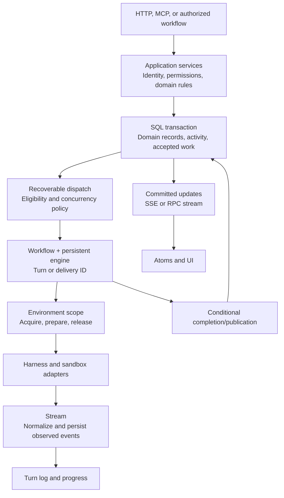

# Effect capability map for amends

This is a source-backed implementation proposal for the architecture in
[Core model](core-model.md). It recommends Effect APIs and explains what remains our
responsibility. It does not change the agreed domain model or describe the current amends
implementation.

## Recommendation

Use Effect across the application, including its unstable packages. Use its existing
execution, resource management, protocol, persistence, and testing machinery rather than
rebuilding those facilities. Keep the application meanings of turns, thread activity,
notifications, authorization, connections, and resources in our own contracts.

My recommended starting architecture is:

- Domain services built with `Context.Service`, `Layer`, `Effect`, and `Schema`.
- Authoritative domain records and atomic transitions through `SqlClient` and a driver
  whose transaction capabilities satisfy our invariants.
- `Workflow` and `Activity` for durable turn and channel-delivery execution, with
  `ClusterWorkflowEngine` as the first engine to validate. A persistent single-process
  Node/Bun host can use `SingleRunner` without deploying a multi-node cluster.
- `Scope`, `RcMap` or `LayerMap`, and scoped fibers for running environments and connections.
- `Stream` for harness and process output; bounded `Queue` for local work transfer;
  `PubSub` for live fan-out after committing authoritative activity.
- Effect AI for the Amends harness, and Effect MCP server components for the shared tool
  endpoint, with application authorization and upstream-client adapters added explicitly.
- Effect `Tool` and `Toolkit` as the executable tool definitions and handler implementation
  behind our stored workspace toolkit configurations.
- `HttpApi` for the public HTTP contract, RPC where typed streaming or internal runner
  communication warrants it, and atoms for the UI's queries and live state.
- Effect logging, tracing, metrics, deterministic tests, and schema/property tests throughout.

This is a selection proposal. Engine cancellation behavior, storage integration, and
per-turn MCP isolation need focused validation before the corresponding implementation is
considered complete.

## Review basis and versions

The local dependency catalog and vendored package both identify **4.0.0-rc.112**. The API
list supplied in the discussion identifies **4.0.0-rc.115**. I reviewed the local public
module inventory, `LLMS.md`, examples, and the implementations and tests most relevant to
our guarantees. The catalog at the end accounts for every namespace export in the local
core and unstable entry points, plus the additions in the supplied list.

The review goes deepest on workflows, queues, SQL transactions, cluster execution, AI
history, MCP, scoped resources, and event logs. Ordinary collection and type utilities
are grouped by use; this is not a claim to have audited every implementation line or run
the upstream conformance suites. Application implementation files were not used as design
evidence. Package metadata was checked only to establish the pinned version.

The newer release surface requires a deliberate version alignment before implementation:

- `rc.113` introduces `ByteSize`, native schema-based `Arbitrary`, network-address modules,
  and MIME lookup; removes MessagePack APIs; and changes persisted-queue retry and
  dead-letter handling. It also contains workflow, cache, AI-tool, and MCP fixes. These
  differences make a source review of `rc.112` insufficient proof of exact `rc.115`
  behavior. [Official rc.113 release](https://github.com/Effect-TS/effect/releases/tag/effect%404.0.0-rc.113)
- `rc.114` includes schema import/code-generation and published-type fixes.
  [Official rc.114 release](https://github.com/Effect-TS/effect/releases/tag/effect%404.0.0-rc.114)
- `rc.115` includes fixes to SQL persistence lookups and HTTP response handling.
  [Official rc.115 release](https://github.com/Effect-TS/effect/releases/tag/effect%404.0.0-rc.115)

I recommend aligning the package versions and vendored source to the selected target
release together before implementing this plan. This review does not update dependencies
or the subtree. The recommendations below distinguish architectural fit from exact
version-specific behavior.

## Capability decisions

| Area                                     | Selection                                                        | Use in amends                                                                                                                     |
| ---------------------------------------- | ---------------------------------------------------------------- | --------------------------------------------------------------------------------------------------------------------------------- |
| Effects, services, schemas               | Adopt                                                            | Domain operations, adapters, contracts, typed failures, runtime composition.                                                      |
| SQL                                      | Adopt with a suitable driver                                     | Atomic domain transitions, sequence checks, notification handoffs, delivery uniqueness, and audit records.                        |
| Workflow                                 | Adopt as the preferred durable execution abstraction             | Run and recover a turn or channel delivery using its existing domain ID.                                                          |
| Cluster workflow engine                  | Preferred first engine to validate                               | SQL-backed durable execution on a persistent Node/Bun host; start with `SingleRunner`.                                            |
| General cluster entities                 | Use where distribution or serialized coordination earns its cost | Addressable execution owners and distributed workers; avoid turning every record into an actor.                                   |
| Persisted queue                          | Use for independent durable jobs or dispatch where needed        | Simple background work without replayable multi-step state. Avoid a redundant second scheduler for the same turn.                 |
| Durable queue                            | Use selectively inside workflows                                 | Submit work to a worker and durably wait for its result.                                                                          |
| Scoped resources and keyed resource maps | Adopt                                                            | Runtime acquisition/release, connection clients, environment retention.                                                           |
| Streams, local queues, pub/sub           | Adopt                                                            | Provider events, logs, backpressure, UI broadcasts, and local coordination.                                                       |
| Effect AI                                | Adopt for the Amends harness                                     | Provider calls, typed prompts/responses, structured results, and tool definitions.                                                |
| Effect Tool and Toolkit                  | Adopt as runtime building blocks                                 | Build executable tools and typed handlers from workspace toolkit configuration, then expose them through the shared MCP endpoint. |
| Effect MCP                               | Adopt as protocol building blocks                                | Our one tool endpoint; add trusted authorization and per-turn tool selection.                                                     |
| EventLog                                 | Defer as an architectural dependency                             | Evaluate for replicated/offline event sourcing if that becomes a requirement. It is not a ready-made thread timeline.             |
| HTTP API                                 | Adopt                                                            | Schemas, handlers, clients, documentation, and HTTP-boundary authentication.                                                      |
| RPC                                      | Adopt selectively                                                | Cluster communication and typed streaming interfaces with a concrete need.                                                        |
| Reactivity and atoms                     | Adopt at the UI boundary                                         | Queries, mutations, live output, loading/error states, and invalidation.                                                          |
| Observability and testing                | Adopt                                                            | Operational diagnostics and verification of domain guarantees.                                                                    |

## 1. Domain services and authorization

Use `Context.Service` for the behavior a domain or adapter supplies and `Layer` for its
implementation and dependencies. Use `Effect.fn` for named operations and `Effect.gen`
for sequential workflows. Represent expected failures through typed errors and retain
the distinction between those errors, defects, and interruption in `Cause` and `Exit`.

Use `Schema.Struct` and tagged unions at input, persistence, and protocol boundaries;
branded schemas distinguish workspace, thread, turn, connection, and resource identifiers.
`Data.TaggedEnum` and `Match` fit internal decisions that do not require serialization.
The local Effect skill's record conventions take precedence over examples that default
to class-based records.

Trusted acting identity and execution context should be required services or explicit
inputs. They should not be `Context.Reference` values with a permissive default. Resolve
authentication at the HTTP, MCP, or other entry point, then invoke the same authorized
application operation. HTTP or RPC middleware supplies context; it does not replace our
permission rules, role assignments, target resolution, or grant-authority checks.

An agent remains the actor for its turn's operations. The requester is retained for audit
attribution, with no permission intersection. Required internal workflow steps retain the
authorization of the parent operation, as established for task/thread creation.

Effect provides the service and schema machinery for this. It does not provide the amends
membership model or a complete application role-policy engine. `HttpApiSecurity` describes
authentication schemes, and platform-browser `Permissions` concerns browser capabilities;
neither is our workspace permission system.

Sources: [Context](../repos/effect/packages/effect/src/Context.ts),
[Layer](../repos/effect/packages/effect/src/Layer.ts),
[Schema](../repos/effect/packages/effect/src/Schema.ts),
[HttpApiMiddleware](../repos/effect/packages/effect/src/unstable/httpapi/HttpApiMiddleware.ts).

## 2. Local concurrency, persistent jobs, and durable workflows

These APIs have different guarantees:

| API                              | What it does                                                                       | Durability and use                                                                 |
| -------------------------------- | ---------------------------------------------------------------------------------- | ---------------------------------------------------------------------------------- |
| `Queue`                          | Gives each queued value to one consumer; supports backpressure and completion.     | Process-local buffers and workers. It does not survive a process crash.            |
| `PubSub`                         | Broadcasts accepted values to active subscribers, with optional local replay.      | Live fan-out, not durable delivery or stored thread history.                       |
| `TxQueue` and other `Tx*` values | Commit changes to participating in-memory state together through `Effect.tx`.      | Coordinated local state. This is not a database transaction.                       |
| `PersistedQueue`                 | Encodes work into a backing store, deduplicates IDs, and handles processing/retry. | Durable when backed by suitable SQL/Redis storage; simple jobs.                    |
| `DurableQueue`                   | Offers persisted work and awaits a workflow durable deferred.                      | A workflow-to-worker request/result bridge. It waits for processing.               |
| `Workflow` / `Activity`          | Runs named steps, stores results through an engine, and replays completed results. | Multi-step execution, recovery, durable waits and timers with a persistent engine. |

`WorkflowEngine.layerMemory` is for tests and development. The abstract workflow definition
alone does not make execution durable. `ClusterWorkflowEngine` stores execution machinery
using persisted cluster messages; `SingleRunner` uses SQL-backed message storage even when
its runner registry is configured in memory.

### Turn and delivery execution

Use a workflow execution keyed by the already-created `turnId`, and another keyed by the
already-created channel-delivery ID. These are execution mechanisms for existing domains,
not new user-facing work records. Keep the turn's accepted/incorporated boundaries,
environment selection, status, and log authoritative in its domain storage.

The acceptance transaction records a turn or extends its accepted input and acknowledges
the notification together. A dispatcher then schedules eligible domain work and starts or
resumes its workflow. Created/pending domain records can supply the recoverable dispatch
source: a crash between commit and dispatch must not lose work. Deterministic workflow
execution IDs make repeated dispatch address the same attempt.

The Turn domain still owns creation-order scheduling, configured concurrency, eligibility,
and the one-active-turn-per-agent/thread rule. Workflow replay and cluster routing do not
automatically enforce those product policies. Use database constraints/transactions for
the durable rule and `Semaphore` for local capacity. `PartitionedSemaphore` is an option
if we decide to add fairness among competing groups.

Do not add an independent persisted queue for every workflow step. If simple jobs need a
queue, use `PersistedQueue` with an appropriate backend. If queue insertion must commit
with domain data, demonstrate that both operations participate in the same transaction or
dispatch from durable committed intent. An unrelated Redis queue and SQL transaction do
not become atomic because both return Effects.

The queue's processing acknowledgment is not an amends notification acknowledgment. Our
notification is already acknowledged when the turn or delivery accepts ownership, before
the execution engine starts processing.

### Activities and replay

Use activities for named steps with serializable results and an explicit recovery policy.
Use stable names for repeated logical steps, including the relevant input batch or operation
identity. A fresh loop iteration must not accidentally reuse an older activity result.

Persist IDs, snapshot references, and operation outcomes. Reacquire live clients, scopes,
process handles, and running environment interfaces when execution resumes; those cannot
be recovered by deserializing an activity result.

Workflow suspension can unwind ordinary scoped finalizers; the reviewed engine tests check
this behavior. A suspended workflow is not a completed amends turn. Keep terminal domain
updates separate from scope cleanup, and make reacquisition honor the environment's
retention and continuation contracts when the workflow resumes.

A workflow body can run again. Its durable result cache does not make an external action
exactly once: a provider can perform the action before the result is durably recorded.
Use the provider's idempotency mechanism or our existing reconciliation/uncertain-outcome
policy. The local `Activity.make` also retries interruption by default, so wrapping an
arbitrary side effect in an activity is not a safe retry policy by itself.

Use `DurableDeferred` for named external completions while a workflow needs to wait. It is
a one-shot result, not an inbox of arbitrary future messages. New accepted input still
lives in thread activity and turn progress. A wakeup can prompt the execution to reread
that state. Cross-agent request/result activity continues through the notification model;
we do not keep every requesting turn open by replacing it with `DurableQueue.process`.

Use `DurableClock` for workflow waits that must survive restarts. In the local source,
short waits default to an in-memory activity up to a threshold; choose that policy
deliberately rather than treating every call as a persistent alarm.

### Cancellation is domain behavior

Effect interruption stops cooperative local execution and runs finalizers. It does not
prove a remote harness, child process, or provider operation has stopped. Workflow
interruption is therefore one part of our cancellation sequence, not the terminal
cancelled-state transition itself.

Preserve the recorded cancellation request and completed effects, request termination
through the harness/environment contract, establish that the old execution can no longer
act, and only then permit a successor. Do not configure generic compensation to undo
resources or messages that our domain explicitly preserves after cancellation. Avoid
using `interruptUnsafe` as ordinary cancellation; its contract can bypass compensation
and orphan child work.

Sources: [Queue](../repos/effect/packages/effect/src/Queue.ts),
[Effect.tx](../repos/effect/packages/effect/src/Effect.ts),
[PersistedQueue](../repos/effect/packages/effect/src/unstable/persistence/PersistedQueue.ts),
[DurableQueue](../repos/effect/packages/effect/src/unstable/workflow/DurableQueue.ts),
[Workflow](../repos/effect/packages/effect/src/unstable/workflow/Workflow.ts),
[Activity](../repos/effect/packages/effect/src/unstable/workflow/Activity.ts),
[WorkflowEngine](../repos/effect/packages/effect/src/unstable/workflow/WorkflowEngine.ts),
[ClusterWorkflowEngine](../repos/effect/packages/effect/src/unstable/cluster/ClusterWorkflowEngine.ts),
[SingleRunner](../repos/effect/packages/effect/src/unstable/cluster/SingleRunner.ts),
[workflow tests](../repos/effect/packages/effect/test/cluster/ClusterWorkflowEngine.test.ts),
[persisted-queue tests](../repos/effect/packages/effect/test/unstable/persistence/PersistedQueueTest.ts).

## 3. Environment and connection lifetimes

Use `Scope` and `Effect.acquireRelease` for acquisition and release obligations. A turn's
scope releases its use of the environment; the environment's retention policy decides
whether the underlying runtime is kept or destroyed. Closing a scope must not silently
redefine release to mean deleting the sandbox.

Use one of these mechanisms for each resource family:

- `RcMap`: keyed running handles shared by scoped borrowers, with idle retention and
  optional capacity limits. This is a good default for environment handles or connection
  clients.
- `LayerMap`: the equivalent choice when each key produces a graph of services from a
  layer rather than one handle.
- `RcRef`: a single shared scoped resource.
- `Pool`: interchangeable resources that are borrowed with limited concurrency.
- `LayerRef`, `ScopedRef`, or `Resource`: refreshable service/value acquisition where that
  lifecycle actually matches credential or configuration refresh.

Avoid stacking several resource managers around the same handle without a reason. Cache
keys need the workspace/connection identity and relevant configuration identity; a provider
name alone cannot distinguish accounts. Reusing a handle also requires validating its
current configuration, history, and turn credentials, as the core model already requires.

Use `FiberMap` to track local turn-processing fibers, `FiberHandle` for one supervised
consumer, and `FiberSet` for a group of owned background fibers. A keyed FiberMap is only
process-local supervision. Its default replacement behavior interrupts an existing fiber;
use admission rules and the appropriate options so a new notification does not silently
replace the currently active turn.

An environment switch can use durable orchestration for preparation and recorded progress,
but the turn's atomic `environmentId` change and stored switch result remain the handoff
decision. The destination must support the pending tool-call continuation. Replaying a
workflow cannot create that harness capability. Its source/destination interfaces are
reacquired from recorded identities, not serialized as live handles.

`EntityResource` is worth considering for externally retained resources when using cluster
entities. Its close scope deliberately survives routine entity shutdown, with explicit
close/idle policy. It does not preserve a JavaScript handle across a dead process or
replace provider-managed filesystem snapshots.

Sources: [Scope](../repos/effect/packages/effect/src/Scope.ts),
[RcMap](../repos/effect/packages/effect/src/RcMap.ts),
[LayerMap](../repos/effect/packages/effect/src/LayerMap.ts),
[FiberMap](../repos/effect/packages/effect/src/FiberMap.ts),
[EntityResource](../repos/effect/packages/effect/src/unstable/cluster/EntityResource.ts).

## 4. Harness streams and the Amends AI implementation

Use `Stream` as the outward event contract for harness output, process output, and
environment events. Adapt callbacks with a bounded `Queue` or stream callback boundary;
decode framing with `Ndjson`, `Sse`, or a schema-aware channel as appropriate. Keep `Channel`
and `Pull` for low-level protocol adapters rather than making every service implement them.

Persist execution events as they are observed. Use `PubSub` to fan out live updates from
committed data, and `SubscriptionRef` for current runtime status plus updates. A subscriber
that reconnects must recover from durable sequence/cursor state; local PubSub replay is not
durable history. Do not drop canonical transcript events to make a slow UI appear current;
buffer, apply backpressure, or reconnect from stored history. Presentation-only updates
may be coalesced under an explicit policy.

For the Amends harness, use:

- `LanguageModel` for text, streaming, and schema-validated structured output.
- `Prompt` for ordered conversation input and tool results.
- `Response` for provider-normalized output parts, finish information, metadata, and usage.
- `Tool` / `Toolkit` for tool definitions and typed handler adapters.
- Provider packages for OpenAI, Anthropic, OpenAI-compatible services, and OpenRouter where
  the selected connection and provider capability support them.
- `AiError` for classified provider errors, `Telemetry` for model spans, and optional
  `Tokenizer` / `ResponseIdTracker` implementations where supported.

The AI modules are a foundation for our harness loop, not a complete replacement for turn
orchestration. Our harness owns additional input, truthful incorporation acknowledgment,
tool scheduling, continuation, and cancellation behavior. Its output still implements the
common harness contract used by the ACP and AI SDK adapters.

Prefer explicit `Prompt` state for that loop initially. `Chat` can be a local helper, but
must not become the authority for thread history, turn logs, or input progress. In the
local source, Chat serializes generation with a semaphore and updates stream history in
cleanup from accumulated response parts. Neither a changed Chat history nor a saved Chat
record proves that a complete response was produced or a pending input batch was handled.

`LanguageModel` can auto-resolve tool calls. For our controlled harness, start with explicit
resolution using `disableToolCallResolution` where needed, so the tool-call log, operation
identity, cancellation, and environment-switch result boundary remain under the harness's
control. Calls to platform tools must still use the shared MCP access path we selected.
Avoid supplying a second direct set of unrestricted platform handlers inside the harness.

`ExecutionPlan` is available for configured model retry/fallback strategies. Adopt it only
when the agent's policy explicitly permits the alternatives. It must not silently substitute
an incompatible model or replay a partially visible generation as if nothing happened.
Structured generation is useful for a triage consultation result; it is not needed to
rewrite the final assistant message, which our domain derives verbatim.

Sources: [LanguageModel](../repos/effect/packages/effect/src/unstable/ai/LanguageModel.ts),
[Prompt](../repos/effect/packages/effect/src/unstable/ai/Prompt.ts),
[Response](../repos/effect/packages/effect/src/unstable/ai/Response.ts),
[Chat](../repos/effect/packages/effect/src/unstable/ai/Chat.ts),
[ExecutionPlan](../repos/effect/packages/effect/src/ExecutionPlan.ts),
[AI examples](../repos/effect/ai-docs/src/71_ai/10_language-model.ts).

## 5. Shared MCP endpoint and external toolkits

Use `McpServer`, `McpSchema`, and `McpProtocol` rather than implementing the MCP wire
protocol from scratch. `registerToolkit` connects Effect tool definitions and handlers to
the server. `addTool` supports runtime registrations and custom result handling, useful for
upstream tools whose MCP content must be preserved rather than flattened into JSON text.

### Effect Toolkit implements our executable tool collections

Use Effect `Tool` and `Toolkit` directly for runtime definitions and handlers. Our workspace
records retain the user-selected connection, settings, enabled tools, and access rules.
Those records determine which executable tools to assemble; they do not need another
generic dispatcher, schema-handling framework, or handler dependency mechanism.

| API                                  | Responsibility                                                                           |
| ------------------------------------ | ---------------------------------------------------------------------------------------- |
| `Tool.make(...)`                     | Defines a tool's name, description, parameter/result schemas, and failure behavior.      |
| `Toolkit.make(...)`                  | Groups tool definitions into a typed collection.                                         |
| `toolkit.toLayer(...)`               | Supplies typed handlers and their Effect dependencies.                                   |
| `Toolkit.merge(...)`                 | Combines tool collections.                                                               |
| The resolved toolkit's `handle(...)` | Dispatches by name, decodes schema-backed inputs, runs the handler, and encodes results. |
| `McpServer.registerToolkit(...)`     | Registers the collection on the shared MCP server.                                       |

The distinction is configuration versus execution:

```text
Workspace toolkit configuration
  Connection, settings, enabled tools
          |
          v
Selected Effect Tool definitions + handler layer
          |
          v
Executable Effect Toolkit
          |
          v
Authorized tool view on our single MCP endpoint
```

Apply this according to the source of the tools:

- Internal handlers invoke our authorized application operations.
- A developer-provided external toolkit supplies reusable tool definitions and a handler
  layer. Its handlers use a client configured from the workspace connection.
- An external MCP adapter discovers the selected tools and forwards calls upstream. It can
  adapt those tools into Effect definitions where suitable, or use custom MCP registration
  when required to preserve rich result content.

Adding a connection still does not automatically create a workspace toolkit. Likewise,
constructing or merging an Effect Toolkit does not grant permission to use its tools.
Our application selects the authorized view and supplies trusted execution context.

Two execution details from the reviewed Toolkit implementation need deliberate handling:

- `Toolkit.merge` lets later definitions replace earlier tools with the same name. Detect
  or namespace collisions when combining configured toolkits so different connections do
  not silently acquire the same tool identity.
- Toolkit handlers can emit preliminary results. The reviewed `registerToolkit` adapter
  consumes the final result with `Sink.last`; preliminary output is not automatically
  forwarded as MCP progress or published as thread activity.

### MCP integration requirements

Two integration details require explicit design:

1. `EnabledWhen` in the reviewed source is a synchronous predicate over initialization
   information such as client capabilities and client metadata. That is not trusted
   workspace/agent/turn authorization. Authenticate the request, isolate or resolve its
   authorized tool view, and enforce the application permission check during invocation.
   Do not mutate one global tool list to represent whichever agent requested it last.
2. The reviewed HTTP layer provides a single POST endpoint and declares limits: no GET
   event stream, event resumption, session expiry, or client session termination. Verify
   the transport behavior each harness actually requires. A supported protocol version
   label does not imply every transport feature.

`registerToolkit` captures handler services when registered. Per-turn identity must be
supplied through a deliberately supported request context or isolated registration scope;
it must not accidentally become one long-lived captured actor shared by all clients.

The public AI module list contains an MCP server and schema/protocol machinery, not a
complete ready-made upstream connection manager with OAuth, refresh, discovery, and
reconnection policy. Implement the external MCP connection adapter using suitable client
machinery, potentially a maintained MCP client SDK at that adapter boundary. Its calls
still return Effects and Streams to the application. Verify rich-content passthrough,
pagination, cancellation, and provider authentication independently.

For dynamically discovered JSON Schemas, inspect `JsonSchema` and `SchemaRepresentation`
before writing a converter. They supply useful schema import/conversion machinery, but
unsupported upstream schema features must be reported rather than silently widened.

Sources: [Tool](../repos/effect/packages/effect/src/unstable/ai/Tool.ts),
[Toolkit](../repos/effect/packages/effect/src/unstable/ai/Toolkit.ts),
[McpServer](../repos/effect/packages/effect/src/unstable/ai/McpServer.ts),
[EnabledWhen and client context](../repos/effect/packages/effect/src/unstable/ai/McpSchema.ts),
[McpProtocol](../repos/effect/packages/effect/src/unstable/ai/McpProtocol.ts),
[MCP conformance tests](../repos/effect/packages/effect/test/unstable/ai/McpServer/McpConformance/ToolsTest.ts),
[SchemaRepresentation](../repos/effect/packages/effect/src/SchemaRepresentation.ts).

## 6. Persistence, ordering, and event logs

Use `SqlClient.withTransaction` for domain commits that must happen together. Important
cases include task creation with its thread/activity, turn acceptance with notification
acknowledgment, delivery creation/reuse with notification acknowledgment, and conditional
response publication with turn completion. SQL constraints and conditional updates enforce
sequence expectations and uniqueness; an in-memory lock is insufficient across processes.

Use `SqlSchema` to decode query results and `Migrator` for storage setup. `SqlResolver`
fits real batch lookups such as loading several referenced timeline subjects. `SqlModel`
and the unstable schema `Model`/`VariantSchema` can derive conventional row repositories
and variants, but should not turn every domain into generic CRUD. Prefer explicit commands
for transitions with several records, permission checks, and conditional publication.

### Driver capabilities are part of the choice

- The reviewed D1 driver explicitly does not support `SqlClient` transactions. Its batch
  facility is not an arbitrary replacement for an interactive read/check/write transaction.
- The Durable Object SQLite driver supports its transaction wrapper when given the full
  storage object, with documented restrictions including nested transactions.
- A persistent Node/Bun host can select a SQLite or PostgreSQL driver and validate the
  concurrency/isolation behavior needed by our domain transitions.

An environment's sandbox provider does not decide where the amends control plane must run.
A Docker or cloud sandbox can be orchestrated by a persistent Node/Bun process. Hosting the
control plane in a Durable Object is a separate choice requiring host-specific lifecycle
and wakeup integration; a local Effect fiber alone does not survive host eviction.

### Why I would not select EventLog as the default thread store yet

Effect's `EventLog` is a typed event-handling and replication system. Its SQL journal can
wrap handlers and journal writes in a transaction, so it is a serious candidate if we
choose a replicated event-sourced architecture.

However, the reviewed journal orders local entries by timestamp and tracks remote
replication sequences. It does not directly supply our conditional append against a
thread's expected sequence, our input boundaries, or our participant/notification rules.
Its remote replay and conflict-handler model also introduces decisions beyond an ordered
thread timeline.

My current recommendation is to implement the agreed durable records and transitions
through SQL services, and use a committed timeline/turn log for replay to clients. Revisit
`EventLog` if offline writers or replicated projections become a deliberate requirement.
Even then, the application must implement its per-thread sequence and consistency rules.

Publish live notifications after the authoritative transaction commits, or derive them
from durable committed activity. A PubSub emission or reactive invalidation inside a
transaction does not establish that the transaction subsequently committed.

Sources: [SqlClient](../repos/effect/packages/effect/src/unstable/sql/SqlClient.ts),
[SqlSchema](../repos/effect/packages/effect/src/unstable/sql/SqlSchema.ts),
[D1 driver](../repos/effect/packages/sql/d1/src/D1Client.ts),
[Durable Object SQLite driver](../repos/effect/packages/sql/sqlite-do/src/SqliteClient.ts),
[EventLog](../repos/effect/packages/effect/src/unstable/eventlog/EventLog.ts),
[SqlEventJournal](../repos/effect/packages/effect/src/unstable/eventlog/SqlEventJournal.ts).

## 7. HTTP, RPC, UI, and platform integration

Use `HttpApi`, endpoint/group definitions, `HttpApiBuilder`, and generated clients for the
public API. They share schema contracts, typed errors, middleware, and OpenAPI generation.
Use HTTP middleware for authentication and service context, then call application services
that enforce the domain action's authorization. The same service path serves MCP tools.

For live thread/turn output, start with a cursor-based HTTP/SSE contract if one-way updates
are sufficient. Use RPC streaming when its bidirectional or internal typed-call behavior
is useful. Do not publish parallel HTTP and RPC implementations of every application
operation merely because both generators exist. Cluster can use RPC internally regardless
of the public API choice.

Use `AtomHttpApi` for HTTP-backed UI data and `AtomRpc` if the corresponding UI service
uses RPC. `Atom`, `AtomRegistry`, `AsyncResult`, `AtomRef`, and hydration helpers support
state lifetimes, loading/error states, cached queries, mutations, and streams. Bindings
exist for React, Solid, and Vue; select the actual UI framework's package. `Reactivity`
coordinates local invalidation; it is not a distributed change-delivery service.

Use `ChildProcess`/`ChildProcessSpawner`, `Stdio`, `FileSystem`, `Path`, and platform
adapters for local harness launch and transport. `Socket` covers bidirectional network
connections; `workers` and `RpcWorker` cover worker-thread/Web Worker execution when
needed. None of these APIs by itself provides a secure sandbox or a filesystem snapshot.
Provider adapters still own those capabilities.

Use `HttpClient`/`FetchHttpClient` and schema decoding for external APIs. `RateLimiter`
can coordinate provider budgets through its storage backend; use keys reflecting the
actual account/budget. `Schedule` controls bounded retries, polling, and backoff. `Cron`
describes calendar recurrence, and `ClusterCron` can coordinate distributed recurring
maintenance. These are separate from the task/turn eligibility policy.

Use `Config` for host configuration, and workspace records for user-configured connection
and agent values. `Redacted` helps avoid accidental secret output but is not encryption or
a secret store. `Crypto` supplies cryptographic primitives; it is not an authorization
policy or credential-management lifecycle.

Sources: [HTTP API example](../repos/effect/ai-docs/src/51_http-server/10_basics.ts),
[Rpc](../repos/effect/packages/effect/src/unstable/rpc/Rpc.ts),
[AtomHttpApi](../repos/effect/packages/effect/src/unstable/reactivity/AtomHttpApi.ts),
[Reactivity](../repos/effect/packages/effect/src/unstable/reactivity/Reactivity.ts),
[ChildProcessSpawner](../repos/effect/packages/effect/src/unstable/process/ChildProcessSpawner.ts),
[RateLimiter](../repos/effect/packages/effect/src/unstable/persistence/RateLimiter.ts).

## 8. Observability and verification

Use `Effect.fn` spans, `Logger`, `Metric`, and `Tracer`, with the unstable OTLP exporters
or the OpenTelemetry package when integrating into an existing OTel setup. Useful
measurements include waiting turns, execution latency, accepted-versus-incorporated lag,
publication conflicts, queue attempts, cancellation duration, and uncertain deliveries.
Use `ErrorReporter` for surfaced failures and `DevTools` during development.

Operational telemetry is separate from the authoritative audit records and turn log.
Sampled or transient traces cannot establish durable permission or delivery history.

Use `@effect/vitest`, `TestClock`, `Deferred`, `Latch`, and test layers for deterministic
execution tests. Use `HttpApiTest` and `RpcTest` for transport/schema behavior without
opening a real network listener. Use schema round-trip and property tests for the
sequence-boundary invariants and encoded transcript data. The local pin provides
`FastCheck`/`TestSchema`; evaluate the newer native `Arbitrary` API after version alignment.

Before committing to the high-level execution implementation, prove these cases:

1. A notification and turn acceptance commit together; a crash before dispatch does not
   lose accepted work, and repeated dispatch does not create another attempt.
2. Input accepted during processing is submitted in a named batch; confirming an earlier
   batch cannot advance incorporation through later input.
3. Recovery restores or explicitly rejects missing harness/filesystem state rather than
   inventing successful continuation from a workflow checkpoint.
4. An environment switch preserves the pending tool call, commits the destination and
   successful result together, and recovers on the recorded side of the handoff.
5. Cancellation keeps a successor waiting until the prior execution is stopped or fenced
   from acting; completed work remains recorded.
6. Publication races with new relevant input and with informational activity follow the
   distinct rules in the core model, including successful completion without a message.
7. Two contacts request one delivery; an ambiguous external send follows provider-specific
   recovery instead of a generic queue retry duplicating it.
8. Two agents using one MCP URL see different authorized tools and cannot invoke hidden
   operations by guessing names or claiming another actor in client metadata.
9. Resource/connection scope cleanup follows release and retention policy; cache invalidation
   does not change acting identity or cross workspace/account boundaries.
10. SQL rollback tests verify actual driver behavior for every transaction relied on above.

These are recommended implementation checks. This research pass read upstream tests but
did not run builds, install dependencies, or execute tests inside the vendored repository.

## 9. Proposed execution flow



This flow has several logs with different jobs: domain/thread activity, the turn transcript,
and workflow-engine execution records. An engine's private messages are not automatically
thread activity or user notifications. The diagram is an implementation proposal, not a
new package layout.

## 10. Similar names that must retain different meanings

| Effect API                                 | Distinction in amends                                                                                               |
| ------------------------------------------ | ------------------------------------------------------------------------------------------------------------------- |
| `Context`                                  | A typed service map, not our running Environment.                                                                   |
| Core `Channel`                             | A low-level streaming primitive, not an external communication Channel.                                             |
| Core `Resource` / cluster `EntityResource` | Runtime acquisition/lifetime helpers, not persisted amends artifacts.                                               |
| Workflow `Activity`                        | A replayable execution step, not a thread timeline activity.                                                        |
| AI `Chat`                                  | Mutable harness-local conversation state, not our Thread or a new domain Session.                                   |
| AI `Toolkit`                               | Runtime tool definitions/handlers, not the complete workspace toolkit configuration and grants.                     |
| AI `Model`                                 | Provider/model layer metadata; schema `Model` describes database/JSON variants. Neither chooses an agent's account. |
| Cluster `Entity`                           | An addressable execution unit; ordinary in-memory state still needs persistence.                                    |
| Cluster `Message` and MCP notifications    | Protocol machinery, not automatically thread messages or amends notifications.                                      |
| `Effect.tx`                                | Atomic transactional memory, not SQL durability or external side-effect rollback.                                   |
| `Schedule` / runtime `Scheduler`           | Retry/repetition policy / fiber execution scheduling, not the domain's durable turn scheduler.                      |

## 11. Adoption order

1. Align the selected Effect version and vendored source; retain this review's version
   distinctions when updating API usage.
2. Establish schemas, domain services, trusted identity, authorization, and SQL transaction
   contracts. Prove notification acceptance and conditional publication atomically.
3. Validate `Workflow` with `ClusterWorkflowEngine` and `SingleRunner` against real persistent
   storage for recovery and cancellation. Keep domain state separate from engine records.
4. Implement environment acquisition/release and one harness end to end, including input
   acknowledgment, transcript persistence, and a supported continuation boundary.
5. Build reusable Effect Tool/Toolkit definitions and handler layers, then expose the
   configured tool collections through the central MCP endpoint with per-turn authorization.
   Add upstream connection adapters. Use Effect AI behind the Amends harness contract.
6. Add public API/UI live streams and atoms, observability, and driver/adapter conformance.
7. Add multi-runner clustering, replicated EventLog, embeddings, worker pools, or advanced
   schema tooling when a concrete requirement calls for them.

The major deployment choice still needed is the control-plane host and durable database.
It determines which engine/storage layers can be used directly. It does not change the
application meanings of turns, environments, notifications, or permissions.

## 12. Complete public module inventory

The following catalog is grouped by namespace so repeated names such as `Model`, `Prompt`,
and `Utils` remain distinguishable. A namespace being available does not mean every helper
needs a direct application import. The recommendations above select responsibilities;
the catalog ensures the rest of the supplied surface has not been mistaken for missing
infrastructure.

### Core exports (`effect`)

#### Effect and service foundations

`Effect`, `Context`, `Layer`, `ManagedRuntime`, `Scope`, `Cause`, `Exit`.

Adopt for domain services, typed execution, failure handling, and runtime composition.

#### Runtime resource lifetimes

`Resource`, `RcRef`, `RcMap`, `Pool`, `ScopedCache`, `ScopedRef`, `LayerMap`, `LayerRef`.

Choose the appropriate acquisition/lifetime mechanism per resource family; do not layer every alternative together.

#### Local concurrency and state

`Fiber`, `FiberHandle`, `FiberMap`, `FiberSet`, `Semaphore`, `PartitionedSemaphore`, `Ref`, `SynchronizedRef`, `Deferred`, `Latch`.

Use for in-process supervision and coordination; durable admission and ownership still require storage.

#### Streaming and local delivery

`Stream`, `Sink`, `Queue`, `PubSub`, `Channel`, `ChannelSchema`, `Pull`, `Take`, `SubscriptionRef`.

Use streams and bounded buffers; keep low-level channel/pull machinery in adapters.

#### Transactional memory

`TxChunk`, `TxDeferred`, `TxHashMap`, `TxHashSet`, `TxPriorityQueue`, `TxPubSub`, `TxQueue`, `TxReentrantLock`, `TxRef`, `TxSemaphore`, `TxSubscriptionRef`.

Use selectively for coordinated local state and test implementations; not a persistence substitute.

#### Schemas and domain data

`Schema`, `SchemaAST`, `SchemaGetter`, `SchemaIssue`, `SchemaParser`, `SchemaRepresentation`, `SchemaTransformation`, `JsonSchema`, `StandardSchema`, `Brand`, `Newtype`, `Data`, `Match`.

Adopt high-level schemas and domain values; use compiler/AST APIs only for concrete schema-adapter needs.

#### Caching, requests, and execution plans

`Cache`, `Request`, `RequestResolver`, `PrimaryKey`, `ExecutionPlan`.

Use caches and actual backend batching; keep fallback plans subject to the explicit model policy.

#### Configuration, time, and sensitive values

`Config`, `ConfigProvider`, `Clock`, `DateTime`, `Duration`, `Schedule`, `Scheduler`, `Cron`, `Crypto`, `Random`, `Redacted`, `Redactable`.

Use configuration and testable time; leave runtime Scheduler internals alone unless an adapter requires them.

#### Diagnostics

`Logger`, `LogLevel`, `Metric`, `Tracer`, `ErrorReporter`, `Console`.

Use structured operational telemetry; persist audit data separately.

#### Platform contracts

`FileSystem`, `Path`, `Stdio`, `Terminal`, `PlatformError`, `Runtime`.

Use through host/provider layers; these interfaces alone do not create sandboxes.

#### Collections, values, algorithms, and library protocols

`Array`, `BigDecimal`, `BigInt`, `Boolean`, `Chunk`, `Combiner`, `Differ`, `Effectable`, `Encoding`, `Equal`, `Equivalence`, `Filter`, `Formatter`, `Function`, `Graph`, `Hash`, `HashMap`, `HashRing`, `HashSet`, `HKT`, `Inspectable`, `Iterable`, `JsonPatch`, `JsonPointer`, `MutableHashMap`, `MutableHashSet`, `MutableList`, `MutableRef`, `NonEmptyIterable`, `Number`, `Optic`, `Option`, `Order`, `Ordering`, `Pipeable`, `Predicate`, `Record`, `Reducer`, `References`, `RegExp`, `Result`, `String`, `Struct`, `Symbol`, `Trie`, `Tuple`, `Types`, `UndefinedOr`, `Unify`, `Utils`.

Use standard collections and value helpers where they simplify actual work. `Graph`, `Trie`,
`HashRing`, `Optic`, and patch/combiner utilities need a matching use case; they do not
automatically become task orchestration or access policy. Type-level and custom-value
protocols are mostly supporting infrastructure, not new application subsystems.

Source: [core export index](../repos/effect/packages/effect/src/index.ts).

### Unstable namespace exports

#### `effect/unstable/ai`

`AiError`, `AnthropicStructuredOutput`, `Chat`, `EmbeddingModel`, `IdGenerator`, `LanguageModel`, `McpProtocol`, `McpSchema`, `McpServer`, `Model`, `OpenAiStructuredOutput`, `Prompt`, `Response`, `ResponseIdTracker`, `Telemetry`, `Tokenizer`, `Tool`, `Toolkit`.

Adopt provider/model, prompt/response, tool, and MCP building blocks. Chat persistence is optional harness-local machinery; embeddings and tokenizer-driven context policies are separate features.

Source: [ai export index](../repos/effect/packages/effect/src/unstable/ai/index.ts).

#### `effect/unstable/cli`

`Argument`, `CliConfig`, `CliError`, `CliOutput`, `Command`, `Completions`, `Flag`, `GlobalFlag`, `HelpDoc`, `Param`, `Primitive`, `Prompt`.

Use Command, Flag, Argument, and Prompt for developer/admin CLIs when exposed. Parsing, help, and completion helpers support that implementation.

Source: [cli export index](../repos/effect/packages/effect/src/unstable/cli/index.ts).

#### `effect/unstable/cluster`

`ClusterCron`, `ClusterError`, `ClusterMetrics`, `ClusterSchema`, `ClusterWorkflowEngine`, `DeliverAt`, `Entity`, `EntityAddress`, `EntityId`, `EntityProxy`, `EntityProxyServer`, `EntityResource`, `EntityType`, `Envelope`, `HttpRunner`, `K8sHttpClient`, `K8sTypes`, `MachineId`, `Message`, `MessageStorage`, `Reply`, `Runner`, `RunnerAddress`, `RunnerHealth`, `Runners`, `RunnerServer`, `RunnerStorage`, `ShardId`, `Sharding`, `ShardingConfig`, `ShardingRegistrationEvent`, `SingleRunner`, `Singleton`, `SingletonAddress`, `Snowflake`, `SocketRunner`, `SqlMessageStorage`, `SqlRunnerStorage`, `TestRunner`.

Use ClusterWorkflowEngine and a suitable runner/storage host for durable workflows. General entities, proxies, multi-runner transports, Kubernetes integration, and distributed cron remain conditional on deployment needs. MessageStorage and RunnerStorage have different responsibilities.

Source: [cluster export index](../repos/effect/packages/effect/src/unstable/cluster/index.ts).

#### `effect/unstable/devtools`

`DevTools`, `DevToolsClient`, `DevToolsSchema`, `DevToolsServer`.

Development diagnostics; no role as a durable turn log or audit store.

Source: [devtools export index](../repos/effect/packages/effect/src/unstable/devtools/index.ts).

#### `effect/unstable/encoding`

`Ini`, `Msgpack`, `Ndjson`, `SchemaBinary`, `Sse`, `Toml`, `Yaml`.

Use SSE/NDJSON for appropriate streams and consider SchemaBinary for binary contracts. Msgpack exists in the local pin but is removed before the supplied rc.115 surface; do not select it for new target-version work.

Source: [encoding export index](../repos/effect/packages/effect/src/unstable/encoding/index.ts).

#### `effect/unstable/eventlog`

`Event`, `EventGroup`, `EventJournal`, `EventLog`, `EventLogEncryption`, `EventLogMessage`, `EventLogRemote`, `EventLogServer`, `EventLogServerEncrypted`, `EventLogServerUnencrypted`, `EventLogSessionAuth`, `SqlEventJournal`, `SqlEventLogServerEncrypted`, `SqlEventLogServerUnencrypted`.

Evaluate as a complete replicated event-handling architecture if required. The journal, remote protocol, session authentication, and encrypted/plaintext servers are not automatic replacements for application timeline, membership, or authorization.

Source: [eventlog export index](../repos/effect/packages/effect/src/unstable/eventlog/index.ts).

#### `effect/unstable/http`

`Cookies`, `Etag`, `FetchHttpClient`, `FindMyWay`, `Headers`, `HttpBody`, `HttpClient`, `HttpClientError`, `HttpClientRequest`, `HttpClientResponse`, `HttpEffect`, `HttpIncomingMessage`, `HttpMethod`, `HttpMiddleware`, `HttpPlatform`, `HttpRouter`, `HttpServer`, `HttpServerError`, `HttpServerRequest`, `HttpServerRespondable`, `HttpServerResponse`, `HttpStaticServer`, `HttpStatus`, `HttpTraceContext`, `Multipart`, `MultipartParser`, `Template`, `Url`, `UrlParams`.

Adopt clients, routers, requests/responses, and selected body/stream helpers in transport adapters. Low-level routing and multipart machinery should generally remain behind higher-level APIs.

Source: [http export index](../repos/effect/packages/effect/src/unstable/http/index.ts).

#### `effect/unstable/httpapi`

`HttpApi`, `HttpApiBuilder`, `HttpApiClient`, `HttpApiEndpoint`, `HttpApiError`, `HttpApiGroup`, `HttpApiMiddleware`, `HttpApiScalar`, `HttpApiSchema`, `HttpApiSecurity`, `HttpApiSwagger`, `HttpApiTest`, `OpenApi`.

Adopt schema-based public contracts, generated clients, middleware, documentation, and in-memory API tests. Select one documentation renderer if a browser documentation page is needed.

Source: [httpapi export index](../repos/effect/packages/effect/src/unstable/httpapi/index.ts).

#### `effect/unstable/observability`

`Otlp`, `OtlpExporter`, `OtlpLogger`, `OtlpMetrics`, `OtlpResource`, `OtlpSerialization`, `OtlpTracer`, `PrometheusMetrics`.

Use OTLP exporter layers or the OpenTelemetry integration appropriate to the host. Prometheus is an alternative metrics presentation; exporters are not business persistence.

Source: [observability export index](../repos/effect/packages/effect/src/unstable/observability/index.ts).

#### `effect/unstable/persistence`

`KeyValueStore`, `Persistable`, `PersistedCache`, `PersistedQueue`, `Persistence`, `RateLimiter`, `Redis`.

Use PersistedQueue for simple durable jobs, RateLimiter for account/provider pacing, and key/value or persisted-cache helpers for suitable data. Cache result persistence is not a guarantee that a side effect executes only once.

Source: [persistence export index](../repos/effect/packages/effect/src/unstable/persistence/index.ts).

#### `effect/unstable/process`

`ChildProcess`, `ChildProcessSpawner`.

Adopt in local process-capable adapters. Remote sandbox providers still supply their own command implementation and lifecycle guarantees.

Source: [process export index](../repos/effect/packages/effect/src/unstable/process/index.ts).

#### `effect/unstable/reactivity`

`AsyncResult`, `Atom`, `AtomHttpApi`, `AtomRef`, `AtomRegistry`, `AtomRpc`, `Hydration`, `Reactivity`.

Adopt the UI state/query family with the actual transport and framework. Local invalidation does not replace cross-process event delivery.

Source: [reactivity export index](../repos/effect/packages/effect/src/unstable/reactivity/index.ts).

#### `effect/unstable/rpc`

`Rpc`, `RpcClient`, `RpcClientError`, `RpcGroup`, `RpcMessage`, `RpcMiddleware`, `RpcSchema`, `RpcSerialization`, `RpcServer`, `RpcTest`, `RpcWorker`, `Utils`.

Use for cluster transport and deliberately selected typed streaming/internal interfaces. Middleware supplies trusted context; domain permission checks remain in shared application operations.

Source: [rpc export index](../repos/effect/packages/effect/src/unstable/rpc/index.ts).

#### `effect/unstable/schema`

`Model`, `VariantSchema`.

Optional derived database/JSON variants. Avoid coupling all domain behavior to generated row CRUD.

Source: [schema export index](../repos/effect/packages/effect/src/unstable/schema/index.ts).

#### `effect/unstable/socket`

`Socket`, `SocketServer`.

Use for harness/provider connections and RPC transports where needed.

Source: [socket export index](../repos/effect/packages/effect/src/unstable/socket/index.ts).

#### `effect/unstable/sql`

`Migrator`, `SqlClient`, `SqlConnection`, `SqlError`, `SqlModel`, `SqlResolver`, `SqlSchema`, `SqlStream`, `Statement`.

Adopt SqlClient, SqlSchema, and migrations; use resolvers/streaming/repositories where the query and driver support them.

Source: [sql export index](../repos/effect/packages/effect/src/unstable/sql/index.ts).

#### `effect/unstable/workers`

`Transferable`, `Worker`, `WorkerError`, `WorkerRunner`.

Optional CPU or platform worker execution. A worker is not a durable workflow, distributed runner, or security sandbox.

Source: [workers export index](../repos/effect/packages/effect/src/unstable/workers/index.ts).

#### `effect/unstable/workflow`

`Activity`, `DurableClock`, `DurableDeferred`, `DurableQueue`, `Workflow`, `WorkflowEngine`, `WorkflowProxy`, `WorkflowProxyServer`.

Preferred durable execution abstraction for turns and deliveries. Use Activities, durable waits, and worker handoffs only at meaningful recoverable boundaries. Proxy-generated APIs still need application authorization.

Source: [workflow export index](../repos/effect/packages/effect/src/unstable/workflow/index.ts).

### Testing, runtime packages, and newer additions

- **Testing:** `@effect/vitest` and `effect/testing` (`TestClock`, `TestConsole`,
  `TestSchema`, `FastCheck`) supply Effect-aware tests and deterministic services.
- **Platform packages:** Node, Bun, browser, and Deno layers implement applicable host
  services. Choose the host; do not assume every platform exposes every service.
- **SQL drivers:** the vendored set covers PostgreSQL, MySQL, MSSQL, ClickHouse, libSQL,
  PGlite, D1, and SQLite variants for Node, Bun, Durable Objects, WASM, and React Native.
  Similar driver interfaces do not establish identical transaction or streaming support.
- **AI providers:** the vendored packages cover OpenAI, Anthropic, OpenAI-compatible APIs,
  and OpenRouter. Configure them from the selected workspace connection.
- **UI bindings:** `@effect/atom-react`, `@effect/atom-solid`, and `@effect/atom-vue`; use
  the binding matching the UI.
- **OpenTelemetry:** `@effect/opentelemetry` is available when integrating an existing OTel
  SDK; the built-in OTLP layers are also available.
- **Low-level HTTP parser helpers in the supplied list:** `MultipartParser/HeadersParser`
  and `MultipartParser/Search` support parsing internals; prefer the public Multipart API
  unless building a transport adapter that specifically needs those helpers.

The additional names in the supplied `rc.115` list are `ByteSize`,
`unstable/arbitrary/Arbitrary`, `unstable/http/Mime`, and `unstable/net`
(`IpInterface`, `IpNetwork`, `NetAddress`). Candidate uses are typed byte limits, generated
property-test inputs, attachment MIME lookup, and network-address validation respectively.
They are not present in the local pin and were checked at the release-documentation level,
not through local implementation tests. Validate their exact APIs after source alignment.
See the [official rc.113 additions](https://github.com/Effect-TS/effect/releases/tag/effect%404.0.0-rc.113)
and [rc.115 package exports](https://raw.githubusercontent.com/Effect-TS/effect/effect%404.0.0-rc.115/packages/effect/package.json).
