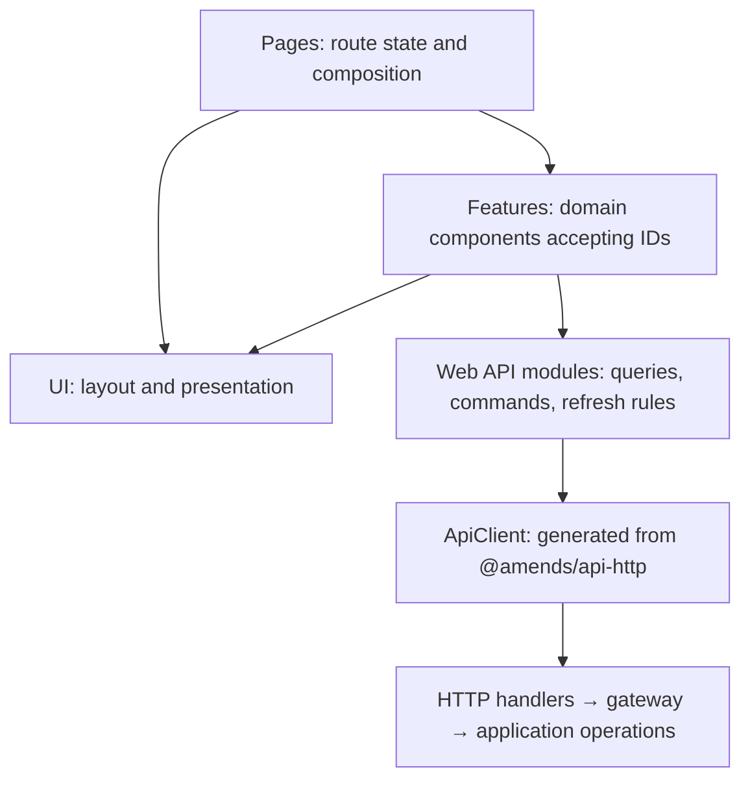

# Web architecture proposal

Status: historical, previously accepted and implemented in the former web app.
That implementation and the legacy `ui` package were removed during the web/desktop
bootstrap reset. The current `apps/ui` package is the renamed shared workshop and
does not restore the historical interfaces described below. This document preserves the earlier design rationale and audit;
its source paths and examples describe that removed implementation, not current
app behavior. See [web](../apps/web/README.md), [desktop](../apps/desktop/README.md),
and [UI](../apps/ui/README.md) for current boundaries.

Backend workspace and live-change operations remain implemented; see
[workspace workflows](workspace-workflows.md) and [known limitations](current-status.md).
Turn and thread APIs below remain proposed HTTP work.

## Intended result

A feature should be usable by supplying its domain identity:

```tsx
<TurnLog turnId={turnId} />
<MemberDetails memberId={memberId} />
```

The component obtains the workspace from its nearest workspace boundary and shares data
through the current atom registry. It owns loading, failures, refresh, and any subscription
it requires. It does not require a particular page, navigation shell, or URL. Pages decide
placement; components decide how to present their domain; API modules decide how data is
requested and refreshed.

Keep Solid, `@amends/ui`, `HttpApi`, `AtomHttpApi`, and `@effect/atom-solid`. The missing
pieces are explicit ownership and lifecycle conventions around these tools.

There is one shell implementation in UI. Each page or nested route composes its parts.
Page folders name the domain they serve: sign-in belongs to `session`, and workspace
selection, access explanations, and workspace settings belong to `workspaces`. `entry`
is not a domain, page family, component, or shell variant in the proposed structure.

## Findings before the refactor

| Area            | Finding                                                                                                                                 | Consequence                                                                       |
| --------------- | --------------------------------------------------------------------------------------------------------------------------------------- | --------------------------------------------------------------------------------- |
| HTTP contract   | `session`, `me`, `workspaces`, `members`, and `invitations` already have named operations, shared schemas, and matching server modules. | Extend this vocabulary into the web app.                                          |
| Client          | `src/api/client.ts` already generates typed queries and mutations and supplies bearer authentication.                                   | Keep this transport boundary.                                                     |
| Settings        | The 531-line page owns routing, query construction, invalidation, member rendering, removal, invitation creation, and layout.           | Extract reusable features and data modules, leaving page composition in the page. |
| Workspace shell | Membership resolution, redirects, workspace context, account actions, navigation, header registration, and layout share one module.     | Separate access resolution from visual layout.                                    |
| Header          | `usePageHeader` installs a function into ancestor context and clears it on cleanup.                                                     | Render the page header in the page's JSX instead.                                 |
| UI layouts      | `DetailLayout`, `MasterDetail`, `FormColumns`, and `InspectorLayout` already implement useful responsive behavior.                      | Preserve these patterns and their tests.                                          |
| Verification    | Web tests cover sign-in; UI tests cover many controls, layouts, focus behaviors, and logs.                                              | Add web data-lifecycle coverage before treating the architecture as established.  |

Former source locations (available in Git history): `apps/web/src/api/client.ts`,
`apps/web/src/pages/workspaces/settings.tsx`, `apps/web/src/pages/workspaces/layout.tsx`,
`apps/ui/src/components/shell.tsx`, and `apps/web/test/sign-in.test.tsx`.
The [HTTP contract](../packages/api-http/README.md) remains current.

The refactor addressed these concrete correctness issues in the former implementation:

- The workspace resolver sends every failed directory lookup to `ClosedWorkspace`.
  An expired credential, a network failure, and an ended membership need different outcomes.
- Member removal invalidates `members` and `me`, but core also revokes the removed human's
  pending invitations. An already loaded invitation list can remain stale.
- Invalidation strings such as `members` and `invitations` cover every workspace in the
  registry. Query identity includes request parameters, so this is overly broad refresh,
  not evidence that workspace responses share a cache entry.
- `ApiClient.mutation(group, operation)` shares one atom per endpoint and response mode.
  Reusable controls using the same operation would share pending/error state. A later
  write can interrupt an earlier request. Creating another hook does not isolate it.
- Settings turns the initial member result into an empty array and displays zero counts
  without a loading state. The invitation error branch labels every typed failure as a
  missing permission, even when the cause is different.

The removal behavior is explicit in
[MemberApplication](../packages/core/src/workspace/member/application.ts).
The atom findings were checked against installed Effect `4.0.0-rc.115` and the matching
vendored source. Small local probes confirmed shared query/mutation identity and that a
second write to a default function atom interrupts the first execution. No server requests
were made by these probes.

## Use the mocks as composition references

The [design-system mocks](../design-system/) show recurring structures worth keeping:

| Reference                                                                                                                                                 | Reusable structure                                                                                 |
| --------------------------------------------------------------------------------------------------------------------------------------------------------- | -------------------------------------------------------------------------------------------------- |
| [Shell](../design-system/Amends%20Shell%20v2.dc.html)                                                                                                     | Sidebar, compact rail, mobile navigation, header, content, and optional inspector.                 |
| [Sign in](../design-system/Amends%20Screen%20%C2%B7%20Sign%20in.dc.html) and [First run](../design-system/Amends%20Screen%20%C2%B7%20First%20run.dc.html) | Header and footer around a constrained reading column.                                             |
| [Settings](../design-system/Amends%20Screen%20%C2%B7%20Settings.dc.html)                                                                                  | Collection with selected detail; form beside related history.                                      |
| [Task detail](../design-system/Amends%20Screen%20%C2%B7%20Task%20detail.dc.html)                                                                          | Companion content panels and contextual detail.                                                    |
| [Session](../design-system/Amends%20Screen%20%C2%B7%20Session.dc.html)                                                                                    | Execution log beside execution details; oldest first, follow latest until the reader scrolls away. |

These are rough product references, not authoritative schemas. In particular:

- The execution screen called **Session** maps to **Turn** in the current core model.
  Reserve `Session` in web code for the existing sign-in session contract.
- Preserve the log's distinction between a failed tool call and a failed turn, and between
  unavailable usage/cost and a recorded zero.
- Revisit the mocks' task/attempt/session status combinations and permission tiers against
  the current domain model before implementing them.
- Thread activity must arrive in the server's thread sequence. The former UI README
  recommended assembling separate collections using timestamps and journal tie-breaking.
  The refactor replaces that guidance with the newer core model.

See [turn ownership](core-model.md#agreed-a-turn-is-an-attempt-on-a-thread) and
[thread activity](core-model.md#agreed-the-thread-timeline-records-typed-activity).

## Four responsibilities



### UI components

`apps/ui` owns visual primitives, layout, accessibility, and interaction mechanics. It
does not load domain data, inspect routes, or know credentials. Existing `LogList`,
`LogRow`, `LogDisclosure`, `FollowLatest`, `TurnSummary`, and layout components remain
useful here. A product-shaped visual component can stay in UI if it accepts presentation
data and has no application dependency.

### Domain components

`apps/web/src/features` owns components such as `MemberList`, `MemberDetails`,
`IssueInvitationForm`, and eventually `TurnLog`. They accept IDs and meaningful interaction
props, obtain workspace scope, subscribe to named queries, and render UI components.

Use callbacks such as `onSelect(memberId)` or `onRemoved(memberId)` when the container
decides what follows an interaction. A reusable detail component should not force navigation
to a particular page after success. The workspace boundary still handles revoked access.

Internal rows receive loaded records from a list. Do not make every row fetch its record
again just because a standalone `MemberDetails` component accepts an ID. Public reusable
features own their data; their internal presentation parts can receive records normally.

Extract a local presentation component such as `TurnLogView` when useful for fixtures,
rendering tests, or an alternate container. Do not require a public controller, hook, view,
and provider for every feature.

### Web API modules

`apps/web/src/api` owns named access to the generated client, consistent query options,
mutation factories, and invalidation. It uses HTTP/core/gateway contract types; it does not
redeclare equivalent DTOs or call backend application services directly.

Keep this layer small. It exists because it adds cache policy, mutation lifetime, and
refresh rules. It is not another repository/service abstraction around every HTTP call.

### Pages and application boundaries

Pages read and validate route parameters, own URL state, set document titles, compose
layouts, and decide navigation. They can read the same named query as a feature when a
header needs its data; identical queries share their result.

Pages are grouped by domain and named for the page's purpose. A shared visual arrangement
does not establish a page domain: sign-in and workspace selection can compose identical
shell parts while living in different domain folders. Route grouping likewise does not
require a corresponding generic page folder.

Application boundaries provide session, registry, theme, and workspace scope. Workspace
access resolution must be usable without rendering a shell. Tests and an embedded panel
can therefore provide the same scope without mounting a router or full page.

## Naming and file layout

Use plural HTTP group names for API namespaces, the exact endpoint verb for operations,
and singular domain nouns for components representing one record. Product copy can still
say “People”; the implementation should say `Member`, `members`, and `memberId`.

| Component                | Web data API                                    | HTTP group.operation                | Backend operation                 |
| ------------------------ | ----------------------------------------------- | ----------------------------------- | --------------------------------- |
| `MemberList`             | `Members.list(workspaceId)`                     | `members.list`                      | `MemberApplication.list`          |
| `MemberDetails`          | `Members.get(workspaceId, memberId)`            | `members.get`                       | `MemberApplication.get`           |
| `RemoveMemberButton`     | `Members.makeRemove()`                          | `members.remove`                    | `MemberApplication.remove`        |
| `InvitationList`         | `Invitations.list(workspaceId)`                 | `invitations.list`                  | `InvitationApplication.list`      |
| `IssueInvitationForm`    | `Invitations.makeIssue()`                       | `invitations.issue`                 | `InvitationApplication.issue`     |
| `AcceptInvitationButton` | `Invitations.makeAccept()`                      | `invitations.accept`                | `InvitationApplication.accept`    |
| `RevokeInvitationButton` | `Invitations.makeRevoke()`                      | `invitations.revoke`                | `InvitationApplication.revoke`    |
| `WorkspacePicker`        | `Me.workspaces()`                               | `me.workspaces`                     | `WorkspaceDirectory.list`         |
| `CreateWorkspaceButton`  | `Workspaces.makeCreate()`                       | `workspaces.create`                 | `Gateway.createWorkspace`         |
| `SignInForm`             | `Session.makeStart()`, `Session.makeComplete()` | `session.start`, `session.complete` | `SignIn.start`, `SignIn.complete` |
| `TurnLog` — future       | `Turns.log(workspaceId, turnId)`                | Proposed `turns.log`                | Proposed turn-log read operation  |

`makeRemove` means “create an independently owned remove-command atom.” The endpoint and
business operation remain `remove`. Only command construction adds `make`.

```text
apps/web/src/
  app.tsx
  routes.tsx
  api/
    client.ts
    keys.ts
    errors.ts
    session.ts
    me.ts
    workspaces.ts
    members.ts
    invitations.ts
  session/
    session.ts
    boundary.tsx
  workspace/
    context.tsx
    boundary.tsx
  theme/
    theme.ts
  components/
    brand-link.tsx
    policy-links.tsx
  features/
    session/
      sign-in-form.tsx
      account-menu.tsx
      session-status.tsx
    workspaces/
      workspace-picker.tsx
      workspace-identity.tsx
      workspace-navigation.tsx
      workspace-details.tsx
    members/
      member-list.tsx
      member-details.tsx
      remove-member-button.tsx
    invitations/
      invitation-list.tsx
      issue-invitation-form.tsx
      accept-invitation-button.tsx
      revoke-invitation-button.tsx
  pages/
    session/
      sign-in.tsx
    workspaces/
      picker.tsx
      access-unavailable.tsx
      layout.tsx
      home.tsx
      settings.tsx
    not-found.tsx
```

`pages/workspaces/layout.tsx` is the nested route's composition of workspace navigation and
the shared shell parts. It implements no shell mechanics. Settings lives in `workspaces`
because it configures that workspace and composes its member and invitation features.
`pages/not-found.tsx` is the routing fallback; it does not invent a domain for unmatched URLs.

Add `api/turns.ts`, `features/turns/`, and `pages/turns/detail.tsx` when the domain arrives.
Task pages similarly belong under `pages/tasks/`, regardless of whether their URLs nest
under a workspace. Keep files flat within a feature until their responsibilities justify
splitting them. Keep same-workspace imports relative and cross-workspace imports through
declared package names.

The page migration is explicit:

| Current page or wrapper                         | Proposed owner                                                                                                 |
| ----------------------------------------------- | -------------------------------------------------------------------------------------------------------------- |
| `pages/entry/sign-in.tsx`                       | `pages/session/sign-in.tsx`; reusable sign-in interaction in `features/session/sign-in-form.tsx`.              |
| `pages/entry/picker.tsx`                        | `pages/workspaces/picker.tsx`; workspace selection in `features/workspaces/workspace-picker.tsx`.              |
| `pages/entry/closed.tsx`                        | `pages/workspaces/access-unavailable.tsx`, rendered for confirmed unavailable membership.                      |
| `pages/settings/page.tsx`                       | `pages/workspaces/settings.tsx`, composing members, invitations, and workspace details.                        |
| `pages/entry/shell.tsx` and its `Entry` wrapper | Removed; pages compose shell, brand, session, and content components directly.                                 |
| `shell/workspace-shell.tsx`                     | Access resolution moves to `workspace/boundary.tsx`; route composition moves to `pages/workspaces/layout.tsx`. |

Split `entry.css.ts` by actual responsibility as well: reusable spacing and width belong
to UI layout primitives; sign-in-specific styles belong with the sign-in feature. Do not
move the same unrelated collection of styles into another vaguely named shared file.

Rename current `People`, `Person`, `Invites`, and `NewInvite` implementation symbols to
`MemberList`, `MemberDetails`, `InvitationList`, and `IssueInvitationForm`. Use decoded
contract fields such as `humanId`, `activeMemberCount`, `workspace`, and `member`; do not
spread wire aliases such as `identity`/`people` into application models. Prefer the existing
`WorkspaceDirectory.Membership` over another renamed copy of the same record.

## Query and mutation conventions

### Share queries by their complete request

For example, the proposed `api/members.ts` uses the existing contract:

```ts
import type { Member, Workspace } from "@amends/core/workspace";
import { ApiClient } from "./client.ts";
import { keys } from "./keys.ts";

export const list = (workspaceId: Workspace.Id) =>
  ApiClient.query("members", "list", {
    params: { workspaceId },
    reactivityKeys: [keys.members.list(workspaceId)],
  });

export const get = (workspaceId: Workspace.Id, memberId: Member.Id) =>
  ApiClient.query("members", "get", {
    params: { workspaceId, memberId },
    reactivityKeys: [keys.members.get(workspaceId, memberId)],
  });

export * as Members from "./members.ts";
```

`AtomHttpApi.query` already uses an atom family. Calling these factories from two
components with the same request and options shares an atom within the registry. Another
`Atom.family` around every generated query is unnecessary. Centralizing options matters:
reactivity keys, retention, and other request options participate in query identity.

The component reads changing IDs inside the hook accessor:

```tsx
const membership = useWorkspace();
const member = useAtomValue(() => Members.get(membership().workspace.id, props.memberId));
```

This form follows workspace and ID changes. Capturing `props.memberId` once outside a
reactive accessor would not. Solid's [props documentation](https://docs.solidjs.com/concepts/components/props)
also explains why destructuring reactive props loses updates.

### Give each mutation an explicit owner

`Members.makeRemove()` should create a fresh `ApiClient.runtime.fn` atom that calls the
generated `client.members.remove` effect and invalidates affected reads after success.
The same pattern applies to issue, accept, revoke, and workspace creation.

Construct it once in the interaction owner:

```tsx
const removeAtom = Members.makeRemove();
const [removal, remove] = useAtom(() => removeAtom, { mode: "promiseExit" });
```

Do not create a fresh atom inside the reactive accessor. Do not implement `makeRemove`
by returning `ApiClient.mutation("members", "remove")`: that returns the shared atom again.
`ApiClient.runtime.fn` uses the existing generated client and runtime; no second HTTP client
or `ManagedRuntime` is needed.

Independent forms/actions get independent pending and failure state. Reject duplicate
submission while a particular action is pending, including keyboard/programmatic submission.
Setting `concurrent: true` on one shared atom does not supply separate per-call UI state.

Capture workspace and resource IDs at submission. Success handlers must not inspect a newly
selected member and mistake it for the submitted target. Key a detail/form owner by resource
identity, or explicitly reset it on identity changes. If an operation must outlive its
button or dialog, mount its owner at the feature/workspace level for that duration.
Unmounting or aborting a client request does not establish that the server rolled back.

### Centralize refresh rules

Use deterministic, fully scoped string keys, constructed in `api/keys.ts`. For example,
`keys.members.get(w, m)` can serialize `["members", "get", w, m]` into **one string**.
Do not use `["members", workspaceId]` as though it were a composite React Query key:
Effect interprets that array as two separate invalidation keys.

| Successful operation | Reads to invalidate in the current session                                                         |
| -------------------- | -------------------------------------------------------------------------------------------------- |
| `workspaces.create`  | `me.workspaces`                                                                                    |
| `members.remove`     | That workspace's member list, the removed member detail, its invitation list, and `me.workspaces`  |
| `invitations.issue`  | That workspace's invitation list and `me.workspaces`                                               |
| `invitations.revoke` | That workspace's invitation list and `me.workspaces`                                               |
| `invitations.accept` | That workspace's member list, the returned member detail, its invitation list, and `me.workspaces` |

Refreshing `me.workspaces` after invitation changes is conservative and keeps any picker
mounted in this registry coherent. It does not refresh another user's browser. Effect's
`Reactivity` is local invalidation; cross-tab or cross-user freshness needs an explicit
refresh policy or a server change feed.

Use `Reactivity.mutation` or equivalent success-only invalidation in command factories.
Do not automatically replay writes after `Gateway.Uncertain`, a lost response, or a client
abort. Preserve the uncertainty/commit information and reconcile by reading server state.

### Make result handling consistent

Share small result/error presentation helpers in web, leaving domain-specific explanations
with their features. Preserve `AsyncResult` and typed causes rather than replacing them
with a second `{ data, loading, error }` state machine.

| Result                                 | Presentation                                                                                |
| -------------------------------------- | ------------------------------------------------------------------------------------------- |
| Initial read                           | Local loading state; do not claim a zero count or empty collection.                         |
| Success with an empty collection       | Domain-specific empty state.                                                                |
| Refreshing with prior data             | Keep the view and show a refresh indicator.                                                 |
| Transient refresh failure              | Keep same-resource prior data, mark it stale, and offer retry.                              |
| Unauthorized                           | End the current session scope and return to sign-in.                                        |
| Removed membership / denied permission | Show the specific access state; suppress protected stale content.                           |
| Missing resource                       | Explain that the requested resource is unavailable.                                         |
| Mutation failure                       | Keep the user's draft and associate the failure with that action.                           |
| Unexpected failure                     | Useful generic copy and diagnostic reporting; do not print arbitrary defects into the page. |

In rc.115, `AtomHttpApi` converts HTTP transport and schema failures into defects; declared
endpoint errors remain typed failures. Commands built with the generated client directly
can retain typed transport/schema errors. The common classifier must cover both forms.
Do not equate every typed failure with a permission error or every defect with a code bug.

`AsyncResult` retains previous successes. Do not reuse those values across a session or
resource identity change. Avoid remounting forms and logs on every background refresh:
preserve the content owner while updating its reactive data. Use `useAtomResource` and
Suspense only when that boundary intentionally wants suspension; `useAtomValue` itself
does not make the current shell's Suspense a query-loading boundary.

## State ownership and lifetime

| State                                         | Owner                                                           |
| --------------------------------------------- | --------------------------------------------------------------- |
| Credentials and persisted sign-in session     | Session boundary, outside the replaceable server-data registry. |
| Server reads and live data                    | Atom registry scoped to that credential session.                |
| Current workspace and resolved membership     | Workspace boundary/context.                                     |
| Page, selected record, shareable tab/filter   | Router URL.                                                     |
| Form draft, local disclosure, scroll position | Solid state in the feature instance.                            |
| Sidebar open state and compact presentation   | Shell context.                                                  |
| Theme and last opened workspace preference    | Application/browser preference state.                           |

Use one shared server-data registry for the current credential session, not one per feature
or workspace. Keep workspace identity in every workspace request so multiple scoped panels
can coexist. On sign-out or credential-session replacement, dispose the old registry and
mount a fresh one before displaying protected content. The session boundary supplies the
credential to that registry's API runtime. Sign-in completion hands the new session to the
boundary; it does not leave two independently writable session stores.

The current client correctly reacts to `sessionAtom`, but rebuilding its runtime is not a
documented guarantee that all previous results disappear. Registry disposal provides a
clear isolation boundary for cached successes, mutations, and streams. Test replacement
while requests are still in flight. Keep delayed callbacks from navigating or displaying
results after their owning session is gone.

For the first refactor, retain ordinary queries only while subscribed. Add finite idle
retention to specific snapshot queries when justified. `timeToLive` is **idle retention**,
not a freshness interval or polling schedule; it can also keep effects alive after the last
subscriber leaves. Live connections should release when their last subscriber releases.

Use context for genuinely inherited scope and UI mechanics. Resource identity remains an
explicit prop. A feature can be embedded in another workspace by providing another workspace
boundary around it; it should not silently read `useParams()` to choose its data. This uses
Solid context's [documented inherited scope](https://docs.solidjs.com/concepts/context).

## Declarative shell composition

Implement one `Shell` component family in `@amends/ui`. Remove the current `EntryShell`
and replace `AppShell` with these shared parts. There is no `EntryLayout`, `Entry` wrapper,
or `variant="entry"`/`variant="workspace"` switch. Omitting `Shell.Sidebar` produces a
page without sidebar navigation. Omitting a footer or account control leaves it absent.

The shared implementation lives in `apps/ui/src/components/shell.tsx` and its stylesheet.
`content-column.tsx`, `page-heading.tsx`, and the existing `page-header.tsx` own their
separate presentation responsibilities. The shell's internal code can be split for clarity,
but there is one public family and one implementation of each frame/navigation behavior.

### Split the current components by responsibility

The existing shells mix reusable layout with product content. Extract the following
responsibilities rather than copying either shell into new wrappers:

| Current responsibility                                             | Proposed owner                                    | Contract                                                                                                                                           |
| ------------------------------------------------------------------ | ------------------------------------------------- | -------------------------------------------------------------------------------------------------------------------------------------------------- |
| Canvas, viewport sizing, skip link, and main focus target          | `Shell.Root`                                      | Owns the common frame and narrowly scoped UI coordination. No workspace, account, title, or route props.                                           |
| Sidebar, compact rail, navigation drawer, and their focus behavior | `Shell.Sidebar` and `Shell.NavigationToggle`      | Own responsive presentation and drawer interaction. The app supplies identity, navigation, and account children.                                   |
| Space remaining after navigation and inspector docking             | `Shell.Body`                                      | Arranges header, main, footer, and inspector host; measures available width before the inspector consumes space.                                   |
| Top header region                                                  | `Shell.Header`                                    | Renders the header landmark and its spacing; accepts children without knowing whether they are branding or page information.                       |
| Primary content and scroll boundary                                | `Shell.Main`                                      | Renders the single main landmark and skip-link target. `scroll="page"` is the default; `scroll="panels"` delegates scrolling to content panels.    |
| Bottom footer region                                               | `Shell.Footer`                                    | Arranges supplied children. It does not contain session text or policy links itself.                                                               |
| Reading width and centered/start placement                         | `ContentColumn`                                   | Reusable layout inside any content region: `width="narrow"` or `"wide"`, `align="center"` or `"start"`. Owns no frame, account, header, or footer. |
| Page title and description inside a reading column                 | `PageHeading`                                     | Presentation only; can appear in main content or a header. Preserves heading level, title treatment, and description.                              |
| Breadcrumbs, title row, page actions, and summary                  | `PageHeader`                                      | Composes heading and control presentation inside `Shell.Header`; its root becomes a non-landmark container to avoid nested headers.                |
| Brand mark/home link                                               | Web `BrandLink`, using UI mark/typography         | App chooses its destination and router integration.                                                                                                |
| Current workspace identity and destinations                        | Web `WorkspaceIdentity` and `WorkspaceNavigation` | Read workspace scope and routes; render shared UI identity and navigation primitives.                                                              |
| Session controls and signed-in description                         | Web `AccountMenu` and `SessionStatus`             | Read session state and wire sign-out/theme/settings behavior to UI controls.                                                                       |
| Terms/privacy destinations and product copy                        | Web `PolicyLinks` and the page                    | Content belongs to the app; the shell accepts it as ordinary children.                                                                             |

All shell parts render where they appear in JSX. Do not build a child-inspection system or
register headers/footers into ancestor slots. `Shell.Body` can use a grid whose header,
main, and footer share the content column and whose optional inspector host spans the
side column. The host is an internal docking target for overlay behavior, not a way for
pages to replace another component's content.

### Compose pages from the same parts

The nested workspace route in `pages/workspaces/layout.tsx` supplies persistent navigation:

```tsx
<WorkspaceBoundary workspaceId={workspaceId}>
  <Shell.Root>
    <Shell.Sidebar>
      <Shell.SidebarHeader>
        <WorkspaceIdentity />
      </Shell.SidebarHeader>
      <Shell.NavigationToggle placement="sidebar" />
      <Shell.SidebarContent>
        <WorkspaceNavigation />
      </Shell.SidebarContent>
      <Shell.SidebarActions>
        <AccountMenu />
      </Shell.SidebarActions>
    </Shell.Sidebar>
    <Shell.Body>{props.children}</Shell.Body>
  </Shell.Root>
</WorkspaceBoundary>
```

The child page supplies its own header and main content. This future turn page uses the
existing companion-panel interaction; the proposed `PageHeader` accepts JSX actions so
domain controls can be composed directly:

```tsx
<Shell.Header>
  <PageHeader
    title="Turn"
    navigation={<Shell.NavigationToggle />}
    actions={<CancelTurnButton turnId={turnId} />}
  />
</Shell.Header>
<Shell.Main scroll="panels">
  <DetailLayout
    primaryLabel="Log"
    detailLabel="Execution"
    primary={<TurnLog turnId={turnId} />}
    detail={<TurnDetails turnId={turnId} />}
  />
</Shell.Main>
```

`pages/session/sign-in.tsx` composes the same shell without a sidebar. Its content contains
the sign-in feature; its frame has no knowledge of the form's email/code steps:

```tsx
<Shell.Root>
  <Shell.Body>
    <Shell.Header>
      <BrandLink />
    </Shell.Header>
    <Shell.Main>
      <ContentColumn width="narrow" align="center">
        <PageHeading title="Sign in to amends" />
        <SignInForm />
      </ContentColumn>
    </Shell.Main>
    <Shell.Footer>
      <PolicyLinks />
    </Shell.Footer>
  </Shell.Body>
</Shell.Root>
```

`pages/workspaces/picker.tsx` can use a wider, top-aligned column and signed-in controls
without acquiring another shell implementation:

```tsx
<Shell.Root>
  <Shell.Body>
    <Shell.Header>
      <BrandLink />
      <AccountMenu />
    </Shell.Header>
    <Shell.Main>
      <ContentColumn width="wide" align="start">
        <PageHeading title="Choose a workspace" />
        <WorkspacePicker />
      </ContentColumn>
    </Shell.Main>
    <Shell.Footer>
      <SessionStatus />
      <PolicyLinks />
    </Shell.Footer>
  </Shell.Body>
</Shell.Root>
```

Sign-in, workspace selection, and the shared shell parts are implemented. The turn page
and its cancellation control illustrate the future turn contract.
Repeating a few explicit layout elements is acceptable. Extract reusable content and
interaction parts when they repeat, without reintroducing a second shell behind a wrapper.
Session/workspace boundaries remain outside this visual composition and resolve access
before protected features mount.

### Preserve interaction and layout ownership

The shell context carries navigation state, main focus coordination, and inspector
placement. It contains no domain records or page-header setters. A sidebar presentation
context supplies compact mode and navigation dismissal to its descendants, replacing the
current `navigation(compact, close)` callback chain. `Shell.NavigationToggle` uses the
same shell instance's drawer state. A page without `Shell.Sidebar` mounts no navigation
drawer, sidebar-specific media listeners, or navigation toggle.

Preserve one active account control and one mounted stateful page tree across responsive
changes. Account placement belongs to the composed sidebar/header content; the shell must
not instantiate an account from a special `account` prop. If separate rail and full
navigation views are useful, keep them presentational and give each mounted view unique
accessibility IDs. Preserve stateful account content when its presentation moves, and do
not instantiate data features once per breakpoint.

Render exactly one main landmark and one header landmark for the page's top header region.
`Shell.Header` supplies that header; `PageHeader` supplies its internal composition.
`PageHeading` can also appear in a main content column without creating another frame.
Keep the current title, breadcrumb, action-label, and keyboard semantics when extracting
these components. Form submission controls remain next to the form, not in page actions.

Make scrolling and width ownership explicit. `Shell.Main` scrolls ordinary pages; panel
layouts fill its available height and own their internal scrollers. A centered
`ContentColumn` must become scrollable from its beginning when its content exceeds the
available height, including on small screens and when the on-screen keyboard opens.
Keep inspector measurement relative to the space after navigation but before docking the
inspector, so opening it does not cause width decisions to oscillate.

Keep the current specialized content layouts:

| Layout            | Meaning                                                                  |
| ----------------- | ------------------------------------------------------------------------ |
| `FormColumns`     | Related sections that stack when narrow.                                 |
| `DetailLayout`    | Companion panels that become tabs when narrow.                           |
| `MasterDetail`    | Collection and selection that become list/detail navigation when narrow. |
| `InspectorLayout` | Contextual detail that docks or becomes a drawer.                        |

These are different interactions, even when each happens to show two columns on desktop.
Their JSX-valued props already provide useful composition; passing a panel directly to its
layout is not the problematic kind of prop drilling. Avoid a universal layout component
with flags for all four behaviors.

## The TurnLog contract

The proposed public component is exactly:

```tsx
<TurnLog turnId={turnId} />
```

It requires application/session and workspace scope, but no route, shell, or task. It can
appear on a turn page, inside an inspector, or in `TurnSummary`'s existing lazy child factory.
Collapsing that preview releases its subscription; an independently open log can continue.

For a read, the proposed trace is:

```text
TurnLog(turnId)
  → Turns.log(workspaceId, turnId)
  → ApiClient.query("turns", "log", request)
  → GET /workspaces/:workspaceId/turns/:turnId/log
  → TurnsHandlers → Gateway.asMember → turn-log application operation
```

For live updates, add a separately named `turns.watchLog` operation if HTTP/SSE remains the
selected transport. Both names and the cursor schema must be agreed with the backend when
implemented. The existing contract currently contains neither operation.

The feature's data module owns snapshot loading, continuation, and stream accumulation.
`AtomHttpApi` can return a typed stream, but merely querying that endpoint does not consume
the stream into rendered rows. Use a scoped Effect stream consumer behind a shared atom for
each workspace/turn. The components subscribe to its accumulated result; they do not each
open their own connection.

Before implementing the log, settle these backend guarantees:

1. Stable entry identity, deterministic ordering, and a resume cursor owned by the server.
   The turn-log cursor is distinct from thread sequence and accepted/incorporated-input
   boundaries.
2. A snapshot boundary plus replay-after-cursor protocol, or one history-and-live stream,
   so entries arriving between initial load and subscription cannot be lost.
3. Defined duplicate handling, retention/cursor-expiry behavior, and terminal status.
   Reconnect by cursor; refetch explicitly if that cursor is no longer usable.
4. Authorized, bounded history reads and lazy access to large tool output. Avoid retaining
   an entire unbounded execution transcript as a forever-live browser atom.

The view owns filters, expanded rows, and follow-latest independently for each instance.
Sharing data must not make two viewers share their scroll position. Preserve the reading
anchor when older entries load; append new entries without moving a reader who scrolled up.
Keep the mocks' unseen-entry indicator as desired behavior: the current `FollowLatest`
primitive handles following but does not yet implement that indicator.

Render the canonical event schemas, preserving harness/tool/environment meaning. A tool
failure is an event outcome, not an inferred turn failure. Intermediate assistant messages
belong in this log; they are not automatically published thread messages. Thread timeline
components consume the server's ordered activity rather than rebuilding a conversation
from turn-log rows. Unknown cost remains unavailable, and display timestamps are not ordering
keys. See the core model's [event ownership](core-model.md#agreed-harness-event-normalization-and-environment-composition).

## Migration and acceptance criteria

The following sequence records the accepted migration plan. Steps 1–4 are implemented
for the existing domains; step 5 awaits the turn backend. Settings remains the working
example. The criteria continue to guide regression coverage as features are added.

1. **Establish data policy with members and invitations.** Extract API modules and scoped
   keys; introduce independently owned command factories; fix removal invalidation and
   directory error classification. Add focused data tests around those behaviors.
2. **Extract reusable Settings features.** Move members and invitations out of the page.
   Render `MemberDetails` in both the Settings detail panel and a test-only alternate
   container. Keep selection/tab state in the route and mutation errors with their controls.
3. **Extract boundaries and implement one composable shell.** Separate session/workspace
   access from layout; split the existing shells according to the ownership table; move
   pages to their domain folders. Compose sign-in, workspace picker, access explanations,
   and workspace routes using the same shell parts. Remove `Entry`, `EntryShell`, the old
   `AppShell`, and `PageHeaderContext`/`usePageHeader`, including obsolete exports and styles.
   Preserve current layout and focus behaviors in tests of the shared parts and compositions.
4. **Publish the standard from the working example.** Update web/UI READMEs, correct stale
   Session/timeline terminology, and document the API/component naming map. Add dependency
   checks preventing pages from using raw `ApiClient` and UI from importing web/contracts.
   API modules remain the normal owner of endpoint strings and invalidation rules.
5. **Apply it to turns when the backend contract exists.** Add turn reads and streaming only
   after agreeing on the guarantees above, then compose the same `TurnLog` in multiple places.

Acceptance tests should demonstrate behavior rather than assert file arrangement:

- Two same-resource viewers share a query; different workspace IDs and filters do not.
- Changing an ID while a read is pending cannot display the old resource as the new one.
- Independent remove/revoke controls do not share state or interrupt one another; duplicate
  submission within one control is prevented.
- Successful removal refreshes member detail/list, invitations, and directory counts in
  the affected scope. Failures do not trigger success-only invalidation.
- Sign-out/session replacement disposes active queries and streams, removes cached protected
  content, and prevents delayed callbacks from affecting the replacement session.
- Unauthorized, denied, removed membership, missing resource, network failure, and empty
  success render distinct outcomes. A failed refresh preserves eligible same-resource data
  and does not discard a form draft.
- Sign-in, workspace picker, and workspace route compositions use the same shell and retain
  keyboard navigation, drawer focus restoration where present, one main landmark, correct
  header semantics, and stable mounted content across widths. Omitting the sidebar leaves
  no sidebar, rail, drawer, or navigation trigger behind. Long centered content remains
  reachable on a short viewport, and inspector docking preserves consistent width decisions.
- Once turn streaming exists, snapshot/subscription overlap, reconnect duplicates, cursor
  expiry, changing turn IDs, and final-subscriber cleanup are covered. Follow-latest preserves
  the reader's position while new or older entries arrive.

Use fresh atom registries and controlled HTTP responses in web tests, including deferred
responses for races. Keep existing UI component coverage and perform browser checks for
layout/scroll behavior that Happy DOM cannot verify. Run `bun run check`, `bun run test`,
and the web build after implementation changes. These tests and a reusable Settings example
are the evidence needed before applying the conventions to additional features.

## Source notes for Effect rc.115

- [AtomHttpApi](../repos/effect/packages/effect/src/unstable/reactivity/AtomHttpApi.ts):
  query/mutation families, request identity, retention, transport/schema error conversion.
- [Atom](../repos/effect/packages/effect/src/unstable/reactivity/Atom.ts): function atoms,
  default interruption, runtime factories, stream consumption, and previous results.
- [Solid hooks](../repos/effect/packages/atom/solid/src/Hooks.ts): reactive atom accessors,
  subscription cleanup, promise exits, and resource/Suspense integration.
- [Registry provider](../repos/effect/packages/atom/solid/src/RegistryContext.ts): provider
  disposal and construction-only options; changing its props does not recreate the registry.
- [Reactivity](../repos/effect/packages/effect/src/unstable/reactivity/Reactivity.ts):
  success-only mutation invalidation and independent key matching.
- [Capability map](effect-capability-map.md): existing preference for generated HTTP clients
  and cursor-based live output; version-specific behavior above was checked in source.
